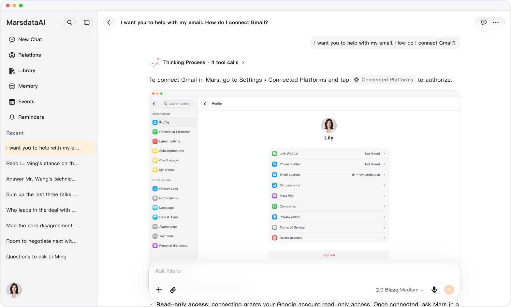
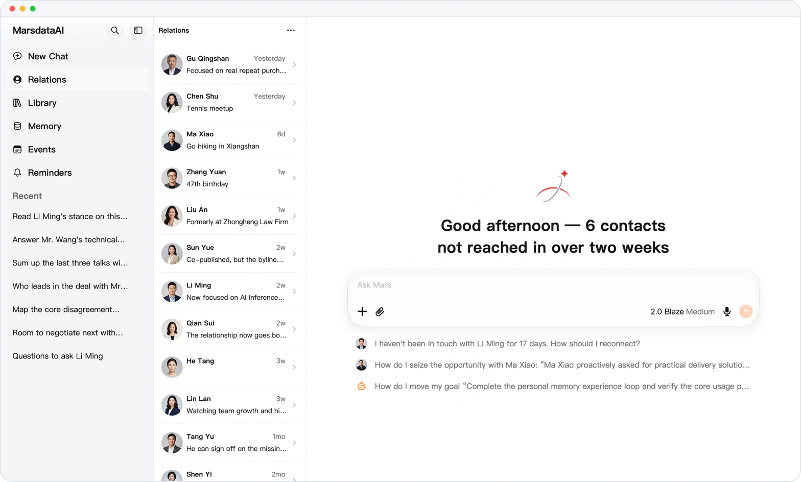
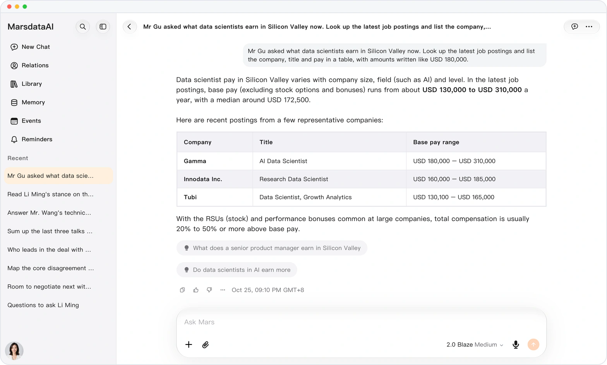

<!-- mars-crm-preview:start -->
# Mars — product updates

> **Preview** — These features are available in the preview version and have not been generally released.

[Explore the preview](https://canary.marsdata.ai) · [English](./CHANGELOG.md) · [简体中文](./CHANGELOG.zh-CN.md) · [繁體中文](./CHANGELOG.zh-HK.md)

## Preview updates

### [Mars, inside your Feishu](releases/crm-2026-10-28-mars-in-feishu.md)

**Preview** · 2026-10-28 · `0.1.1.8920`

Scan once to get your own Mars bot in Feishu: send text, images, files or voice and Mars answers, with reminders there too.

*Illustration using fictional demo data.*

### [Build on what Mars already said](releases/crm-2026-10-28-quote-past-conversations.md)

**Preview** · 2026-10-28 · `0.1.1.8920`

Quote the exact line from this or an earlier chat; Mars answers with it, and one tap takes you back to it.

*Illustration using fictional demo data.*

### [Ask once, land on the right setting](releases/crm-2026-10-27-open-settings-from-an-answer.md)

**Preview** · 2026-10-27 · `0.1.1.8292`

Ask where a setting is or how to connect data, and a capsule in the answer takes you there, no menus to dig through.

*Illustration using fictional demo data.*

### [Mars on your Mac, room to see it all](releases/crm-2026-10-26-mars-for-mac.md)

**Preview** · 2026-10-26 · `0.1.1.8385`

Mars arrives on the Mac as a native app: the three-column workspace on a big screen, on the same account as iPhone and iPad.

*Illustration using fictional demo data.*

### [From their handle to a chat in one tap](releases/crm-2026-10-26-open-social-accounts-in-one-tap.md)

**Preview** · 2026-10-26 · `0.1.1.8385`

Ask for someone's WeChat ID or other accounts, and one tap on its capsule copies it and opens the app, so you can reach them now.

*Illustration using fictional demo data.*

### [Add your thought mid-answer](releases/crm-2026-10-25-add-to-a-running-answer.md)

**Preview** · 2026-10-25 · `0.1.1.8208`

Keep typing while Mars answers: add a detail or change direction, and it continues below your message, no waiting or asking again.

*Illustration using fictional demo data.*

### [What a role pays, from live postings](releases/crm-2026-10-25-what-a-role-pays.md)

**Preview** · 2026-10-25 · `0.1.1.8208`

Ask what a role pays somewhere, and Mars sums up the advertised pay in current LinkedIn and Google Jobs postings, each figure sourced.

*Illustration using fictional demo data.*

### [Mars in one tap, no app to open](releases/crm-2026-10-24-mars-widgets-on-iphone.md)

**Preview** · 2026-10-24 · `0.1.1.7959`

Mars widgets on the iPhone Home Screen, Lock Screen and Mac desktop: camera, voice or research in one tap, credits always in view.

*Illustration using fictional demo data.*

### [One request, a deck ready to present](releases/crm-2026-10-24-mars-makes-decks-and-documents.md)

**Preview** · 2026-10-24 · `0.1.1.7959`

One request gets you an editable PowerPoint deck with pictures in one style, or an illustrated Word document, without the layout grind.

*Illustration using fictional demo data.*

### [Mars reads the web, never your login](releases/crm-2026-10-23-read-pages-without-your-login.md)

**Preview** · 2026-10-23 · `0.1.1.7618`

Mars reads public web pages without your login, and sends you to the original link for anything behind a sign-in, so your accounts stay yours.

*Illustration using fictional demo data.*

### [What's worth your time comes first](releases/crm-2026-10-23-sort-by-value.md)

**Preview** · 2026-10-23 · `0.1.1.7618`

Sort by value puts deals, funding talks and referrals ahead of routine logistics, so what deserves your time comes first, on the web and iOS.

*Illustration using fictional demo data.*

### [Know what they say on camera](releases/crm-2026-10-22-mars-watches-social-videos.md)

**Preview** · 2026-10-22 · `0.1.1.7433`

Mars understands videos on Douyin, Xiaohongshu, Bilibili, Kuaishou and Weibo: look someone up and it watches for you, quoting what they actually said.

*Illustration using fictional demo data.*

### [Share only with the people you choose](releases/crm-2026-10-22-share-links-with-a-password.md)

**Preview** · 2026-10-22 · `0.1.1.7433`

Add a six-character access password to a shared conversation, so a forwarded link alone opens nothing, on the web and iOS.

*Illustration using fictional demo data.*

### [See every day of your trip on one map](releases/crm-2026-10-21-plan-trips-on-a-map.md)

**Preview** · 2026-10-21 · `0.1.1.6886`

Plan a trip in conversation and see each day's stops and route on an interactive map, so you know what is close to what.

*Illustration using fictional demo data.*

### [Diagrams: 86% lighter, near-instant](releases/crm-2026-10-20-faster-adaptive-diagrams.md)

**Preview** · 2026-10-20 · `0.1.1.6573`

Diagrams in answers download about 86% less, draw in a few milliseconds and re-flow for narrow screens, so they stay readable anywhere.

*Illustration using fictional demo data.*

### [Know every source before you click](releases/crm-2026-10-19-cited-link-titles.md)

**Preview** · 2026-10-19 · `0.1.1.6479`

Each link Mars cites shows its page's real title, so you know whether a source is worth opening before you click.

*Illustration using fictional demo data.*

### [2 GB recordings, every moment findable](releases/crm-2026-10-19-long-recordings.md)

**Preview** · 2026-10-19 · `0.1.1.6479`

Send audio and video up to 2 GB, and ask about any moment of recordings longer than 20 minutes, with its timestamp.

*Illustration using fictional demo data.*

### [A batch of pictures, one tidy message](releases/crm-2026-10-18-picture-grids-and-gallery.md)

**Preview** · 2026-10-18 · `0.1.1.6118`

Pictures sent together form one tidy grid that opens into a gallery, so a batch never floods the conversation.

*Illustration using fictional demo data.*

### [Sign in with the Apple ID you have](releases/crm-2026-10-17-sign-in-with-apple.md)

**Preview** · 2026-10-17 · `0.1.1.5950`

Sign in with Apple on iOS: one tap with the Apple ID you already have, no new password to set up.

*Illustration using fictional demo data.*

### [Apple Health summaries, everywhere](releases/crm-2026-10-17-apple-health-sync.md)

**Preview** · 2026-10-17 · `0.1.1.5950`

Sync your Apple Health daily summaries from iOS, so you can ask about your health from the web and your other devices.

*Illustration using fictional demo data.*

### [Health answers that see more of your day](releases/crm-2026-10-17-richer-health-answers.md)

**Preview** · 2026-10-17 · `0.1.1.5950`

Health answers now cover sleep stages, water, energy, protein and carbohydrates, and smart-scale readings stay complete, for a fuller picture.

*Illustration using fictional demo data.*

### [Mars asks before it guesses](releases/crm-2026-10-17-question-panel.md)

**Preview** · 2026-10-17 · `0.1.1.5950`

When Mars needs a decision, it asks up to five questions in one panel and follows exactly what you choose, so long tasks stay on course.

*Illustration using fictional demo data.*

### [Find any line, act on any answer](releases/crm-2026-10-17-find-in-chat-and-a-new-answer-menu.md)

**Preview** · 2026-10-17 · `0.1.1.5950`

Find any line in a long chat, and branch, read aloud, switch model, retry or search the web from one answer menu.

*Illustration using fictional demo data.*

### [On time, Mars gets started on its own](releases/crm-2026-10-17-reminders-that-start-a-conversation.md)

**Preview** · 2026-10-17 · `0.1.1.5950`

At the set time, a reminder starts a Mars conversation from your prompt, so daily reviews and check-ins run without you starting them.

*Illustration using fictional demo data.*

### [Charts that draw as the answer arrives](releases/crm-2026-10-17-live-charts-and-diagrams.md)

**Preview** · 2026-10-17 · `0.1.1.5950`

Charts and diagrams draw as the answer streams, with insights and follow-ups, and open full size, so the trend is clear at once.

*Illustration using fictional demo data.*

### [iWork and WPS files, right in the chat](releases/crm-2026-10-17-iwork-and-wps-previews.md)

**Preview** · 2026-10-17 · `0.1.1.5950`

Keynote, Pages, Numbers and WPS files show their first page right in the chat, so you can check them without another app.

*Illustration using fictional demo data.*

### [See which conversation needs you](releases/crm-2026-10-17-conversation-status-at-a-glance.md)

**Preview** · 2026-10-17 · `0.1.1.5950`

Recent conversations show a progress ring, an unread dot and a completion pop, so you see which one needs you without opening it.

*Illustration using fictional demo data.*

### [Event reminders, right in WeChat](releases/crm-2026-10-17-wechat-event-reminders.md)

**Preview** · 2026-10-17 · `0.1.1.5950`

Event reminders reach every WeChat you have bound, so you see them where you already spend your day.

### [Know who to reach today](releases/crm-2026-10-17-relationship-activity-lines.md)

**Preview** · 2026-10-17 · `0.1.1.5950`

Each relationship row shows recent activity and when you last interacted, so opening the list tells you who to reach today.

*Illustration using fictional demo data.*

### [Find what you know about anyone, fast](releases/crm-2026-10-17-clearer-information-groups.md)

**Preview** · 2026-10-17 · `0.1.1.5950`

What you know about a person now sits in Business & Team, Tech & Tools, and Mindset & Preferences, so each detail is quick to find.

*Illustration using fictional demo data.*

### [Apple files? Mars still makes the edit](releases/crm-2026-10-17-convert-iwork-files.md)

**Preview** · 2026-10-17 · `0.1.1.5950`

Ask Mars to edit a Keynote, Pages or Numbers file and it converts a copy to Office and edits that, leaving your original untouched.

*Illustration using fictional demo data.*

### [Lend your device, keep Mars locked](releases/crm-2026-10-15-privacy-lock.md)

**Preview** · 2026-10-15 · `0.1.1.5585`

Privacy lock: unlock Mars with a 6-digit PIN, Face ID, Touch ID or a passkey, so lending your device exposes nothing.

*Illustration using fictional demo data.*

### [Step up to Mars-2.0 Blaze](releases/crm-2026-10-15-mars-2-0-blaze.md)

**Preview** · 2026-10-15 · `0.1.1.5585`

Mars-2.0 Blaze joins as the top tier, above Flare and Ember, ready whenever a question deserves more.

*Illustration using fictional demo data.*

### [Subscribe the way you already pay](releases/crm-2026-10-15-plans-on-web-and-ios.md)

**Preview** · 2026-10-15 · `0.1.1.5585`

Subscribe with Stripe Checkout on the web or the App Store on iOS, right where you use Mars, with coupons or offer codes.

*Illustration using fictional demo data.*

### [One thumbs-down, straight to support](releases/crm-2026-10-15-feedback-from-thumbs-down.md)

**Preview** · 2026-10-15 · `0.1.1.5585`

One thumbs-down opens a feedback sheet that sends your report to support with the conversation, no screenshots needed.

*Illustration using fictional demo data.*

### [Deep research you can watch](releases/crm-2026-10-15-deep-research-you-can-follow.md)

**Preview** · 2026-10-15 · `0.1.1.5585`

Each deep research helper shows its steps live on a card, and you confirm its proposal, so you can see and steer the work.

*Illustration using fictional demo data.*

### [Complex ideas, clear at a glance](releases/crm-2026-10-15-structured-diagrams.md)

**Preview** · 2026-10-15 · `0.1.1.5585`

Mars draws flowcharts, mind maps, sequence diagrams and timelines, so complex ideas read at a glance; download them as PNG on mobile web.

*Illustration using fictional demo data.*

### [Keep what Mars makes as real files](releases/crm-2026-10-15-write-files-to-the-library.md)

**Preview** · 2026-10-15 · `0.1.1.5585`

Mars saves its results as Markdown, text and JSON files in the Library, ready to preview or print instead of lost in chats.

*Illustration using fictional demo data.*

### [A slip won't cost you a goal or skill](releases/crm-2026-10-15-safer-deletes.md)

**Preview** · 2026-10-15 · `0.1.1.5585`

Deleting a goal or skill now asks first, so a stray tap loses nothing, on the web and iOS.

*Illustration using fictional demo data.*

### [Reuse your own words with one long-press](releases/crm-2026-10-15-long-press-your-messages.md)

**Preview** · 2026-10-15 · `0.1.1.5585`

Long-press your own message to copy, select or share it, with no retyping.

*Illustration using fictional demo data.*

### [Let Mars find the answer in your Gmail](releases/crm-2026-10-13-gmail-read-only.md)

**Preview** · 2026-10-13 · `0.1.1.5222`

Connect Gmail read-only and Mars searches and reads your mail in chat, while your inbox stays untouched.

### [Bring the contacts you already have](releases/crm-2026-10-13-import-contacts.md)

**Preview** · 2026-10-13 · `0.1.1.5222`

Import the Google or iPhone contacts you choose from Connected Platforms, without retyping a single one.

*Illustration using fictional demo data.*

### [Answers that use your iPhone, live](releases/crm-2026-10-13-live-iphone-data.md)

**Preview** · 2026-10-13 · `0.1.1.5222`

On iOS, Mars reads your contacts, calendar, and Apple Health and Fitness live, source by source as you allow, so answers use what is on your phone.

*Illustration using fictional demo data.*

### [Phone sign-in, no guesswork](releases/crm-2026-10-13-phone-and-password-sign-in.md)

**Preview** · 2026-10-13 · `0.1.1.5222`

Sign in on the web with your phone number and password, and any security check tells you why it is there.

*Illustration using fictional demo data.*

### [Charts that feel at home on iPhone](releases/crm-2026-10-13-native-charts-on-ios.md)

**Preview** · 2026-10-13 · `0.1.1.5222`

Charts and diagrams draw natively on iOS for a crisp look, and selected answer text can be quoted or read aloud.

*Illustration using fictional demo data.*

### [Switch apps. Your answer keeps going.](releases/crm-2026-10-13-answers-that-keep-going.md)

**Preview** · 2026-10-13 · `0.1.1.5222`

Switch apps and your answer keeps going; if a turn fails, retry it in the same conversation.

*Illustration using fictional demo data.*

### [Out of credits? Keep finished work](releases/crm-2026-10-13-graceful-credit-limits.md)

**Preview** · 2026-10-13 · `0.1.1.5222`

When credits run out, the current turn still delivers what it finished before new messages pause, so no work is wasted.

*Illustration using fictional demo data.*

### [Your language from the first screen](releases/crm-2026-10-13-your-language-from-the-start.md)

**Preview** · 2026-10-13 · `0.1.1.5222`

Mars starts in your device language, so you can read it from the first screen, with English as the fallback.

*Illustration using fictional demo data.*

### [Mars in your pocket, on iPhone and iPad](releases/crm-2026-10-10-mars-for-ios.md)

**Preview** · 2026-10-10 · `0.1.1.4799`

Mars for iOS: a sidebar drawer, swipe actions, an iPad desktop workspace, and image generation and deep research wherever you are.

*Illustration using fictional demo data.*

### [Know when a task is done](releases/crm-2026-10-10-native-notifications.md)

**Preview** · 2026-10-10 · `0.1.1.4799`

Turn on task completion alerts and hear the moment a task is done; iOS asks once, and settings work on the web and iOS.

*Illustration using fictional demo data.*

### [Dates that read the way you do](releases/crm-2026-10-10-week-start-and-date-format.md)

**Preview** · 2026-10-10 · `0.1.1.4799`

Set the first day of the week and your date format, and events on the web and iOS read the way you expect.

*Illustration using fictional demo data.*

### [Every relationship, by type and stage](releases/crm-2026-10-10-relationship-types.md)

**Preview** · 2026-10-10 · `0.1.1.4799`

Group relationships by type with their own stages and milestones, and filter by either, so you see where each one stands.

### [Every revision kept, every edit approved](releases/crm-2026-10-10-revised-office-files.md)

**Preview** · 2026-10-10 · `0.1.1.4799`

Revised Word, Excel and PowerPoint files save as new documents, never over the original, and Word edits arrive as tracked changes to review.

*Illustration using fictional demo data.*

### [Light, dark or automatic: your call](releases/crm-2026-10-10-appearance-settings.md)

**Preview** · 2026-10-10 · `0.1.1.4799`

Choose Follow system, Light or Dark on the Appearance page, so Mars looks the way you like; Language has its own page.

*Illustration using fictional demo data.*

### [See inside a RAR or ZIP, no unpacking](releases/crm-2026-10-10-archive-previews.md)

**Preview** · 2026-10-10 · `0.1.1.4799`

RAR and ZIP previews list the files inside, so you know what is there without downloading or unpacking.

*Illustration using fictional demo data.*

### [Times that match wherever you are](releases/crm-2026-10-07-time-zone-setting.md)

**Preview** · 2026-10-07 · `0.1.1.4285`

Follow your device or pick a city, and conversations, reminders, Events and usage show your local time, with no time-difference maths.

*Illustration using fictional demo data.*

### [Hear about answers and events in time](releases/crm-2026-10-07-notifications-page.md)

**Preview** · 2026-10-07 · `0.1.1.4285`

The Notifications page gathers browser push, answer-finished alerts and event reminders, so you miss nothing without keeping Mars open.

*Illustration using fictional demo data.*

### [Set a routine once, and it repeats](releases/crm-2026-10-07-repeating-events.md)

**Preview** · 2026-10-07 · `0.1.1.4285`

Events and reminders repeat with an offset, a rule, weekdays, a time and an end date, so a routine is set once.

*Illustration using fictional demo data.*

### [Your text size, comfortable reading](releases/crm-2026-10-07-text-size.md)

**Preview** · 2026-10-07 · `0.1.1.4285`

One text size setting scales conversations, contacts, memory, events, the Library and Settings, so long reads stay comfortable.

*Illustration using fictional demo data.*

### [Revoke a link, find any old answer](releases/crm-2026-10-07-stop-sharing-and-wider-search.md)

**Preview** · 2026-10-07 · `0.1.1.4285`

Revoke a shared link any time with Stop sharing, and find an old answer by its words now that search covers conversation text.

*Illustration using fictional demo data.*

### [Keep track of who knows whom](releases/crm-2026-10-07-relationships-between-contacts.md)

**Preview** · 2026-10-07 · `0.1.1.4285`

Record how two of your contacts are connected, each with its own type and summary, so you always know who knows whom.

### [Peak hours and refunds on one page](releases/crm-2026-10-07-usage-records.md)

**Preview** · 2026-10-07 · `0.1.1.4285`

Usage records in day, week and month views show your busiest and quietest hours and refunds, filterable by call type, all on one page.

*Illustration using fictional demo data.*

### [A calendar of what really happened](releases/crm-2026-10-07-event-status.md)

**Preview** · 2026-10-07 · `0.1.1.4285`

Mark events Planned, Happened or Cancelled so your calendar shows what really happened; swipe or right-click to complete, edit or delete.

*Illustration using fictional demo data.*

### [What Mars knows, one card per topic](releases/crm-2026-09-30-grouped-personal-memory.md)

**Preview** · 2026-09-30 · `0.1.1.3581`

Personal Memory merges what Mars knows about you into one card per topic, with no empty rows in the way.

*Illustration using fictional demo data.*

### [Every fact Mars learned, with its source](releases/crm-2026-09-28-what-mars-learned-with-sources.md)

**Preview** · 2026-09-28 · `0.1.1.3543`

A contact's page lists what Mars learned, each fact with its quote and source link, and anything auto-detected waits for your approval.

*Illustration using fictional demo data.*

### [See the whole month beside the day](releases/crm-2026-09-23-month-events-beside-the-day.md)

**Preview** · 2026-09-23 · `0.1.1.3475`

The day view lists the whole month's events beside it, and dots in the mini calendar show the busy days at a glance.

*Illustration using fictional demo data.*

### [Read a PDF like a long page](releases/crm-2026-09-12-continuous-pdf-reading.md)

**Preview** · 2026-09-12 · `0.1.1.3383`

PDFs in the Library scroll like a long page, with thumbnails to jump straight to any page, and files show their first page so you spot them fast.

*Illustration using fictional demo data.*

### [Compare plans, then buy with confidence](releases/crm-2026-09-04-a-clearer-plans-page.md)

**Preview** · 2026-09-04 · `0.1.1.3352`

The new plans page sets three plans side by side with a full benefits comparison and a pinned purchase bar, so you know what you get before you pay.

*Illustration using fictional demo data.*

<!-- mars-crm-preview:end -->

## Previously released product history

Every change we ship to **Marsdata AI** (also known as Mars Agent), the AI that maintains your relationships. This repository mirrors the changelog published at [https://marsdata.ai/changelog](https://marsdata.ai/changelog).

> Canonical source of record: [https://marsdata.ai/changelog](https://marsdata.ai/changelog)

## [Sign in from the changelog and return right where you started.](releases/2026-08-15-sign-in-from-the-changelog-and-return-right.md)

`0.1.1.2928` · 2026-08-15

- **Fixed** — Sign in from the changelog and you now return to the changelog as soon as sign-in finishes, instead of being sent to the home screen. Opening the page while already signed in still works as before.

## [Ask Mars to curate your Atlas and reconnect every relationship circle.](releases/2026-08-15-ask-mars-to-curate-your-atlas-and-reconnect.md)

`0.1.1.2922` · 2026-08-15

- **New** — You can now ask Mars to curate Atlas for you — move someone into the right circle, pin or hide a person, adjust a circle's emphasis, and confirm or dismiss a relationship without editing records by hand.
- **Improved** — Atlas now considers your complete identity roster when it organizes relationship circles. People found in either structured profiles or relationship history can be classified, and restored contacts return to their circles instead of remaining unlinked when one source is incomplete.
- **Improved** — Relationship circles are easier to scan and navigate. Each row now uses a clear color marker, the search box keeps a stable width when the circle list collapses, and the preview uses the same relationship view as Atlas itself.

## [Atlas turns your relationships into distinct, living circles.](releases/2026-08-13-atlas-turns-your-relationships-into-distinct-living-circles.md)

`0.1.1.2873` · 2026-08-13

- **New** — Atlas now organizes your relationship map into distinct circles. Each circle has its own color, focusing one reveals the people inside it, and someone who belongs in more than one part of your life can appear in more than one circle. People Mars cannot place yet stay visible as ungrouped planets instead of being filed under a dismissive catch-all label.
- **Improved** — A nickname, a new name and an uncertain match no longer collapse into the same person by default. Mars now asks you to confirm an unclear identity before it merges records, reveals personal details or writes new information, while an unmistakably new person can still be added without getting stuck in a confirmation loop.
- **Fixed** — Tell Mars about two people in the same message and each person's update now keeps its own result. Successful details stay saved even when another detail needs clarification, merge-and-split corrections restore the right records, and Mars reports partial outcomes instead of claiming that everything worked.
- **Improved** — Web answers are no longer forced through one blanket brevity rule. Mars can now give a fuller answer when the question needs context, while straightforward questions can still stay concise.

## [The words you mean to send now arrive ready to copy.](releases/2026-08-11-the-words-you-mean-to-send-now-arrive.md)

`0.1.1.2820` · 2026-08-11

- **New** — When Mars writes something you are meant to send — an opening line, a reply, a message to smooth something over — it now arrives in its own card with its own copy button, and what you get is exactly the text you will send: no heading, no explanation, no quote marks. Ordinary answers and whole-answer copy are unchanged. On the web for now.
- **New** — Ask Mars whether to do something and it now answers on two books instead of one: the practical costs and outcomes, and the private rule that makes the choice mean something about who you are. It builds that second reading only from what you actually told it, states it as a hypothesis rather than a verdict, and names the one observation that would overturn it — and when it does not know how someone else will react, it asks you instead of inventing them.
- **Improved** — Turning on deep research a second time now opens a fresh conversation instead of asking whether to restart the one you are already in. First activation, turning the mode off, and the upgrade prompt on the free plan all behave as before.
- **Fixed** — Answers stream word by word again. A security layer meant only for run-history requests was also matching the token stream, so it held every word back and replayed the whole answer in one burst at the end — measured as fifteen seconds of nothing followed by thirty events in three milliseconds. The model had been streaming correctly the whole time.
- **Fixed** — Lock your phone mid-answer and the text keeps moving when you come back. The rule that protects a live answer from being overwritten was keyed to the connection rather than to the run, so the moment the connection dropped in the background an older saved snapshot took over the display and the visible text froze — or advanced in lumps.
- **Fixed** — A turn that ends with nothing to show now says so. When the model finishes having thought but never actually speaks, you get a visible note telling you to retry — kept in the conversation rather than flashed once — instead of an empty bubble. And a reply that could not be recovered is no longer reported as successfully finished.
- **Fixed** — Images, videos and documents reach the model again. For a stretch at the start of August every upload was quietly dropped on the way in: the file was stored and appeared in your own bubble, and the model then asked you for a screenshot you had already sent.
- **Fixed** — Charts and mind maps that used to come out as a wall of raw code now draw. When the underlying description arrives with a missing bracket, full-width punctuation or invisible characters — or as one unbroken line — it is repaired and rendered instead of shown as source or as a conversion failure. Anything genuinely unreadable still falls back to code rather than being guessed at.
- **Improved** — Mars only says it saved something after it really did. Every write into a person's record now comes back with a receipt, and a claim without one is corrected before it reaches you — so "noted" stops being something the model can say out of politeness.
- **Improved** — Tell Mars six things about one person in a single breath and all six get recorded. They used to be split into six competing writes, of which one landed and the rest were dropped against a per-turn limit — while the reply confirmed all six anyway. One write now carries every field, each stamped with the exact sentence of yours that authorises it.
- **Fixed** — Deleting a person now also clears the names they went by. A whole-node delete used to leave the alias list still naming them, and the underlying folder was reported as gone without being checked; both are verified before the delete reports success, and anything that survives is shown to you as a partial delete rather than a clean one.
- **Fixed** — Journal entries read back at the time they happened. A note written at ten in the evening Beijing time was being rendered as two in the morning, and for a while the day's entries were not reaching the record at all. Deleting a preference now removes it, instead of only clearing the text and leaving the row behind.
- **Fixed** — Mention an old transfer again and Mars asks before booking it twice. Restating a payment from further back than its de-duplication window used to slip past the check that catches repeats, and an entry still waiting on your confirmation could be counted into the totals as settled.
- **Fixed** — Binding and unbinding a phone number works. A first-time bind never sent the code at all, unbinding signed you out while leaving the number bound, and the Unbind button answered every tap with a session-expired error. The two actions now also sit side by side as filled capsules, in the same visual language as the WeChat panel one row below.
- **Improved** — The welcome screen opens without waiting on the work behind it. Its relationship read used to be composed on the spot — eight scanners and one billed authoring call — before the page could answer, and a second visitor arriving inside that window waited on the first. It now serves what is already prepared and prepares the next batch after the page has loaded.
- **Fixed** — Signed-in visitors on iPhone stop landing on a half-drawn page. Safari implements none of the API the cache gate relied on, so a signed-in iOS visitor was served the anonymous copy of the page — after a release, the previous build's copy, whose asset addresses no longer exist — and what loaded was the header alone, with no composer and no sidebar. The gate no longer depends on that API, and a page that fails to come up now reloads itself.

## [Every person you know becomes a structured record.](releases/2026-08-01-every-person-you-know-becomes-a-structured-record.md)

`0.1.1.2598` · 2026-08-01

- **New** — Everything you tell Mars about a person is now kept as a structured record — every detail is its own field, sitting next to that person's interaction log, money ledger and change history. Edit one detail and only that detail changes; remove one and the person, their history and everything else you saved stay exactly where they were.
- **Improved** — One person, one record. Mars no longer splits the same contact across several entries, no longer turns a role word like "my date" into a person of its own, and books one transfer as exactly one row.
- **Improved** — Details Mars captures on its own now carry a confidence level. When it is confident enough to treat two entries as the same person or the same payment, it tells you it did instead of merging quietly; when it isn't sure — especially about money — it holds the entry and asks you first, and anything still waiting on your answer is left out of the totals.
- **Improved** — Your personal memory — your goals, your preferences, your own profile — is now read in full on every turn instead of being partially searched, so Mars stops missing something you already told it.
- **Fixed** — Delete something and it is really gone. A person or a detail you removed no longer comes back from an older copy, and Mars no longer recites a value you deleted as if it were still current.
- **New** — The relationship cards on the welcome screen now answer instead of asking. Tap one and Mars opens with the analysis it has already done — who has gone quiet, which promises are still open, who among the people you just met is worth following up — rather than handing you an empty composer.
- **New** — @-mention someone in chat and Mars now reads their structured record — the fields, the recent interactions, the ledger — so a detail you just corrected or deleted is reflected in the very next answer.
- **New** — Send a screenshot of a chat or a transfer and the facts inside it settle into that person's record on their own — including exchanges that involve no money at all, which previously had nowhere to land.
- **New** — Signing in no longer asks for a password — there is nothing to register and nothing to remember. If you already set a password, the entry to it is still on the sign-in card.
- **New** — Hong Kong Traditional Chinese is now a language you can actually read the whole product in — the app, the landing pages and the relationship views included.
- **Fixed** — Ask a follow-up about a finished research report and Mars answers from the report itself, instead of starting the whole research over. Reloading the page during a long task also lets you watch it continue live again, rather than staring at a silent screen until it ends.
- **Fixed** — A skill you imported is findable again — some imports were saved successfully but could never be recalled afterwards, so they silently did nothing.

## [Mention a person right inside the chat.](releases/2026-07-24-mention-a-person-right-inside-the-chat.md)

`0.1.1.2383` · 2026-07-24

- **New** — You can now @-mention a person directly in chat — type @ and the picker opens on your Relationships by default, so you can pull someone you've already told Mars about straight into your message. Their key details ride along automatically.
- **New** — Upload a screenshot of a chat and Mars reads the conversation style, then offers to save a personalized reply coach for that exact person — one tap turns it into a reusable skill you can call anytime with /.
- **Improved** — After you save a reply coach, Mars now confirms it back to you — what got saved, that it'll recognize this person next time, and how to invoke it — so you're never left guessing whether the save actually worked.
- **New** — @-mention someone and Mars shows a rich relationship card right inside your message — their recent facts, latest interactions, and a short profile excerpt — instead of a plain name tag.

## [All three models step up to 1.7.](releases/2026-07-22-all-three-models-step-up-to-1-7.md)

`0.1.1.2353` · 2026-07-22

- **New** — All three models upgraded: 1.6 becomes 1.7. mini moves to a newer-generation fast model, while think and pro both step up to the brand-new flagship engine released this week — think tuned for speed, pro tuned for maximum reasoning depth. Smarter on complex analysis and long tasks, and each answer now costs less than before.
- **Improved** — Memory got smarter too — the engine that quietly captures people and facts from your conversations was upgraded to a newer model, so what Mars remembers is more accurate and better organized.

## [Atlas · Relation Nebula is live.](releases/2026-07-20-atlas-relation-nebula-is-live.md)

`0.1.1.2324` · 2026-07-20

- **New** — New: Atlas · Relation Nebula — a 3D star map of your relationships. Every person you've told Mars about becomes a star; tap one to fly in and watch their key facts orbit it like moons, tap again to open the full dossier. Includes search, quick-jump chips, and a fullscreen mode, tuned for both desktop and phone.
- **New** — Your Deep Research reports live in the star map too — each research topic is a planet whose moons are the titles of that session's documents; tap the planet to browse and read every document, including the full report and each dimension chapter.
- **New** — Sign in with your +86 phone number — receive a code by SMS with a live validity countdown. A new Account & Security section in Settings lets you bind, change, or unbind your phone, change your password, and read the privacy policy without leaving the app.
- **New** — PowerPoint (.pptx / .ppt), Word (.doc), and Excel (.xls) uploads are now fully supported — Mars actually reads their contents instead of skipping them.
- **New** — Copying a reply now keeps its formatting — headings, tables, and lists paste cleanly into documents, and charts and diagrams come along as images.
- **Improved** — Opening a conversation from history is faster and more dependable — cold opens no longer stall, the loading skeleton always resolves instead of hanging, and a case where the page could go blank when jumping from the welcome screen is fixed.
- **Improved** — The site loads faster and replies start sooner during busy hours — first-time visitors get the welcome page near-instantly, and response start times under heavy load improved by an order of magnitude.
- **Fixed** — Text you typed in the input box now survives a page reload — drafts are kept per conversation, so an accidental refresh no longer eats your message.
- **Fixed** — Chart and math rendering fixes: quadrant charts now draw as clean interactive charts, timeline diagrams tolerate more formatting quirks from the model, and multi-line block math renders correctly instead of showing raw symbols.

## [Everyone you mention now gets their own dossier.](releases/2026-07-06-everyone-you-mention-now-gets-their-own-dossier.md)

`0.1.1.2173` · 2026-07-06

- **New** — Mars now automatically builds a structured record for each person you talk about — identity, background, how you know each other, key interactions, and an overall value read are extracted from your conversations into a dedicated database record and summarized on the person's page. Details you've already told Mars no longer get silently overwritten when new information arrives, and when two records turn out to be the same person, merging them now keeps everything from both sides.
- **New** — When you chat about someone Mars already knows, the conversation is now automatically filed into that person's folder — so everything about one person stays in one place without manual sorting.
- **Improved** — The person detail page got a cleaner desktop layout — interaction log, profile, and key facts now sit side by side in three equal columns instead of one long scroll, duplicated profile text is gone, and the memory panel now shows titles and writes new memories in your chosen language.
- **Improved** — Opening a conversation is more dependable — cases where a chat could stay stuck on the loading skeleton forever (right after our servers restarted, or when you switched conversations at just the wrong moment) are fixed; the loading view now always resolves within a few seconds.
- **Improved** — Switching between Wi-Fi and cellular mid-conversation now recovers much faster — requests stranded on the old network are cut off and retried right away instead of hanging.
- **Improved** — Our servers now detect and automatically recover from a rare internal stall that could previously make replies hang for everyone until we stepped in manually.
- **Fixed** — Excel (.xlsx) files you upload are now actually read and analyzed — previously the file was silently dropped on the way in, and Mars could end up analyzing unrelated data instead.
- **Fixed** — A batch of rendering fixes: amounts like "$6,000$" and fractions like "$1/3$" now render as proper math instead of literal dollar signs, flowcharts with Chinese quotation marks in their labels no longer fail to draw, and a chart block that arrives without its closing marker now still renders instead of showing raw code.
- **Improved** — The welcome screen feels smoother on iPhone — the glow animation now renders at full quality on every device (a visible color-banding artifact is gone), the input box expands without a sudden jump in Safari, and tapping the input no longer shoves the page around when the keyboard appears.

## [Projects — keep one topic in one clean space.](releases/2026-06-23-projects-keep-one-topic-in-one-clean-space.md)

`0.1.1.2098` · 2026-06-23

- **New** — Projects are here — a place to group related conversations together so a whole topic, person, or piece of work lives in one tidy space instead of being scattered across your chat list. Open a project and you'll see everything that belongs to it side by side.
- **New** — Each project now gathers the images and media from the conversations inside it automatically — so the photos and files you've shared on a topic show up together, no manual sorting needed.
- **New** — You can now name a project, pick a color for it, and rename or delete it anytime from a simple settings panel — making your projects easy to tell apart at a glance.
- **Improved** — The project view got a cleaner layout — a header that stays put while you scroll, and a sidebar that tucks itself away to give your content more room.

## [Mars now feels the time that passed between you.](releases/2026-06-18-mars-now-feels-the-time-that-passed-between.md)

`0.1.1.2018` · 2026-06-18

- **New** — Mars now keeps track of time across a conversation. When you come back after a few days away, it notices the gap instead of picking up the old plan as if no time had passed — so it won't keep pushing a next step that may already be behind you. It quietly checks how much time has passed since you last talked and re-confirms what may have changed before continuing.
- **Improved** — Mars is more honest about what it can't be sure of. Instead of confidently carrying forward stale assumptions, after a long gap it now asks where things stand now — cutting down the kind of mix-ups where it acts on information that's days out of date.

## [A smoother home screen, answers shaped to the question.](releases/2026-06-14-a-smoother-home-screen-answers-shaped-to-the.md)

`0.1.1.1967` · 2026-06-14

- **Improved** — The home screen now runs smoother and uses less battery — the glowing animation on the welcome page automatically goes lighter on older or slower phones, so it stays fluid instead of stuttering, and it quietly rests when you scroll it out of view. It also looks a little cleaner.
- **Improved** — Mars now answers in the way that suits your question — if you ask how to do something, it gives you the answer up front; if you ask for advice on a decision, it walks you through the thinking first; and if you just need to talk something out, it listens and responds with understanding before anything else.

## [The memory panel became a relationship graph.](releases/2026-06-13-the-memory-panel-became-a-relationship-graph.md)

`0.1.1.1959` · 2026-06-13

- **New** — The memory panel now shows a relationship graph — the people and topics Mars remembers about you arranged around a central hub, with each one sized by how much detail it holds, and you can click any person to open their full profile. Mars is also more careful about what it keeps: it won't file away traits that actually belong to someone else, and when you delete a person or a memory folder they now stay deleted instead of quietly regrowing from past chat logs.
- **New** — Select any text in a reply and a small toolbar now appears — you can quote it straight into your next message, or have it read aloud. The labels follow your chosen language.
- **Improved** — Opening your conversation history and switching between chats is noticeably faster — the list now paints progressively, and a chat you recently opened shows its content almost instantly. It's also more resilient: a brief hiccup right after you open the app no longer freezes the "scroll down to load more" behavior or makes conversations inside folders disappear — the list now recovers on its own as you keep scrolling.
- **Improved** — The app's first screen loads faster and more cleanly — visitors now see the real home page right away instead of a brief grey skeleton flash, and signed-in users no longer momentarily glimpse the logged-out intro page before their workspace appears.
- **Improved** — Uploading large or long videos now works reliably — the previous length limit is gone, videos no longer have to be re-compressed in your browser before sending, and an upload placeholder appears right away so you can see it's in progress. A case on iPhone where a video upload could get stuck and never finish is also fixed.
- **Improved** — Long, complex tasks end more gracefully — when Mars reaches an internal safety limit it now hands you a real, usable answer instead of a generic "stopped" message, and it no longer mistakes a completed action (such as saving your data) for a failed one.
- **Improved** — Strengthened how your account and data are protected — closed several issues where information could potentially be reached across separate accounts, hardened the app against malicious content hidden in pages Mars reads for you, and tightened the safeguards around your data sandbox.
- **Improved** — Pop-up confirmations, alerts, and the "usage limit reached" notice now appear in your chosen language instead of defaulting to one language.
- **Improved** — On iPhone and iPad, launching Mars from the Home Screen now opens straight into a dark splash that matches the app, instead of a brief white flash.
- **Fixed** — The stop button now reliably stops a reply that's still being generated, and starting to type a new message while Mars is producing its very first answer no longer accidentally creates a duplicate conversation.
- **Fixed** — Generating images is smoother — the placeholder no longer flickers while an image is being created, and when Mars produces several images they now show together in a gallery.
- **Fixed** — Math formulas written inside table cells now render properly instead of showing up as raw code.
- **Fixed** — Times shown for Douyin live-stream data are now correct — they were previously off by eight hours.
- **Fixed** — Signing in with Apple using a hidden (relay) email address no longer occasionally merges two separate accounts into one.
- **Fixed** — The storage panel is steadier and more informative — it no longer jitters on high-DPI Windows displays, and it now lists the built-in data tables alongside how many rows you have in each.

## [Long browser tasks now hold together end to end.](releases/2026-06-01-long-browser-tasks-now-hold-together-end-to.md)

`0.1.1.1828` · 2026-06-01

- **Improved** — Long, multi-step tasks — especially ones where Mars drives a browser for you (logging into a site, clicking through pages, pulling data) — now stay reliable from start to finish. Previously a single conversation could get quietly handed off between our servers partway through, which sometimes dropped the browser's logged-in session and left a browser task stalled or failed. Now each conversation stays anchored in one place and the browser session is shared, so the browser keeps your login and picks up exactly where it left off, even across a long back-and-forth.

## [Deep Research, rewritten — deeper and safer.](releases/2026-05-26-deep-research-rewritten-deeper-and-safer.md)

`0.1.1.1803` · 2026-05-26

- **New** — Deep Research mode rebuilt for depth and recovery — Mars now does a quick pre-search before asking you to confirm the research questions (so the suggested questions are grounded in what's actually out there), runs a cross-review pass after gathering sources, and continuously saves a recovery copy of the long report to cloud storage. If the final synthesis is ever interrupted (network blip, app close), the draft can be restored instead of starting from zero. The mode also waits for you to actually confirm the questions before it spends time on the deep dive, and won't ship a final report that came up suspiciously thin
- **Fixed** — Conversations that recently reopened as a blank loading shell now load correctly again — and a quieter problem where a single bad conversation could 500 the entire sidebar list has been closed at the same time. Previously affected conversations should now open, and the sidebar list should be reliable
- **Improved** — Read-aloud now reads cleaner prose — the play button no longer speaks JSON braces, code fences, or special HTML formatting blocks aloud, so playback sounds like someone reading you the answer rather than dictating syntax. Push-notification previews use the same cleanup, so the preview text on your lock screen reads as natural prose instead of raw markdown
- **Fixed** — Mermaid charts now render correctly on older iPhones (iOS 16) — a regex compatibility issue that left the chart blank on those devices is fixed
- **Fixed** — Math formulas that contained a currency escape next to a number (e.g. "$\$72亿$") no longer leave a red LaTeX error in place of the formula — the surrounding math now renders cleanly
- **Fixed** — Push notifications now reliably reach every device you've enabled them on — the prior design had a race where multiple devices could quietly deactivate each other's subscriptions, so the "task complete" push silently stopped arriving for many of you. Fleet now converges; each device is tracked independently
- **Improved** — WeChat Channel login flow smoother — when Mars opens a Channel page that needs you to log in, the right-side panel now auto-takes over so you can finish the login and Mars resumes the task. The panel also won't show up empty anymore when there's nothing to display, and the credentials you provided in one login flow are now correctly carried forward to subsequent sessions in the same conversation
- **Fixed** — An empty grey section box that occasionally appeared between sections of a long AI reply no longer shows up
- **Fixed** — The conversation title at the top of the sidebar no longer briefly flips between an early guess and the final version on the first turn — Mars now derives the title from your first message in a single authoritative step so it lands correctly the first time

---

[简体中文](./CHANGELOG.zh-CN.md) · [繁體中文](./CHANGELOG.zh-HK.md)
