<!-- mars-crm-preview:start -->
# Mars — 产品更新

> **预览** — 以下功能目前处于预览阶段，尚未正式上线。

[体验预览版](https://marsdata.ai) · [English](./CHANGELOG.md) · [简体中文](./CHANGELOG.zh-CN.md) · [繁體中文](./CHANGELOG.zh-HK.md)

## 预览版更新

### [一句话，Mars 另开一个对话去办](releases/crm-2026-10-31-conversations-that-hand-off-work.zh-CN.md)

**预览** · 2026-10-31 · `0.1.1.9443`

让 Mars 新开一个对话专门办一件事，或把结果送到你的另一段对话，来处一目了然。

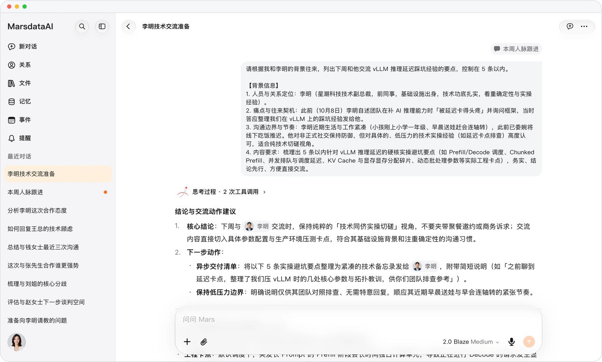

*示意图，使用虚构演示数据。*

### [洞察一多，先看你要的那一类](releases/crm-2026-10-31-filter-relationship-insights.zh-CN.md)

**预览** · 2026-10-31 · `0.1.1.9443`

关系洞察可按时间排序，按机会、风险、需求等六类筛选，默认只看仍然有效的。

*示意图，使用虚构演示数据。*

### [不用切应用，飞书里就能问 Mars](releases/crm-2026-10-28-mars-in-feishu.zh-CN.md)

**预览** · 2026-10-28 · `0.1.1.8920`

扫一次码，飞书里就有你的专属 Mars：发文字、图片、文件、语音都能回，提醒也到飞书。

*示意图，使用虚构演示数据。*

### [说过的那句话，直接拿来接着问](releases/crm-2026-10-28-quote-past-conversations.zh-CN.md)

**预览** · 2026-10-28 · `0.1.1.8920`

从这次或以前的对话里引用原句提问，Mars 按原话回答，点一下就回到原处。

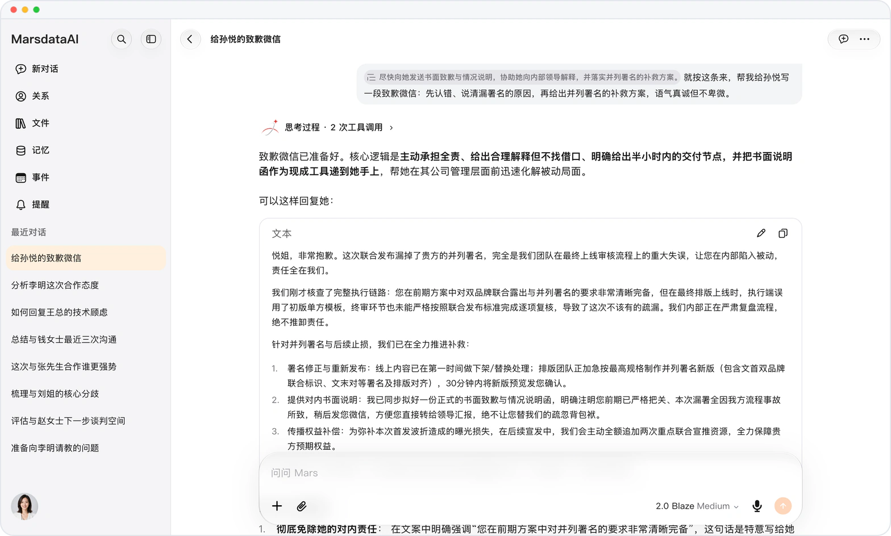

*示意图，使用虚构演示数据。*

### [问一句，直达那页设置](releases/crm-2026-10-27-open-settings-from-an-answer.zh-CN.md)

**预览** · 2026-10-27 · `0.1.1.8292`

问 Mars 设置在哪、怎么连数据，回答里的设置胶囊一点直达，不用再翻菜单。

*示意图，使用虚构演示数据。*

### [Mars 上 Mac，大屏一眼看全](releases/crm-2026-10-26-mars-for-mac.zh-CN.md)

**预览** · 2026-10-26 · `0.1.1.8385`

Mars 推出 Mac 原生应用：三栏桌面工作区大屏一眼看全，与 iPhone、iPad 同一账号接着用。

*示意图，使用虚构演示数据。*

### [问到账号，一点就联系上](releases/crm-2026-10-26-open-social-accounts-in-one-tap.zh-CN.md)

**预览** · 2026-10-26 · `0.1.1.8385`

问到某人的微信号或其他账号，点一下胶囊即复制并打开对应应用，马上就能联系。

*示意图，使用虚构演示数据。*

### [回答没写完，想法随时补](releases/crm-2026-10-25-add-to-a-running-answer.zh-CN.md)

**预览** · 2026-10-25 · `0.1.1.8208`

Mars 回答时也能继续输入：中途补充或改方向，它在你的消息下方接着答，不用等也不用重问。

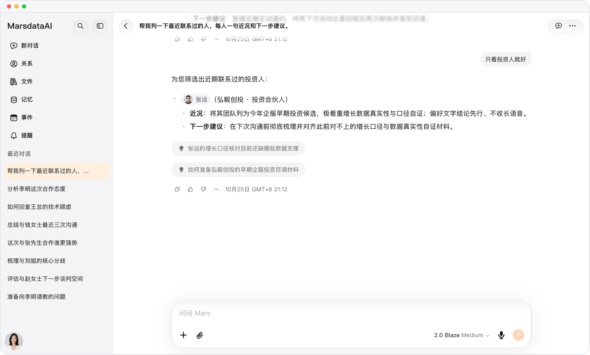

*示意图，使用虚构演示数据。*

### [职位值多少钱，看真实招聘](releases/crm-2026-10-25-what-a-role-pays.zh-CN.md)

**预览** · 2026-10-25 · `0.1.1.8208`

问某个职位在某地的薪资，Mars 汇总领英和 Google Jobs 当前招聘的公开薪资，每个数字都有出处。

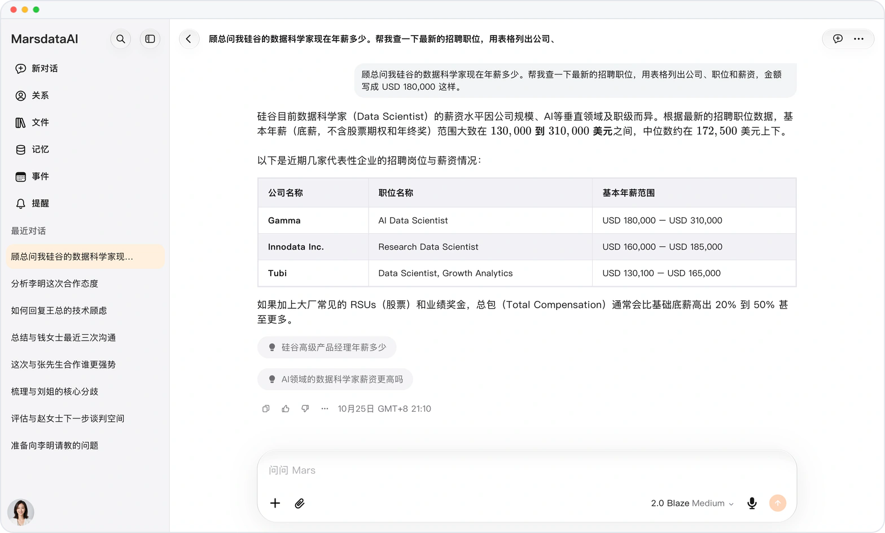

*示意图，使用虚构演示数据。*

### [不开应用，一点就叫出 Mars](releases/crm-2026-10-24-mars-widgets-on-iphone.zh-CN.md)

**预览** · 2026-10-24 · `0.1.1.7959`

Mars 小组件登陆 iPhone 主屏幕、锁屏和 Mac 桌面：不开应用，一点就能拍照、语音或研究，额度随时可见。

*示意图，使用虚构演示数据。*

### [一句话，做出能直接上台的演示文稿](releases/crm-2026-10-24-mars-makes-decks-and-documents.zh-CN.md)

**预览** · 2026-10-24 · `0.1.1.7959`

一句话，Mars 做出可编辑的 PowerPoint 演示文稿，配图风格统一；也能写带插图的 Word 文档，省下找图排版的时间。

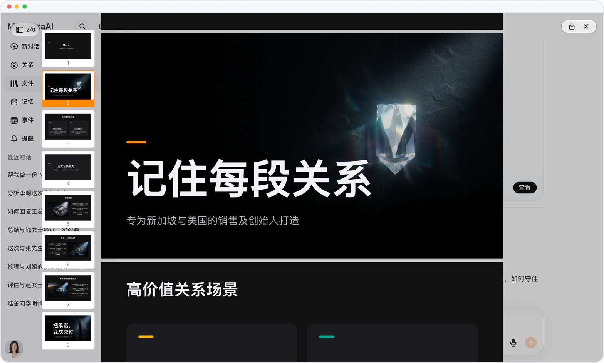

*示意图，使用虚构演示数据。*

### [账号不交出去，网页照样读](releases/crm-2026-10-23-read-pages-without-your-login.zh-CN.md)

**预览** · 2026-10-23 · `0.1.1.7618`

Mars 不用你的账号也能读公开网页；需要登录的内容，请你打开原文链接，账号始终在你手里。

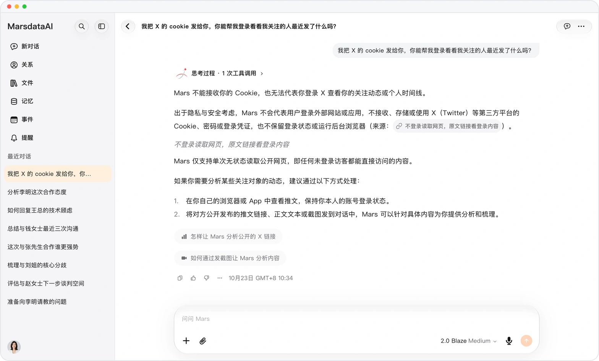

*示意图，使用虚构演示数据。*

### [值得投入的事和人，排在前面](releases/crm-2026-10-23-sort-by-value.zh-CN.md)

**预览** · 2026-10-23 · `0.1.1.7618`

按价值排序：签约、融资和引荐排在琐事前面，值得投入的事和人先看见，网页与 iOS 都支持。

*示意图，使用虚构演示数据。*

### [见面之前，先看懂对方的视频](releases/crm-2026-10-22-mars-watches-social-videos.zh-CN.md)

**预览** · 2026-10-22 · `0.1.1.7433`

Mars 能看懂抖音、小红书、B站、快手和微博的视频：问起一个人，它替你看完视频，引用本人在镜头前的原话。

*示意图，使用虚构演示数据。*

### [分享对话，只给你想给的人看](releases/crm-2026-10-22-share-links-with-a-password.zh-CN.md)

**预览** · 2026-10-22 · `0.1.1.7433`

给分享的对话加上 6 位访问密码，链接被转发也打不开，网页和 iOS 都能设置。

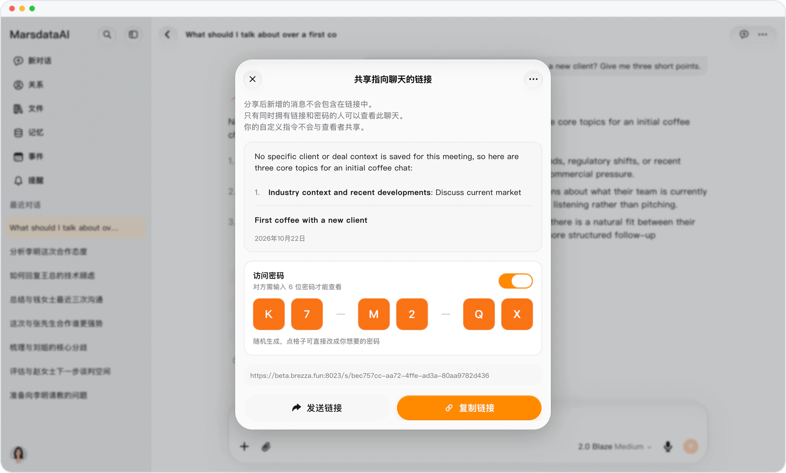

*示意图，使用虚构演示数据。*

### [行程画在地图上，每天怎么走一目了然](releases/crm-2026-10-21-plan-trips-on-a-map.zh-CN.md)

**预览** · 2026-10-21 · `0.1.1.6886`

在对话中规划旅行，每天的地点与路线画在交互地图上，哪里挨着哪里一目了然。

*示意图，使用虚构演示数据。*

### [图表下载少约 86%，几毫秒画好](releases/crm-2026-10-20-faster-adaptive-diagrams.zh-CN.md)

**预览** · 2026-10-20 · `0.1.1.6573`

回答中的图表下载量减少约 86%，几毫秒内画好，窄屏自动改为上下排列，在哪都看得清。

*示意图，使用虚构演示数据。*

### [点开之前，就知道来源是什么](releases/crm-2026-10-19-cited-link-titles.zh-CN.md)

**预览** · 2026-10-19 · `0.1.1.6479`

Mars 引用的每个链接都显示真实标题，点开之前就知道来源值不值得看。

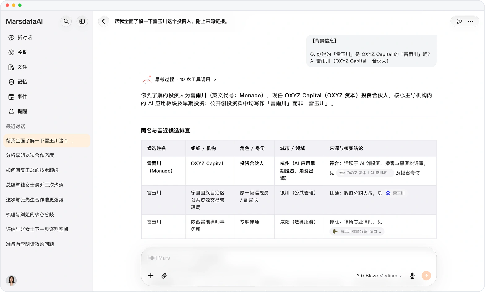

*示意图，使用虚构演示数据。*

### [2 GB 长录音，每句话都能定位](releases/crm-2026-10-19-long-recordings.zh-CN.md)

**预览** · 2026-10-19 · `0.1.1.6479`

音视频上限提高到 2 GB，超过 20 分钟的录音也能问到每一句、定位到几分几秒。

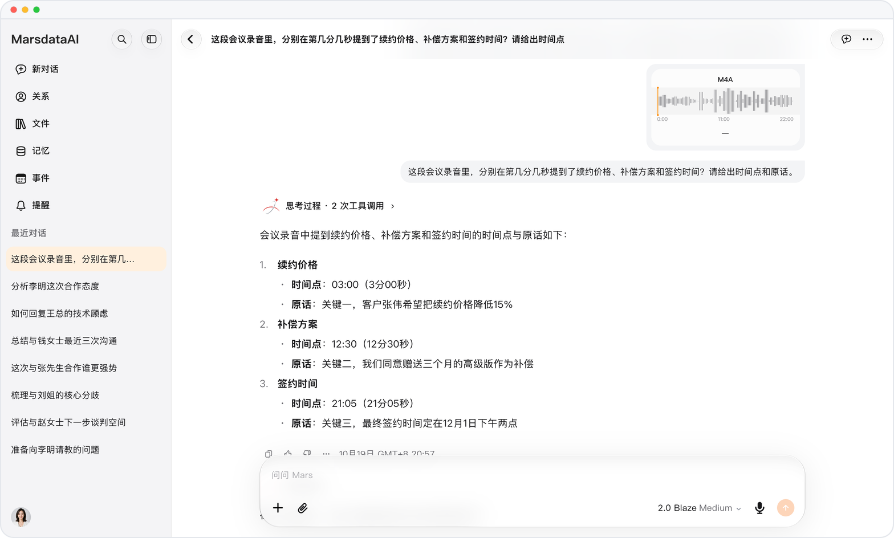

*示意图，使用虚构演示数据。*

### [一组图片，一条整洁消息](releases/crm-2026-10-18-picture-grids-and-gallery.zh-CN.md)

**预览** · 2026-10-18 · `0.1.1.6118`

一起发送的多张图片合成一个整洁网格，点任意图块就能在图库里翻看，对话不再被刷屏。

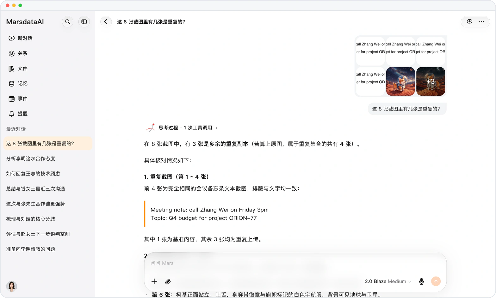

*示意图，使用虚构演示数据。*

### [用 Apple ID，一点就登录](releases/crm-2026-10-17-sign-in-with-apple.zh-CN.md)

**预览** · 2026-10-17 · `0.1.1.5950`

iOS 支持用 Apple 登录：用已有的 Apple ID 一点进入，不用另设密码。

*示意图，使用虚构演示数据。*

### [健康数据在手机，到哪儿都能问](releases/crm-2026-10-17-apple-health-sync.zh-CN.md)

**预览** · 2026-10-17 · `0.1.1.5950`

iOS 把 Apple 健康每日汇总同步到 Mars，在网页和其他设备上也能问健康问题。

*示意图，使用虚构演示数据。*

### [睡眠、饮水、营养，健康回答更完整](releases/crm-2026-10-17-richer-health-answers.zh-CN.md)

**预览** · 2026-10-17 · `0.1.1.5950`

健康问答新增睡眠阶段、饮水、热量、蛋白质与碳水，体脂秤读数完整保存，回答参考的数据更全面。

*示意图，使用虚构演示数据。*

### [拿不准时，Mars 先问你](releases/crm-2026-10-17-question-panel.zh-CN.md)

**预览** · 2026-10-17 · `0.1.1.5950`

需要你做决定时，Mars 在提问面板里一次问清最多五个问题，严格按你的选择继续，长任务少走弯路。

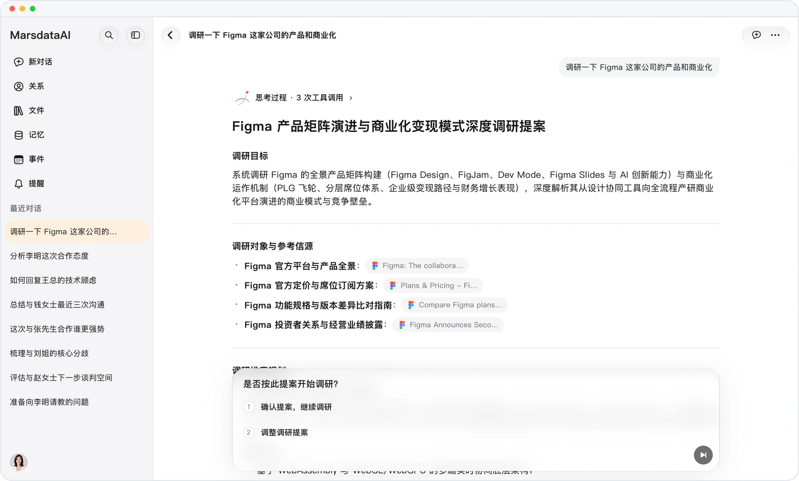

*示意图，使用虚构演示数据。*

### [长对话一搜就到，回答操作一处搞定](releases/crm-2026-10-17-find-in-chat-and-a-new-answer-menu.zh-CN.md)

**预览** · 2026-10-17 · `0.1.1.5950`

长对话里一搜就到；回答菜单集中了分支对话、朗读、切换模型、重试与联网搜索，操作一处搞定。

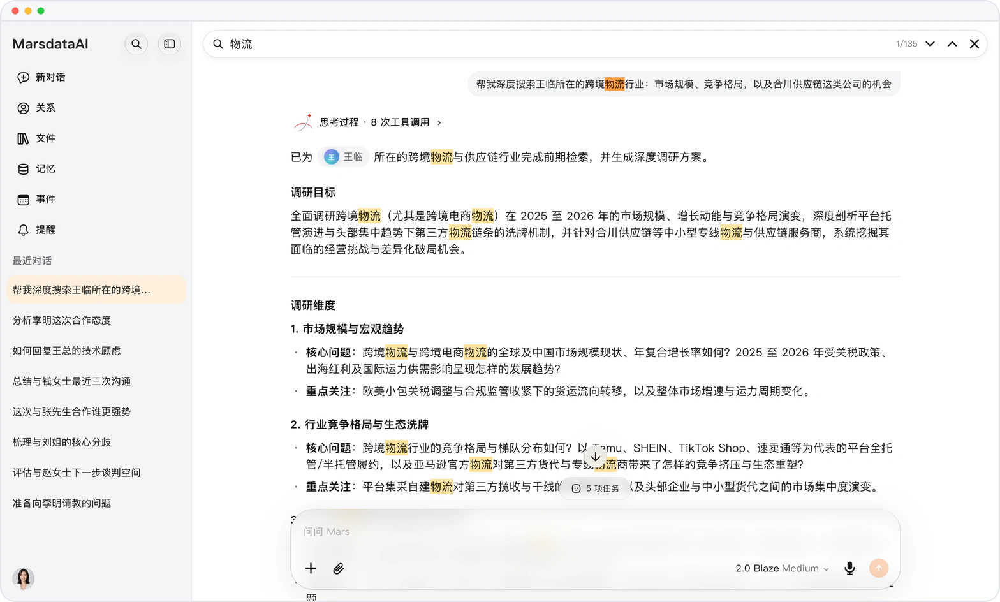

*示意图，使用虚构演示数据。*

### [到点了，Mars 自己开工](releases/crm-2026-10-17-reminders-that-start-a-conversation.zh-CN.md)

**预览** · 2026-10-17 · `0.1.1.5950`

提醒到点，Mars 按你写好的提示词自动开启对话，每日复盘、定期检查不用再手动发起。

*示意图，使用虚构演示数据。*

### [回答还在写，图表已经画出来](releases/crm-2026-10-17-live-charts-and-diagrams.zh-CN.md)

**预览** · 2026-10-17 · `0.1.1.5950`

图表与流程图随回答实时画出，附带洞察与追问，可全屏细看，趋势一眼看懂。

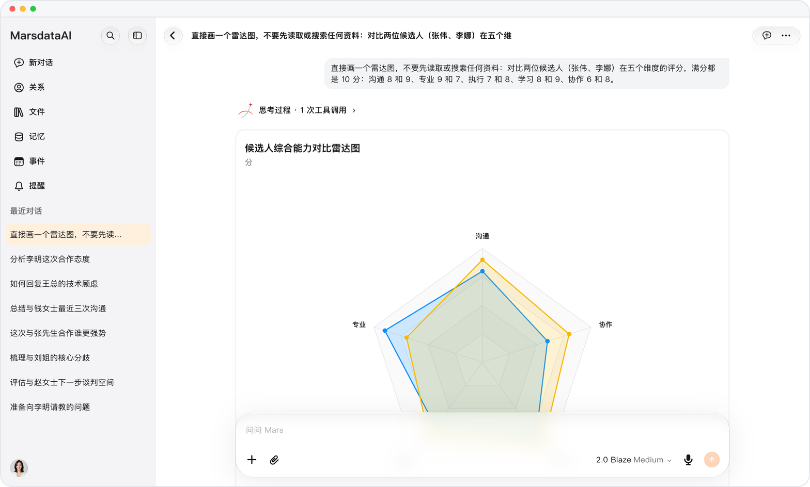

*示意图，使用虚构演示数据。*

### [iWork、WPS 文件，对话里直接看](releases/crm-2026-10-17-iwork-and-wps-previews.zh-CN.md)

**预览** · 2026-10-17 · `0.1.1.5950`

Keynote、Pages、Numbers 和 WPS 文件在对话里直接显示首页，不用另装软件就能确认内容。

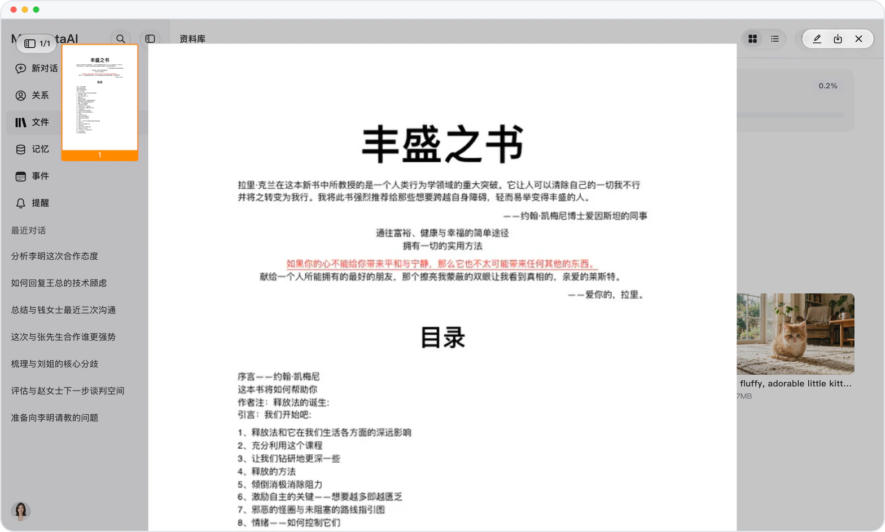

*示意图，使用虚构演示数据。*

### [哪段对话在等你，一眼看出](releases/crm-2026-10-17-conversation-status-at-a-glance.zh-CN.md)

**预览** · 2026-10-17 · `0.1.1.5950`

近期对话显示进度环、未读圆点和完成提示，哪段对话在等你，不用点开就知道。

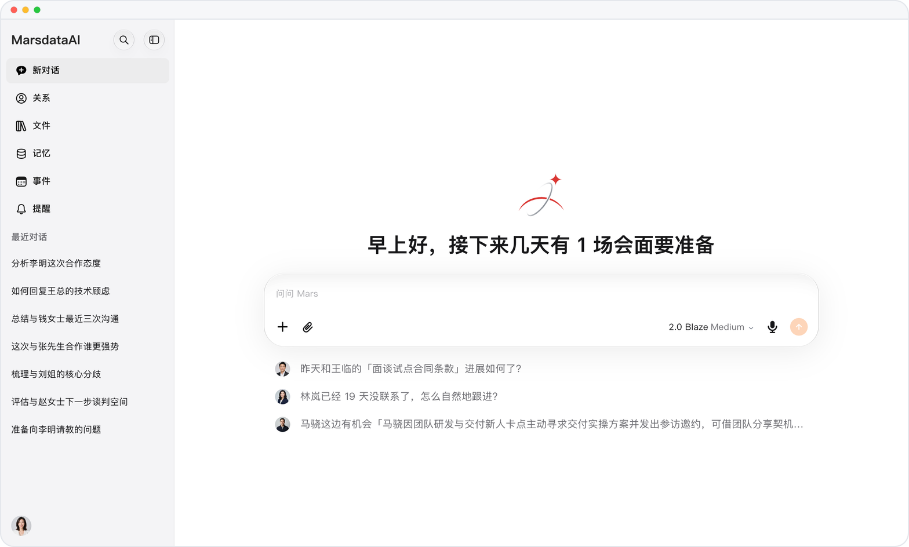

*示意图，使用虚构演示数据。*

### [日程提醒，直接发到微信](releases/crm-2026-10-17-wechat-event-reminders.zh-CN.md)

**预览** · 2026-10-17 · `0.1.1.5950`

日程提醒直接发到你绑定的微信，在每天都打开的地方收到提醒，重要日程不再错过。

### [打开列表，就知道今天该联系谁](releases/crm-2026-10-17-relationship-activity-lines.zh-CN.md)

**预览** · 2026-10-17 · `0.1.1.5950`

关系列表每一行显示近期动态和最近一次互动的时间，打开列表就知道今天该联系谁。

*示意图，使用虚构演示数据。*

### [一个人的信息，分组清楚好找](releases/crm-2026-10-17-clearer-information-groups.zh-CN.md)

**预览** · 2026-10-17 · `0.1.1.5950`

一个人的信息拆成「事业与团队」「技术与工具」「观念与偏好」，每组更短，想找的一眼就到。

*示意图，使用虚构演示数据。*

### [Keynote、Pages、Numbers 也能改](releases/crm-2026-10-17-convert-iwork-files.zh-CN.md)

**预览** · 2026-10-17 · `0.1.1.5950`

让 Mars 修改 Keynote、Pages 或 Numbers 文件，它转换成 Office 副本再改，原件保持不变。

*示意图，使用虚构演示数据。*

### [设备借出去，Mars 照样上锁](releases/crm-2026-10-15-privacy-lock.zh-CN.md)

**预览** · 2026-10-15 · `0.1.1.5585`

隐私锁：用 6 位隐私密码、面容 ID / 触控 ID 或通行密钥解锁 Mars，设备借给别人也不怕。

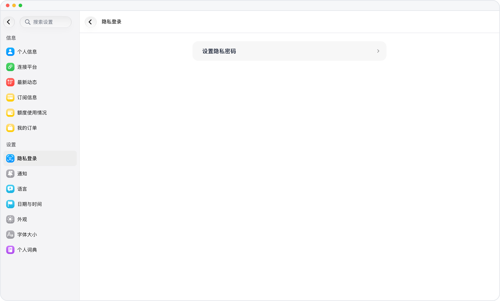

*示意图，使用虚构演示数据。*

### [更高一档的 Mars-2.0 Blaze](releases/crm-2026-10-15-mars-2-0-blaze.zh-CN.md)

**预览** · 2026-10-15 · `0.1.1.5585`

新增顶级模型 Mars-2.0 Blaze，位于 Flare 与 Ember 之上，关键问题随时换上更高一档。

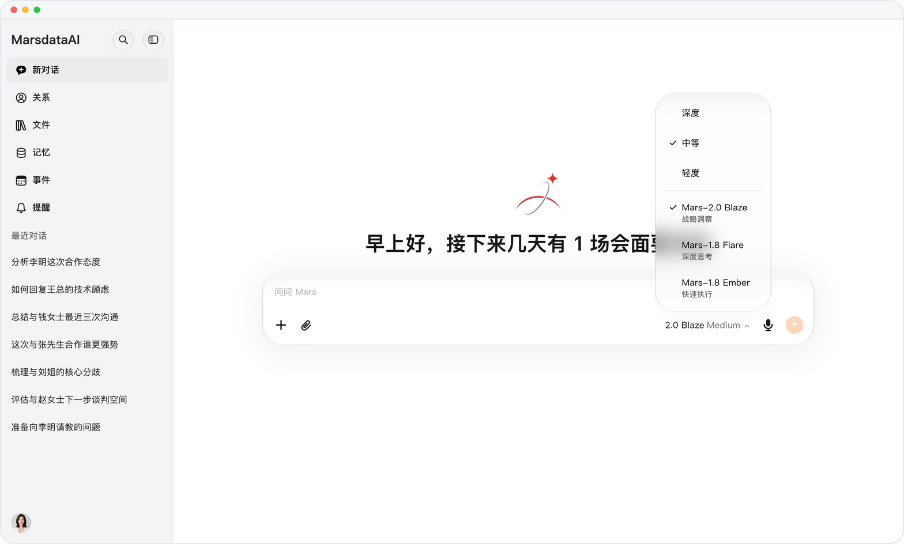

*示意图，使用虚构演示数据。*

### [网页、iOS 都能订阅，用熟悉的方式付](releases/crm-2026-10-15-plans-on-web-and-ios.zh-CN.md)

**预览** · 2026-10-15 · `0.1.1.5585`

网页用 Stripe Checkout、iOS 用 App Store 订阅，在哪儿用就在哪儿订，优惠券和优惠代码各自兑换。

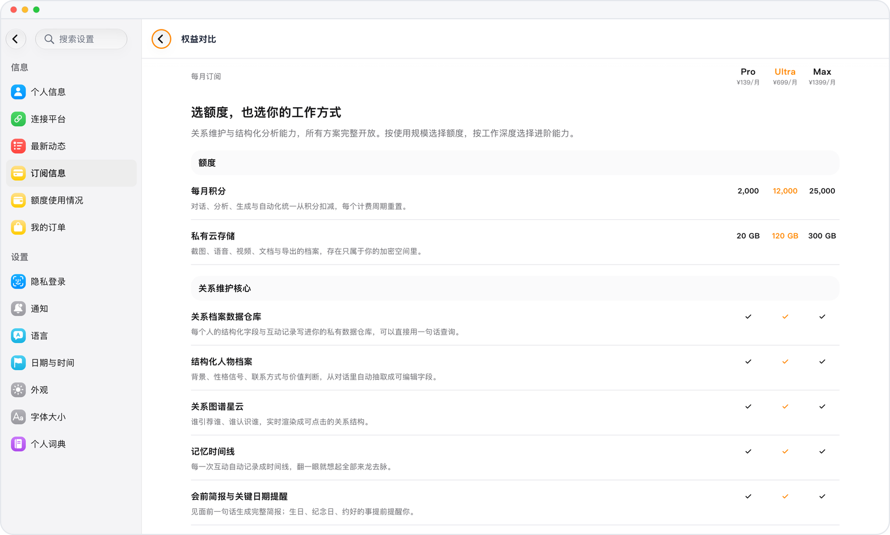

*示意图，使用虚构演示数据。*

### [点一下踩，问题直达客服](releases/crm-2026-10-15-feedback-from-thumbs-down.zh-CN.md)

**预览** · 2026-10-15 · `0.1.1.5585`

点一下踩就能反馈，报告连同整段对话发给客服，不用截图、不用重述。

*示意图，使用虚构演示数据。*

### [深度研究，每一步都看得见](releases/crm-2026-10-15-deep-research-you-can-follow.zh-CN.md)

**预览** · 2026-10-15 · `0.1.1.5585`

深度研究的每位助手以卡片实时展示步骤，调研提案由你确认，过程看得见、方向你把关。

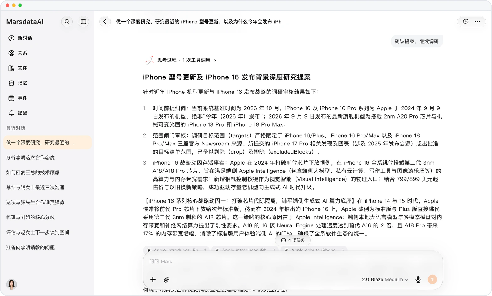

*示意图，使用虚构演示数据。*

### [复杂想法，画成一眼能懂的图](releases/crm-2026-10-15-structured-diagrams.zh-CN.md)

**预览** · 2026-10-15 · `0.1.1.5585`

Mars 能画流程图、思维导图、时序图和时间线，复杂想法一眼看懂；手机网页可下载为 PNG。

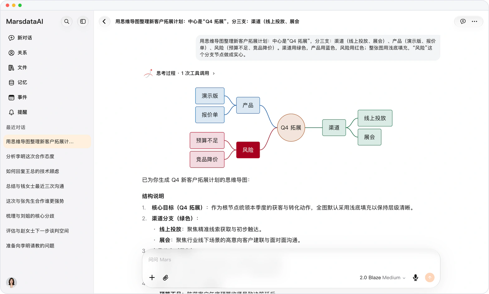

*示意图，使用虚构演示数据。*

### [Mars 的成果，直接存成文件](releases/crm-2026-10-15-write-files-to-the-library.zh-CN.md)

**预览** · 2026-10-15 · `0.1.1.5585`

Mars 把成果写成 Markdown、文本和 JSON 文件存进资料库，随时预览或打印，不再散落在对话里。

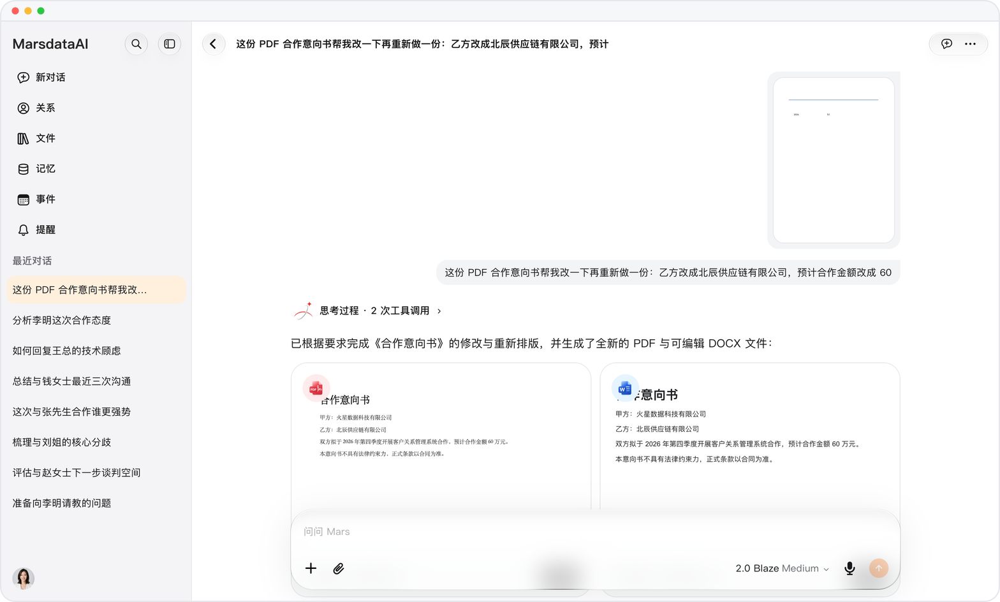

*示意图，使用虚构演示数据。*

### [手一滑，目标和技能也不会丢](releases/crm-2026-10-15-safer-deletes.zh-CN.md)

**预览** · 2026-10-15 · `0.1.1.5585`

删除目标或技能前先确认，误触不会再丢东西，网页与 iOS 都适用。

*示意图，使用虚构演示数据。*

### [自己说过的话，长按就能再用](releases/crm-2026-10-15-long-press-your-messages.zh-CN.md)

**预览** · 2026-10-15 · `0.1.1.5585`

长按自己的消息即可复制、选择或分享，说过的话不用重打。

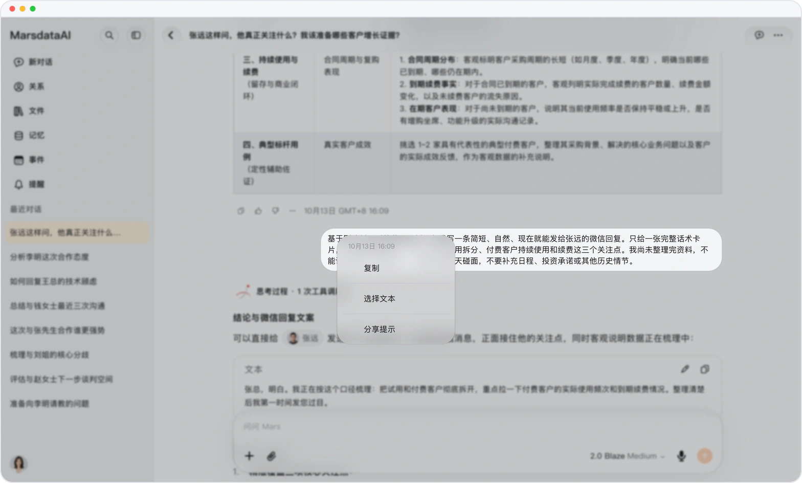

*示意图，使用虚构演示数据。*

### [邮件里的答案，Mars 帮你找](releases/crm-2026-10-13-gmail-read-only.zh-CN.md)

**预览** · 2026-10-13 · `0.1.1.5222`

以只读方式连接 Gmail，Mars 在对话中帮你搜索和阅读邮件，收件箱原封不动。

### [现有联系人，一次带进 Mars](releases/crm-2026-10-13-import-contacts.zh-CN.md)

**预览** · 2026-10-13 · `0.1.1.5222`

从「连接平台」导入你选定的 Google 或 iPhone 联系人，不用一个个重新录入。

*示意图，使用虚构演示数据。*

### [手机上的信息，回答实时用上](releases/crm-2026-10-13-live-iphone-data.zh-CN.md)

**预览** · 2026-10-13 · `0.1.1.5222`

在 iOS 上，Mars 按你逐项授权实时读取通讯录、日历和 Apple 健康与健身数据，回答用得上手机里的信息。

*示意图，使用虚构演示数据。*

### [手机号加密码，登录清清楚楚](releases/crm-2026-10-13-phone-and-password-sign-in.zh-CN.md)

**预览** · 2026-10-13 · `0.1.1.5222`

网页支持手机号加密码登录；需要安全验证时说明原因，登录过程清清楚楚。

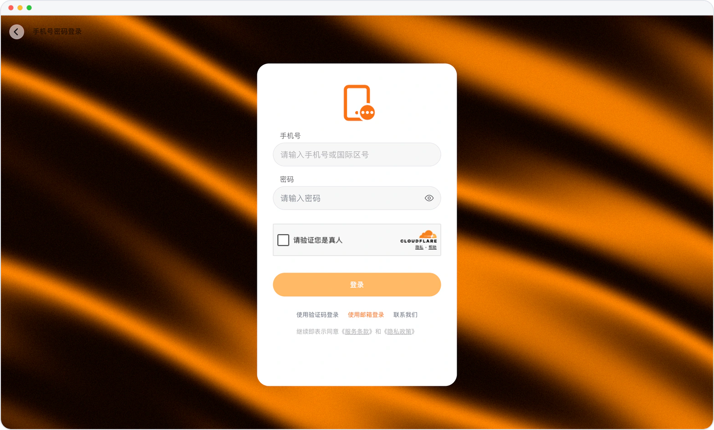

*示意图，使用虚构演示数据。*

### [iPhone 上的图表，清晰顺手](releases/crm-2026-10-13-native-charts-on-ios.zh-CN.md)

**预览** · 2026-10-13 · `0.1.1.5222`

iOS 上的图表与流程图原生绘制、清晰顺手；选中回答文字即可引用或朗读。

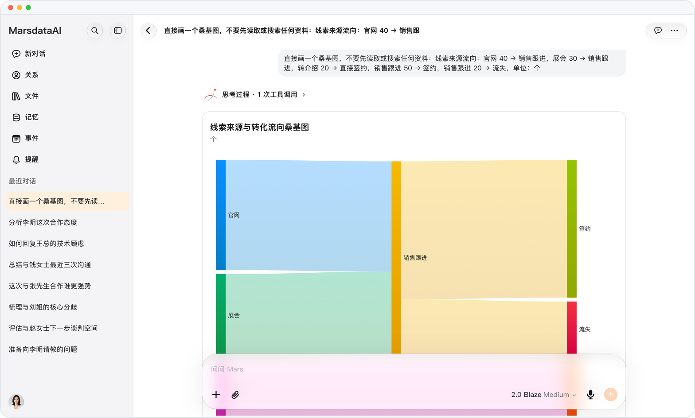

*示意图，使用虚构演示数据。*

### [切走应用，回答照样写完](releases/crm-2026-10-13-answers-that-keep-going.zh-CN.md)

**预览** · 2026-10-13 · `0.1.1.5222`

切换到其他应用，回答照样写完；某一轮失败，可在同一对话中重试。

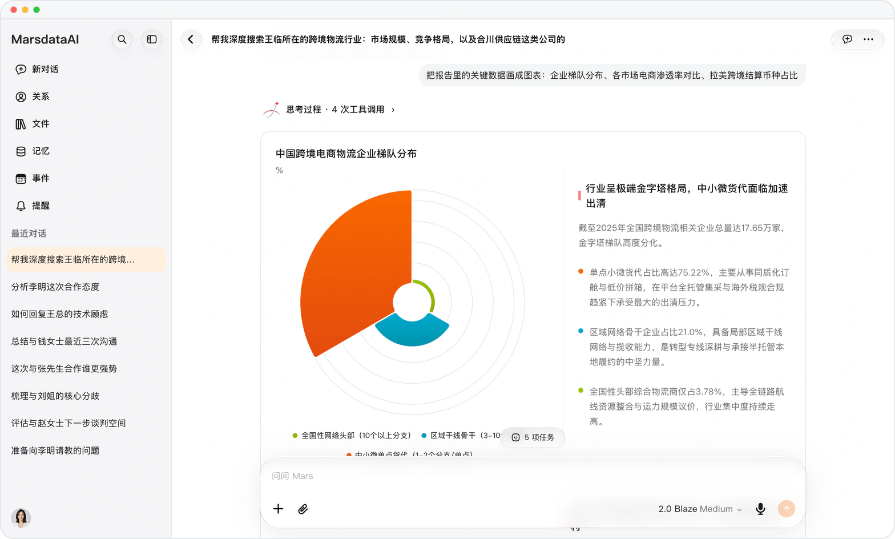

*示意图，使用虚构演示数据。*

### [额度用完，做好的结果照样交付](releases/crm-2026-10-13-graceful-credit-limits.zh-CN.md)

**预览** · 2026-10-13 · `0.1.1.5222`

额度用完时，当前这一轮已完成的结果照样交付，之后才暂停新消息，已投入的不会白费。

*示意图，使用虚构演示数据。*

### [第一眼，就是你的语言](releases/crm-2026-10-13-your-language-from-the-start.zh-CN.md)

**预览** · 2026-10-13 · `0.1.1.5222`

首次启动就跟随设备语言，打开即可看懂；不支持的语言使用英文。

*示意图，使用虚构演示数据。*

### [Mars 装进 iPhone 和 iPad](releases/crm-2026-10-10-mars-for-ios.zh-CN.md)

**预览** · 2026-10-10 · `0.1.1.4799`

Mars iOS 应用上线：侧边抽屉、滑动操作、iPad 桌面工作区，生成图片和深度研究随身可用。

*示意图，使用虚构演示数据。*

### [任务完成，Mars 主动告诉你](releases/crm-2026-10-10-native-notifications.zh-CN.md)

**预览** · 2026-10-10 · `0.1.1.4799`

开启任务完成通知，任务一完成就提醒你；iOS 只需授权一次，网页与 iOS 都能调整。

*示意图，使用虚构演示数据。*

### [日期按你的习惯来](releases/crm-2026-10-10-week-start-and-date-format.zh-CN.md)

**预览** · 2026-10-10 · `0.1.1.4799`

设置每周起始日和日期格式，网页与 iOS 的事件都按你的习惯显示。

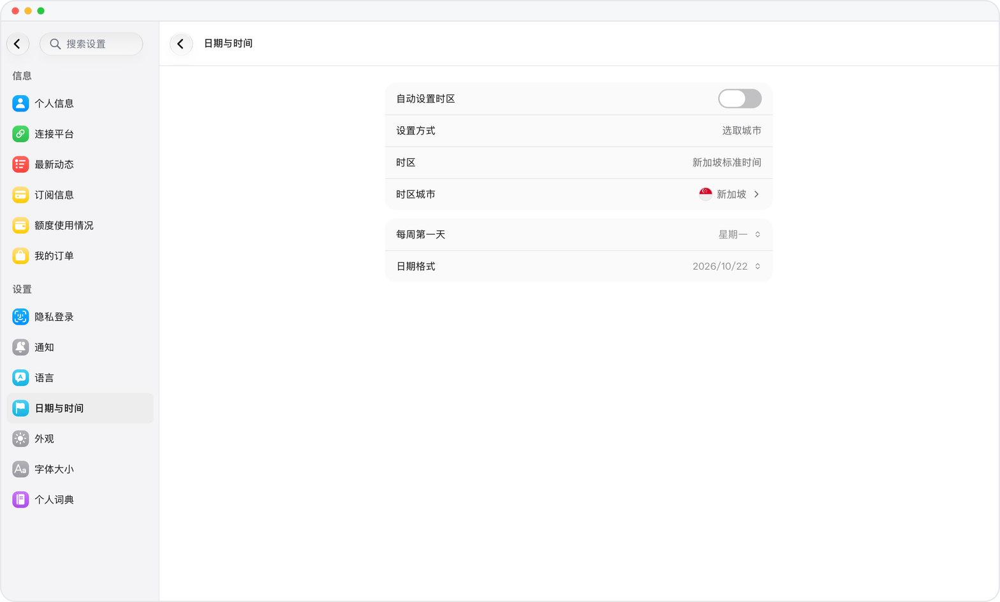

*示意图，使用虚构演示数据。*

### [按类型和阶段，管好每段关系](releases/crm-2026-10-10-relationship-types.zh-CN.md)

**预览** · 2026-10-10 · `0.1.1.4799`

关系按类型分组，设置各自的阶段与里程碑，按类型或阶段筛选，每段关系走到哪步一目了然。

### [改过的文件，每一版都留得住](releases/crm-2026-10-10-revised-office-files.zh-CN.md)

**预览** · 2026-10-10 · `0.1.1.4799`

修订后的 Word、Excel、PowerPoint 另存为新文档，原版不被覆盖；Word 修改以修订痕迹呈现，先审后收。

*示意图，使用虚构演示数据。*

### [浅色、深色，随你选](releases/crm-2026-10-10-appearance-settings.zh-CN.md)

**预览** · 2026-10-10 · `0.1.1.4799`

「外观」页可选跟随系统、浅色或深色，Mars 跟着你的习惯来；语言设置单独成页。

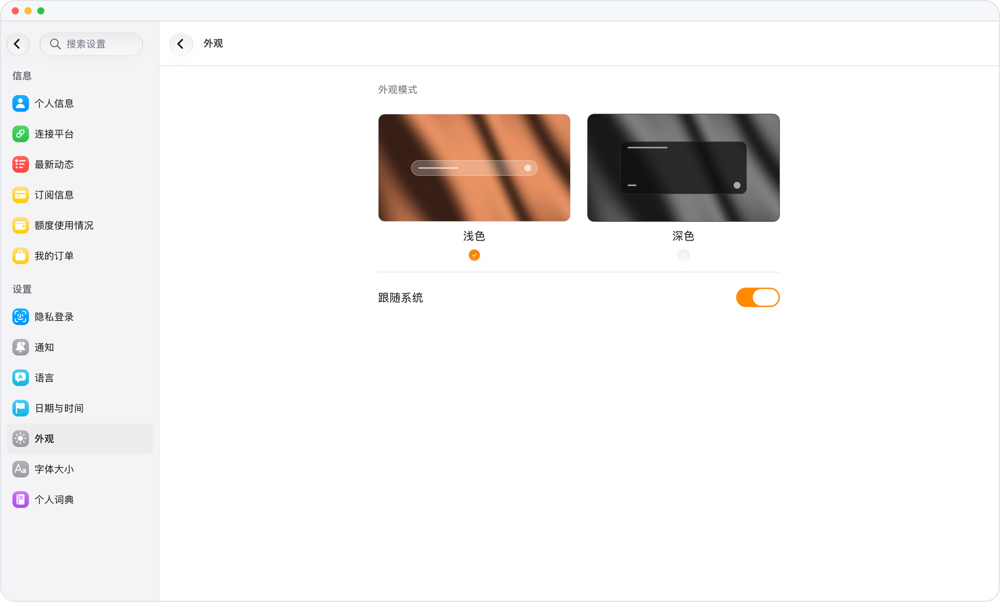

*示意图，使用虚构演示数据。*

### [压缩包里有什么，不解压就知道](releases/crm-2026-10-10-archive-previews.zh-CN.md)

**预览** · 2026-10-10 · `0.1.1.4799`

预览 RAR 和 ZIP 文件即可列出包内文件，不用下载解压就知道里面有什么。

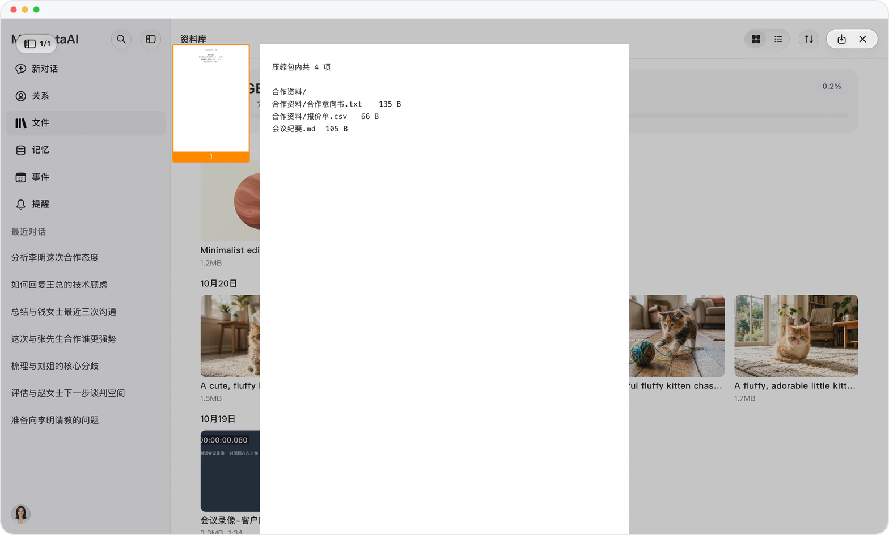

*示意图，使用虚构演示数据。*

### [人在哪里，时间就对到哪里](releases/crm-2026-10-07-time-zone-setting.zh-CN.md)

**预览** · 2026-10-07 · `0.1.1.4285`

时区可跟随设备或选择城市，对话、提醒、事件与用量记录都按你所在地显示，不用换算时差。

*示意图，使用虚构演示数据。*

### [不开着 Mars，也不错过消息](releases/crm-2026-10-07-notifications-page.zh-CN.md)

**预览** · 2026-10-07 · `0.1.1.4285`

设置中的「通知」页集中管理浏览器推送、回答完成提醒和日程提醒，不开着 Mars 也不错过。

*示意图，使用虚构演示数据。*

### [周期安排，设一次就够](releases/crm-2026-10-07-repeating-events.zh-CN.md)

**预览** · 2026-10-07 · `0.1.1.4285`

事件和提醒可按提前量、重复规则、星期、时间和结束日期自动重复，周期安排设一次就够。

*示意图，使用虚构演示数据。*

### [字号随你调，长对话读得舒服](releases/crm-2026-10-07-text-size.zh-CN.md)

**预览** · 2026-10-07 · `0.1.1.4285`

一个字体大小设置，统一缩放对话、联系人、记忆、事件、资料库和设置页，长对话读得更舒服。

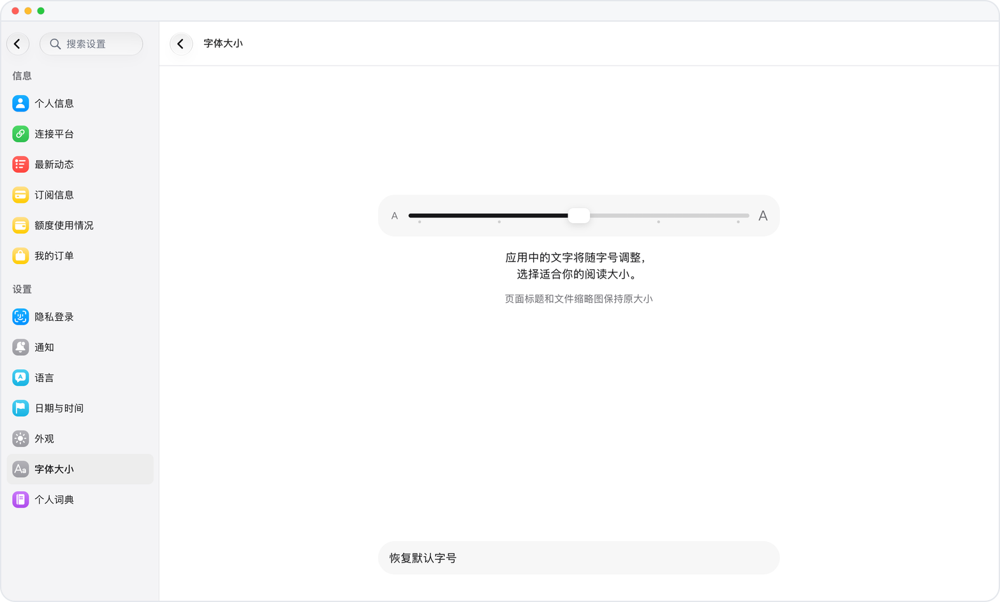

*示意图，使用虚构演示数据。*

### [分享随时收回，旧回答一搜就到](releases/crm-2026-10-07-stop-sharing-and-wider-search.zh-CN.md)

**预览** · 2026-10-07 · `0.1.1.4285`

分享链接可随时「取消分享」收回；工作区搜索覆盖对话正文，凭一句原话就能找回旧回答。

*示意图，使用虚构演示数据。*

### [谁和谁认识，Mars 帮你记着](releases/crm-2026-10-07-relationships-between-contacts.zh-CN.md)

**预览** · 2026-10-07 · `0.1.1.4285`

记录两位联系人之间的关系，各有类型与摘要，谁和谁认识清清楚楚。

### [用量高峰和退款，一页看清](releases/crm-2026-10-07-usage-records.zh-CN.md)

**预览** · 2026-10-07 · `0.1.1.4285`

用量记录支持日、周、月视图，标出高峰与低谷时段和退款，可按调用类型筛选，花在哪里一页看清。

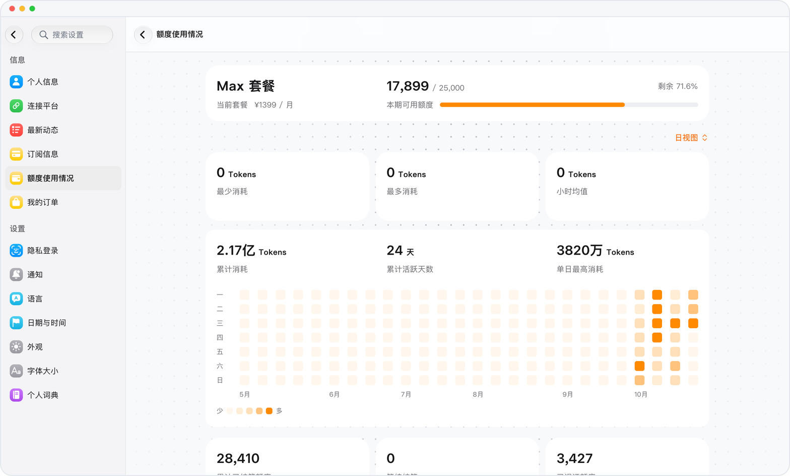

*示意图，使用虚构演示数据。*

### [日历记下真正发生的事](releases/crm-2026-10-07-event-status.zh-CN.md)

**预览** · 2026-10-07 · `0.1.1.4285`

事件可标记为计划中、已发生或已取消，日历记下真正发生的事；滑动或右键即可完成、编辑、删除。

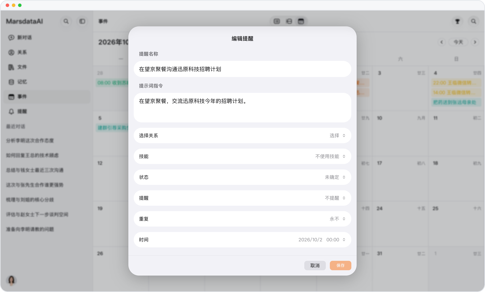

*示意图，使用虚构演示数据。*

### [关于你的信息，一个主题一张卡](releases/crm-2026-09-30-grouped-personal-memory.zh-CN.md)

**预览** · 2026-09-30 · `0.1.1.3581`

个人记忆按主题合并成一张张卡片，空字段不再占行，关于你的信息一处看全。

*示意图，使用虚构演示数据。*

### [每条信息，都能回到出处核对](releases/crm-2026-09-28-what-mars-learned-with-sources.zh-CN.md)

**预览** · 2026-09-28 · `0.1.1.3543`

联系人页面列出 Mars 了解到的信息，每条附原话和来源链接，自动识别的由你确认，有据可查。

*示意图，使用虚构演示数据。*

### [看一天的同时，整月尽收眼底](releases/crm-2026-09-23-month-events-beside-the-day.zh-CN.md)

**预览** · 2026-09-23 · `0.1.1.3475`

日视图旁列出整月日程，小日历用圆点标出有日程的日子，哪天忙一目了然。

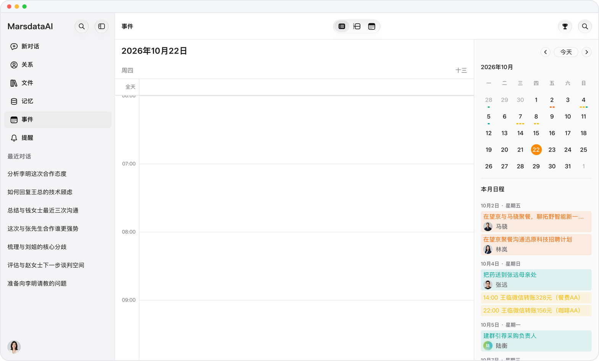

*示意图，使用虚构演示数据。*

### [PDF 一路往下滚，像读长文一样](releases/crm-2026-09-12-continuous-pdf-reading.zh-CN.md)

**预览** · 2026-09-12 · `0.1.1.3383`

资料库里的 PDF 一路往下滚着读，缩略图一点就跳页；文件都以首页作缩略图，一眼认出。

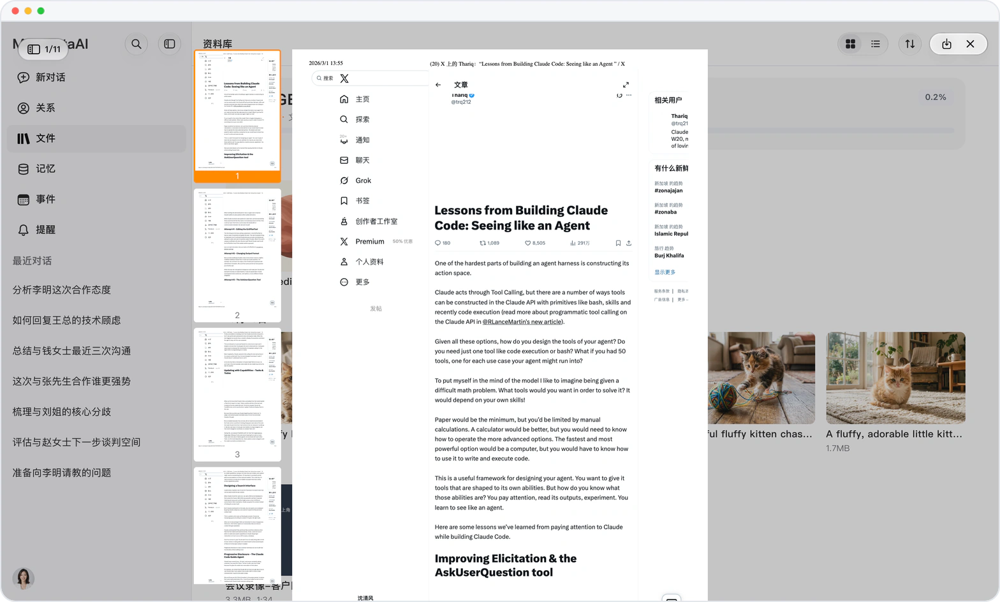

*示意图，使用虚构演示数据。*

### [方案并排比，买前看清楚](releases/crm-2026-09-04-a-clearer-plans-page.zh-CN.md)

**预览** · 2026-09-04 · `0.1.1.3352`

新的订阅页三个方案并排比较，权益一点就看全，购买栏固定在底部，付款前就清楚能得到什么。

*示意图，使用虚构演示数据。*

<!-- mars-crm-preview:end -->

## 已正式上线的历史更新

**Marsdata AI**（也叫 Mars Agent）的每一次产品变化。Marsdata 是一个替你维护关系的 AI。本仓库镜像自 [https://marsdata.ai/changelog](https://marsdata.ai/changelog)。

> 内容以官网为准：[https://marsdata.ai/changelog](https://marsdata.ai/changelog)

## [从更新日志登录，完成后回到原来的位置。](releases/2026-08-15-sign-in-from-the-changelog-and-return-right.zh-CN.md)

`0.1.1.2928` · 2026-08-15

- **修复** — 从更新日志页登录时，登录完成后现在会直接回到更新日志，不会再被送到首页。已经登录后直接打开更新日志的行为保持不变。

## [让 Mars 帮你整理 Atlas，并重新连好每一个关系圈层。](releases/2026-08-15-ask-mars-to-curate-your-atlas-and-reconnect.zh-CN.md)

`0.1.1.2922` · 2026-08-15

- **新功能** — 你现在可以直接让 Mars 帮你整理 Atlas——把某个人移到正确圈层、置顶或隐藏人物、调整圈层的突出程度，以及确认或忽略一段关系，不再需要手动改档案。
- **改进** — Atlas 现在会依据完整的人物名册来组织关系圈层。无论一个人来自结构化档案还是关系历史，都能参与归类；当其中一处资料不完整时，恢复回来的联系人也会重新回到所属圈层，而不是一直停留在未关联状态。
- **改进** — 关系圈层现在更容易浏览和定位。每一行都有清晰的颜色标记，收起圈层列表时搜索框宽度保持稳定，预览也会使用与 Atlas 本身一致的关系视图。

## [Atlas 把你的关系组织成清晰而鲜活的圈层。](releases/2026-08-13-atlas-turns-your-relationships-into-distinct-living-circles.zh-CN.md)

`0.1.1.2873` · 2026-08-13

- **新功能** — Atlas 现在会把你的关系图谱组织成一个个清晰的圈层。每个圈层都有自己的颜色，聚焦后会显示其中的人；同一个人如果横跨你生活里的多个部分，也可以同时出现在多个圈层中。Mars 暂时无法归类的人仍会以未分组星球留在图上，不会再被塞进一个带有敷衍意味的兜底分类。
- **改进** — 昵称、新名字和无法确定的对应关系，不会再被默认合并成同一个人。身份不明确时，Mars 会先请你确认，再合并档案、展示个人信息或写入新内容；而一个明确的新人物仍然可以直接加入，不会卡在反复确认里。
- **修复** — 在同一条消息里告诉 Mars 两个人的情况，每个人的更新现在都会保留各自的结果。即使其中一项需要进一步确认，已经成功的内容也会继续保存；合并后再拆分时会恢复到正确档案；如果只完成了一部分，Mars 会如实说明，不再笼统地说全部成功。
- **改进** — 网页端回答不再被一条统一的简短规则强行压缩。问题需要背景和解释时，Mars 现在可以完整展开；简单问题仍然可以保持简洁。

## [你想发送的话，现在可以直接复制。](releases/2026-08-11-the-words-you-mean-to-send-now-arrive.zh-CN.md)

`0.1.1.2820` · 2026-08-11

- **新功能** — 当 Mars 写出一段你要发出去的话——开场、回复、一句用来把事情说圆的消息——它现在会单独成卡，带自己的复制按钮，复制到的就是你要发的那段话本身：没有标题、没有解释、没有引号。普通回答和整段复制保持原样。目前先上网页端。
- **新功能** — 问 Mars 该不该做某件事，它现在会同时算两本账：一本是现实的代价与结果，另一本是这个选择对「你是谁」意味着什么的那条私人规则。第二本账只从你真正说过的话里搭起来，用假设的语气而不是下判决，并且指出哪一个观察就能推翻它——而当它不知道对方会怎么反应时，它会问你，而不是替对方编一个反应。
- **改进** — 再次开启深度研究时，现在会直接开一个新的空对话，而不是弹窗问你要不要在当前这轮里重启。第一次开启、关闭该模式、以及免费版的升级提示都和原来一样。
- **修复** — 回答重新逐字出现。一个本来只该处理运行记录请求的安全层，把逐字输出的通道也一起匹配上了，于是它把每个字都攒着，最后一次性回放整段——实测是先静默十五秒，然后三十条事件在三毫秒内涌出。模型一直都在正常逐字输出。
- **修复** — 回答途中锁屏，回来时文字会继续走。原先「保护正在生成的回答不被覆盖」这条规则认的是连接而不是这次运行，所以后台一断连，一份更早的存档就接管了显示，画面上的文字因此卡住——或者一段一段地跳。
- **修复** — 一轮结束后没有内容可显示时，Mars 现在会明说。当模型「想完了但没开口」，你会看到一条明确的重试提示，并且这条提示会留在对话里，而不是一闪而过——取代原来的空气泡。另外，没能恢复出来的回复不会再被标成「已成功完成」。
- **修复** — 图片、视频、文档重新能被模型读到。八月初有一段时间，每个上传都在送进模型的路上被静默丢掉：文件存下来了、在你自己的气泡里也显示出来了，然后模型转头问你要一张你刚刚已经发过的截图。
- **修复** — 以前会变成一堆源码的图表和思维导图，现在能正常画出来。当底层描述缺了括号、带了全角标点或不可见字符、或者整段挤在一行时，现在会先修好再渲染，而不是把源码摊给你、或者报一句「转换失败」。真正读不懂的内容仍然退回代码显示，不会瞎猜。
- **改进** — Mars 只在真的写进去之后才说「已记下」。现在每一次写入某个人的档案都会带回一张回执，没有回执的说法会在给你看之前被纠正——「记下了」不再是模型出于礼貌就能说出口的话。
- **改进** — 一口气告诉 Mars 关于某个人的六件事，六件都会被记下。它们原先会被拆成六次互相抢占的写入，只有一次落库、其余撞上单轮上限被丢掉——而回答却把六件都确认了一遍。现在一次写入就带上全部字段，每个字段各自盖上授权它的那句原话。
- **修复** — 删除一个人时，现在也会一并清掉他曾用过的称呼。整节点删除以前会留下别名表里仍然写着这个人，底层文件夹也是没核对就报「已删除」；这两处现在都会在报成功之前核实，真的残留下来的部分会明确告诉你这是一次未删净的删除，而不是干净收场。
- **修复** — 日志条目读回来的时间就是它发生的时间。原先北京时间晚上十点写下的一条，读出来是凌晨两点，而且有一段时间当天的条目其实根本没落到记录里。删除一条偏好现在是真的删掉，不再只是清掉文字、把那行数据留在原地。
- **修复** — 再次提到一笔早前的转账，Mars 会先问你，而不是直接记成第二笔。原先重述一笔时间较久的付款会绕过查重那一步；另外，还在等你确认的条目有可能被当成已结清算进总额里。
- **修复** — 手机号的绑定和解绑现在真的能用了。首次绑定从来就没把验证码发出去过；解绑会把你踢下线、号码却还留着；「解绑」按钮则对每一次点击都回一句登录已失效。现在这两个操作还并排排成了实心胶囊按钮，和下面一行的微信绑定面板用同一套视觉语言。
- **改进** — 欢迎页打开时不再等它背后的活干完。原先页面要先当场生成那份关系解读——八个扫描器加一次计费的撰写调用——才肯响应，而在这期间进来的第二个请求还得排在第一个后面。现在它直接给出已经备好的内容，下一批在页面加载完之后再准备。
- **修复** — iPhone 上已登录的用户不会再落到一个画了一半的页面上。Safari 完全没有实现缓存判断所依赖的那个接口，于是已登录的 iOS 用户被发到了页面的匿名副本——发版之后就是上一版的副本，它引用的资源地址已经不存在了——结果加载出来只有顶栏，既没有输入框也没有侧边栏。现在这道判断不再依赖那个接口，加载失败的页面也会自己重新载入。

## [你认识的每一个人，都成为一份结构化档案。](releases/2026-08-01-every-person-you-know-becomes-a-structured-record.zh-CN.md)

`0.1.1.2598` · 2026-08-01

- **新功能** — 你告诉 Mars 的每一个人，现在都以结构化档案保存——每条信息都是独立字段，旁边并列着这个人的互动日志、往来账本和变更记录。改一条只改这一条；删一条，这个人以及其余信息、历史记录原样保留。
- **改进** — 一个人只有一个节点。同一个人不再被拆成多条记录，「相亲对象」这类称呼也不会再被当成一个人；同一笔转账只入账一次。
- **改进** — Mars 自动记录的信息现在带有置信度。有把握把两条判定为同一个人、同一笔钱时，它会明确告诉你，而不是悄悄合并；没把握时——尤其涉及金额——会先暂存并来问你，还在等你确认的条目不计入总额。
- **改进** — 你的个人记忆——目标、偏好、自我档案——现在每一轮都被完整读取，而不是只检索出其中一部分，Mars 不会再漏掉你已经说过的事。
- **修复** — 删除就是真的删除。你删掉的人或某条信息不会再从旧副本里复活，Mars 也不会再把已经删掉的数值当成现状复述出来。
- **新功能** — 欢迎页的关系卡片从「向你提问」变成「给你答案」。点一下，Mars 直接给出它已经做好的分析——谁最近冷下来了、还有哪些承诺没兑现、刚认识的人里谁最值得继续跟进——而不是丢给你一个空白输入框。
- **新功能** — 在对话里 @ 某个人，Mars 现在读取的是这个人的结构化档案——字段、最近往来、账本——你刚刚修正或删除的信息，下一句回答里就会体现。
- **新功能** — 发一张聊天或转账截图，里面的事实会自动沉淀进这个人的档案——包括完全不涉及金额的往来，这类记录以前没有落脚点。
- **新功能** — 登录不再需要密码——没有注册流程，也没有密码要记。已经设过密码的用户，入口仍留在登录卡片上。
- **新功能** — 新增繁體中文（香港）：产品界面、官网页面与关系相关视图均已完整支持。
- **修复** — 对已完成的研究报告追问时，Mars 会基于报告本身作答，而不是把整个研究重做一遍。长任务进行中刷新页面，也能重新实时看到进展，而不是一片安静直到任务结束。
- **修复** — 导入的技能重新可以被找到——此前部分技能导入后虽然保存成功，却始终无法被调用，等于静默失效。

## [在对话里直接 @ 一个人。](releases/2026-07-24-mention-a-person-right-inside-the-chat.zh-CN.md)

`0.1.1.2383` · 2026-07-24

- **新功能** — 现在可以在对话里直接 @ 一个人——输入 @ 就会默认打开「关系」列表，把你和 Mars 聊过的人一键带进消息，对方的关键信息会自动附带。
- **新功能** — 上传一张聊天截图，Mars 会读懂对话风格，并主动帮你把它存成专属这个人的「回复教练」——一键就变成可复用的技能，之后随时用 / 调用。
- **改进** — 存好回复教练后，Mars 现在会主动给你一条确认——存了什么、下次会自动认出这个人、以及怎么调用——再也不用猜到底存没存上。
- **新功能** — @ 某个人时，消息里会直接展示一张丰富的关系卡片——最近的信息、最新的往来记录和一段简短档案摘要，不再只是一个光秃秃的名字标签。

## [三大模型全面升级为 1.7。](releases/2026-07-22-all-three-models-step-up-to-1-7.zh-CN.md)

`0.1.1.2353` · 2026-07-22

- **新功能** — 三大模型全面升级：1.6 升级为 1.7。mini 换上新一代极速模型；think 和 pro 双双搭载本周刚发布的最新旗舰引擎——think 侧重响应速度，pro 侧重最深的推理深度。复杂分析和长任务明显更聪明，且单次回答的消耗反而更低。
- **改进** — 记忆也变聪明了——从对话中自动记录人物和事实的引擎同步升级为新一代模型，Mars 记住的内容更准确、更有条理。

## [Atlas · 关系星云上线了。](releases/2026-07-20-atlas-relation-nebula-is-live.zh-CN.md)

`0.1.1.2324` · 2026-07-20

- **新功能** — 全新「Atlas · 关系星云」——你的人际关系 3D 星图。你和 Mars 聊过的每个人都是一颗星；点一下飞近聚焦，这个人的关键信息会像卫星一样环绕在旁，再点一下打开完整档案。支持搜索、快捷跳转和全屏模式，桌面端和手机都专门调校过。
- **新功能** — 深度研究报告也进入了星图——每个研究主题是一颗行星，环绕的卫星就是当次研究各篇文档的标题；点开行星即可浏览并阅读全部文档，包括完整报告和每个维度章节。
- **新功能** — 支持 +86 手机号登录——短信验证码带实时有效期倒计时。设置里新增「账号与安全」：可绑定、更换或解绑手机号、修改密码，还能直接在应用内阅读隐私政策。
- **新功能** — 现在完整支持上传 PowerPoint（.pptx/.ppt）、Word（.doc）和 Excel（.xls）文件——Mars 会真正读取其中的内容，而不再跳过。
- **新功能** — 复制回复时现在会保留排版——标题、表格和列表能干净地粘贴进文档，图表和示意图也会作为图片一并带上。
- **改进** — 从历史打开对话更快也更可靠了——冷启动打开不再卡顿，加载骨架屏总会正常退出而不是一直挂着，从欢迎页跳转历史对话偶发白屏的问题也已修复。
- **改进** — 页面加载更快，高峰时段回复起步更早——首次访问的欢迎页几乎秒开，高负载下的响应启动时间提升了一个数量级。
- **修复** — 输入框里打了一半的文字现在能在页面刷新后保留——草稿按对话保存，误刷新不再吃掉你的消息。
- **修复** — 图表与公式渲染修复：四象限图现在渲染为清晰的交互式图表，时间线图能容忍更多格式瑕疵，跨行的块级公式也能正确渲染而不再显示原始符号。

## [每个你提到的人，都会有一份自己的档案。](releases/2026-07-06-everyone-you-mention-now-gets-their-own-dossier.zh-CN.md)

`0.1.1.2173` · 2026-07-06

- **新功能** — Mars 现在会自动为你提到的每个人建立结构化档案——身份、背景、关系脉络、关键互动和综合价值判断会从对话中自动提取到独立的数据记录里，并在人物页上汇总呈现。你已经告诉过 Mars 的细节不会再被新信息悄悄覆盖；当两条记录被确认是同一个人时，合并后双方的信息也会完整保留。
- **新功能** — 当你聊到一个 Mars 已经认识的人时，这场对话会自动归入这个人的文件夹——关于同一个人的内容自动聚在一处，不用手动整理。
- **改进** — 人物详情页在电脑上的排版更清爽了——互动记录、人物画像和关键信息改为三栏并排展示，不再一路下拉；重复出现的画像文本已去掉；记忆面板的标题和新写入的记忆内容现在也会跟随你选择的语言。
- **改进** — 打开对话更可靠了——修复了对话可能永远卡在加载骨架屏上的问题（多发生在服务刚重启后、或恰好在切换对话的瞬间）；加载画面现在总会在几秒内退出。
- **改进** — 对话中在 Wi-Fi 和蜂窝网络之间切换时恢复明显更快了——滞留在旧网络上的请求会被立即中断并重试，而不再一直挂着不动。
- **改进** — 服务器现在能自动检测并恢复一种罕见的内部卡死状况——此前这种情况会让所有人的回复挂起，需要人工介入才能恢复。
- **修复** — 上传的 Excel（.xlsx）文件现在会被真正读取和分析——此前文件会在传输途中被静默丢弃，Mars 可能因此转而分析到不相关的数据。
- **修复** — 一批渲染修复：像「$6,000$」的金额和「$1/3$」的分数现在能正确渲染为公式，而不是显示成美元符号；标签里带中文引号的流程图不再画不出来；缺少结尾标记的图表块也能正常渲染，而不是显示原始代码。
- **改进** — 欢迎页在 iPhone 上更顺滑了——发光动画在所有设备上都以全画质渲染（可见的色带瑕疵消失了）；输入框在 Safari 里展开时不再突然跳动；点击输入框弹出键盘时，页面也不会再被顶得乱跑。

## [「项目」上线，把一摊事集中在一个空间里。](releases/2026-06-23-projects-keep-one-topic-in-one-clean-space.zh-CN.md)

`0.1.1.2098` · 2026-06-23

- **新功能** — 「项目」上线了——你可以把相关的对话归到一起，让一整个主题、一个人、或一摊事务集中放在一个清爽的空间里，而不再散落在长长的对话列表中。打开一个项目，属于它的内容会一并呈现在你眼前。
- **新功能** — 每个项目现在会自动把里面各场对话中出现的图片和媒体收拢到一起——你在某个主题下分享过的照片和文件会集中显示，不用再手动整理。
- **新功能** — 你现在可以给项目起名字、挑一个颜色，并随时在一个简单的设置面板里重命名或删除它——让每个项目一眼就能区分开。
- **改进** — 项目视图的排版更清爽了——标题栏在滚动时固定不动，侧边栏会自动收起，把更多空间留给你的内容。

## [Mars 现在能感知你们之间流逝的时间。](releases/2026-06-18-mars-now-feels-the-time-that-passed-between.zh-CN.md)

`0.1.1.2018` · 2026-06-18

- **新功能** — Mars 现在能感知一段对话里的时间流逝了。当你隔了几天再回来，它会注意到这中间过了多久，而不是当作什么都没发生、接着讲旧剧情——也就不会再催你去做一件可能早已过去的事。它会先算一下距离上次聊天过了多长时间，在继续之前先确认一下哪些情况可能已经变了。
- **改进** — Mars 在「拿不准的事」上更诚实了。隔了较长时间之后，它不再自顾自地沿用过时的假设，而是会先问问你现在进展到哪一步了——大大减少了那种「拿着好几天前的旧信息继续办事」的张冠李戴。

## [首页更流畅，回答更贴题。](releases/2026-06-14-a-smoother-home-screen-answers-shaped-to-the.zh-CN.md)

`0.1.1.1967` · 2026-06-14

- **改进** — 首页现在更流畅、也更省电了——欢迎页上那团发光动画会在较旧或较慢的手机上自动变轻，不再卡顿；当你把它滑出屏幕时也会自动「歇一下」。整体看起来也更干净了一点。
- **改进** — Mars 现在会用更贴合你问题的方式来回答——你问「怎么做」，它会先把答案给你；你想听某件事该怎么决定，它会先带你把思路理一遍；而当你只是想找人说说时，它会先好好听、先回应你的心情。

## [记忆面板变成了一张关系图谱。](releases/2026-06-13-the-memory-panel-became-a-relationship-graph.zh-CN.md)

`0.1.1.1959` · 2026-06-13

- **新功能** — 记忆面板现在会以「关系图谱」呈现：Mars 记住的人和话题围绕中心节点排列，每个节点的大小反映它掌握的详细程度，点击任一人物即可打开完整档案。Mars 在「记什么」上也更谨慎了：不会再把本属于别人的特征记到你名下；当你删除一个人物或一个记忆文件夹时，它们现在会真正被删除，而不会再从过往聊天记录里悄悄重新长出来。
- **新功能** — 选中回复里的任意文字，现在会弹出一个小工具栏——你可以把它直接引用到下一条消息里，或者让它朗读出来。按钮文字会跟随你选择的语言。
- **改进** — 打开历史对话、在多个对话之间切换明显更快了——列表会逐步渲染，刚打开过的对话几乎瞬间就能看到内容。它也更稳健了：在你刚打开 App 时偶发的一次短暂卡顿，不再会让「下滑加载更多」失灵、也不会让文件夹里的对话消失——列表会在你继续下滑时自动恢复。
- **改进** — App 的首屏加载更快、也更干净了——访客现在会立即看到真正的首页，而不是先闪一下灰色骨架；已登录用户也不会再在进入工作区之前瞬间闪过未登录的介绍页。
- **改进** — 上传大体积或较长的视频现在稳定可靠了——之前的时长限制已取消，视频也不再需要在浏览器里重新压缩后才能发送，上传占位会立即出现，让你看得到正在进行。同时修复了 iPhone 上视频上传可能卡住、迟迟传不完的问题。
- **改进** — 较长、较复杂的任务现在结束得更体面——当 Mars 触及内部安全上限时，会给你一个真正可用的答案，而不是一句笼统的「已停止」；它也不会再把已经完成的动作（比如保存你的数据）误判为失败。
- **改进** — 加强了对你账号和数据的保护——修复了几个信息可能被跨账号访问的问题，强化了应对 Mars 为你阅读的页面中隐藏恶意内容的防护，并收紧了你数据沙箱的安全防护。
- **改进** — 弹窗确认、提醒以及「额度已用完」的提示，现在都会按你选择的语言显示，而不是固定一种语言。
- **改进** — 在 iPhone 和 iPad 上，从主屏幕启动 Mars 现在会直接进入与 App 风格一致的深色启动页，而不是先闪一下白屏。
- **修复** — 停止按钮现在能可靠地停下正在生成的回复；在 Mars 生成第一个回复的过程中就开始输入新消息，也不会再意外创建出一个重复的对话。
- **修复** — 生成图片更顺了——图片生成过程中占位图不再闪烁；当 Mars 一次生成多张图片时，它们现在会以画廊形式一起展示。
- **修复** — 写在表格单元格里的数学公式，现在能正常渲染，而不是显示成原始代码。
- **修复** — 抖音直播数据里显示的时间现在是正确的了——之前会偏差八个小时。
- **修复** — 使用 Apple 登录并选择隐藏（中转）邮箱时，不再会偶尔把两个独立的账号合并成一个。
- **修复** — 存储面板更稳定、信息也更全了——在高分辨率 Windows 屏幕上不再抖动，并且现在会列出内置的数据表以及你在每张表里的行数。

## [需要操作浏览器的长任务，从头到尾更稳了。](releases/2026-06-01-long-browser-tasks-now-hold-together-end-to.zh-CN.md)

`0.1.1.1828` · 2026-06-01

- **改进** — 长任务、尤其是需要 Mars 帮你操作浏览器的任务（登录某个网站、逐页点击浏览、抓取数据），现在能从头到尾稳定完成了。此前同一个对话有时会在中途被悄悄交接到不同的服务器，导致浏览器里已登录的会话丢失、浏览器任务卡住或失败。现在每个对话都会固定在同一处处理，浏览器会话也会共享，因此浏览器能保持登录状态，在长对话中接着之前的进度继续操作。

## [Deep Research 重写：更深，也更安全。](releases/2026-05-26-deep-research-rewritten-deeper-and-safer.zh-CN.md)

`0.1.1.1803` · 2026-05-26

- **新功能** — Deep Research（深度研究）模式做了一轮重写，更深也更安全：现在会先做一轮快速预搜索再让你确认研究问题（让候选问题真正贴合可查到的资料），收集来源后还会跑一轮交叉核验；过程中会把长报告增量备份到云端，万一最终合成被网络波动或关掉页面打断，草稿可以恢复，不用从零再来。另外，这个模式现在会等你真正确认了问题再开始动手，而且如果最终报告写得过于稀薄，会被自动拦下不直接抛给你
- **修复** — 之前一段时间内偶尔出现「打开后只剩空骨架屏」的对话现在已经能正常加载；同时修复了一个更隐蔽的问题——单个异常对话会把整个侧栏列表 500 掉。受影响过的对话现在应该都能打开，侧栏列表也会稳定显示
- **改进** — 朗读播放更像人在念回复了——播放按钮不再把 JSON 大括号、代码围栏、特殊 HTML 格式块也念出来；推送通知的预览正文也用上了同一套清理，锁屏看到的提示文字现在是自然的语句，不再是裸 markdown
- **修复** — Mermaid 图表现在能在较旧的 iPhone（iOS 16）上正常渲染——修复了之前在这些设备上图表显示空白的兼容性问题
- **修复** — 数学公式里同时出现转义货币符号和数字的写法（比如「$\$72亿$」）现在不再渲染成一个红色 LaTeX 报错，公式会正常显示
- **修复** — 推送通知现在能稳定地送达你启用过的每一台设备——此前的实现存在一个竞态：多台设备会悄悄互相把对方的订阅置为失效，导致「任务完成」推送对一些用户长时间收不到。现在订阅按设备独立跟踪，全局收敛
- **改进** — 微信视频号登录流程更顺：当 Mars 打开一个需要你登录的视频号页面时，右侧面板现在会自动接管让你完成登录，登完之后任务继续。面板在没东西可显示时也不会再以空白面板形式出现；同一对话里你已登录的凭据现在也会正确地传给后续会话
- **修复** — 较长 AI 回复中偶尔出现的「空白灰色段落框」不再出现
- **修复** — 侧栏顶部的对话标题在第一轮回复时不再会先显示一个临时猜测再切换到正式标题——现在标题会从你的第一条消息一次性确定，避免来回闪烁

---

[English](./CHANGELOG.md) · [繁體中文](./CHANGELOG.zh-HK.md)
