<!-- mars-crm-preview:start -->
# Mars — 產品更新

> **預覽** — 以下功能目前處於預覽階段，尚未正式上線。

[體驗預覽版](https://canary.marsdata.ai) · [English](./CHANGELOG.md) · [简体中文](./CHANGELOG.zh-CN.md) · [繁體中文](./CHANGELOG.zh-HK.md)

## 預覽版更新

### [問一句，直達那頁設置](releases/crm-2026-10-27-open-settings-from-an-answer.zh-HK.md)

**預覽** · 2026-10-27 · `0.1.1.8292`

問 Mars 設置在哪、怎麼連數據，回答裏的設置膠囊一點直達，不用再翻菜單。

*示意圖，使用虛構演示資料。*

### [Mars 上 Mac，大屏一眼看全](releases/crm-2026-10-26-mars-for-mac.zh-HK.md)

**預覽** · 2026-10-26 · `0.1.1.8385`

Mars 推出 Mac 原生應用：三欄桌面工作區大屏一眼看全，與 iPhone、iPad 同一賬號接着用。

*示意圖，使用虛構演示資料。*

### [問到賬號，一點就聯繫上](releases/crm-2026-10-26-open-social-accounts-in-one-tap.zh-HK.md)

**預覽** · 2026-10-26 · `0.1.1.8385`

問到某人的微信號或其他賬號，點一下膠囊即複製並打開對應應用，馬上就能聯繫。

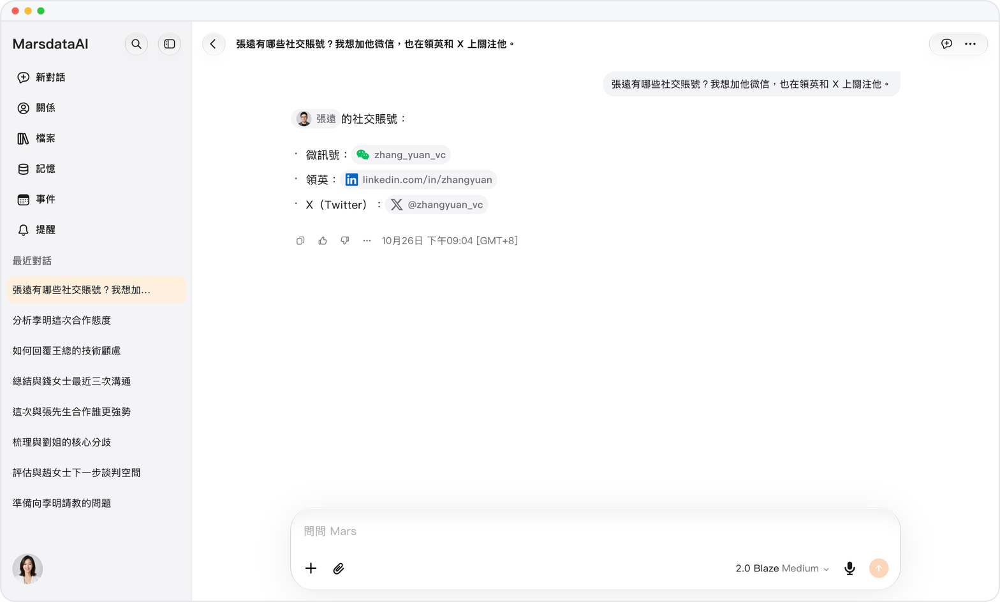

*示意圖，使用虛構演示資料。*

### [回答沒寫完，想法隨時補](releases/crm-2026-10-25-add-to-a-running-answer.zh-HK.md)

**預覽** · 2026-10-25 · `0.1.1.8208`

Mars 回答時也能繼續輸入：中途補充或改方向，它在你的消息下方接着答，不用等也不用重問。

*示意圖，使用虛構演示資料。*

### [職位值多少錢，看真實招聘](releases/crm-2026-10-25-what-a-role-pays.zh-HK.md)

**預覽** · 2026-10-25 · `0.1.1.8208`

問某個職位在某地的薪資，Mars 彙總領英和 Google Jobs 當前招聘的公開薪資，每個數字都有出處。

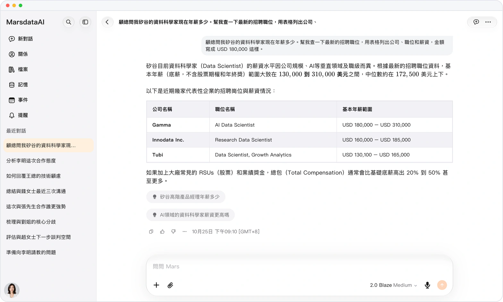

*示意圖，使用虛構演示資料。*

### [不開應用，一點就叫出 Mars](releases/crm-2026-10-24-mars-widgets-on-iphone.zh-HK.md)

**預覽** · 2026-10-24 · `0.1.1.7959`

Mars 小組件登陸 iPhone 主屏幕、鎖屏和 Mac 桌面：不開應用，一點就能拍照、語音或研究，額度隨時可見。

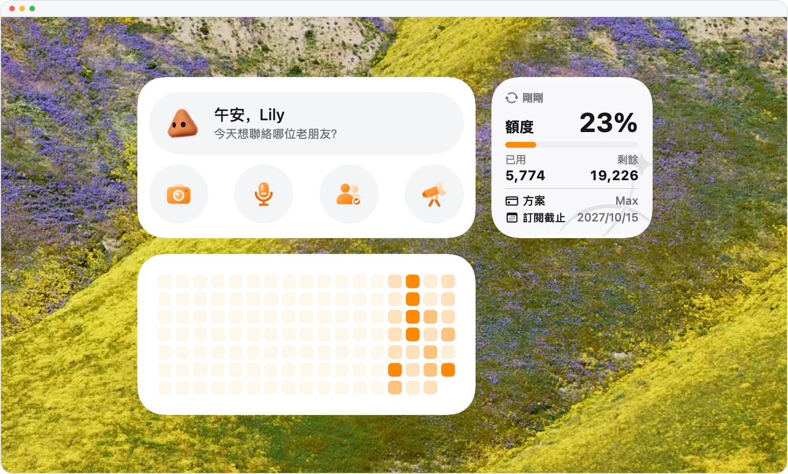

*示意圖，使用虛構演示資料。*

### [一句話，做出能直接上台的演示文稿](releases/crm-2026-10-24-mars-makes-decks-and-documents.zh-HK.md)

**預覽** · 2026-10-24 · `0.1.1.7959`

一句話，Mars 做出可編輯的 PowerPoint 演示文稿，配圖風格統一；也能寫帶插圖的 Word 文檔，省下找圖排版的時間。

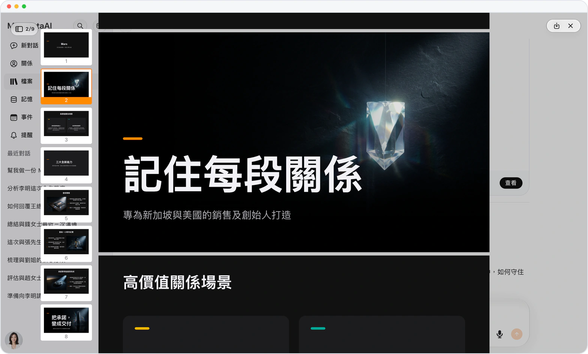

*示意圖，使用虛構演示資料。*

### [賬號不交出去，網頁照樣讀](releases/crm-2026-10-23-read-pages-without-your-login.zh-HK.md)

**預覽** · 2026-10-23 · `0.1.1.7618`

Mars 不用你的賬號也能讀公開網頁；需要登錄的內容，請你打開原文鏈接，賬號始終在你手裏。

*示意圖，使用虛構演示資料。*

### [值得投入的事和人，排在前面](releases/crm-2026-10-23-sort-by-value.zh-HK.md)

**預覽** · 2026-10-23 · `0.1.1.7618`

按價值排序：簽約、融資和引薦排在瑣事前面，值得投入的事和人先看見，網頁與 iOS 都支持。

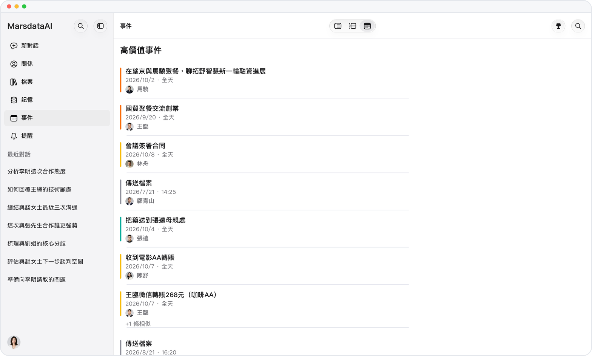

*示意圖，使用虛構演示資料。*

### [見面之前，先看懂對方的視頻](releases/crm-2026-10-22-mars-watches-social-videos.zh-HK.md)

**預覽** · 2026-10-22 · `0.1.1.7433`

Mars 能看懂抖音、小紅書、B站、快手和微博的視頻：問起一個人，它替你看完視頻，引用本人在鏡頭前的原話。

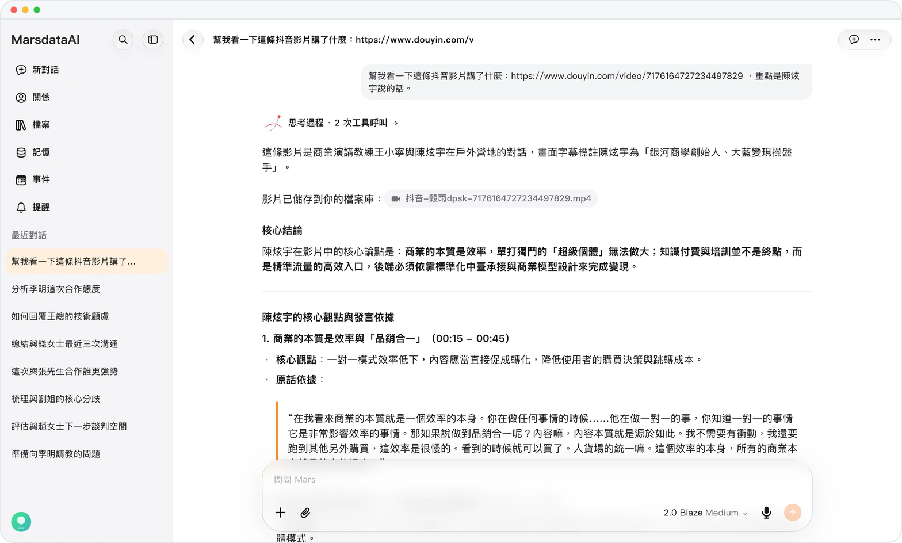

*示意圖，使用虛構演示資料。*

### [分享對話，只給你想給的人看](releases/crm-2026-10-22-share-links-with-a-password.zh-HK.md)

**預覽** · 2026-10-22 · `0.1.1.7433`

給分享的對話加上 6 位訪問密碼，鏈接被轉發也打不開，網頁和 iOS 都能設置。

*示意圖，使用虛構演示資料。*

### [行程畫在地圖上，每天怎麼走一目瞭然](releases/crm-2026-10-21-plan-trips-on-a-map.zh-HK.md)

**預覽** · 2026-10-21 · `0.1.1.6886`

在對話中規劃旅行，每天的地點與路線畫在交互地圖上，哪裏挨着哪裏一目瞭然。

*示意圖，使用虛構演示資料。*

### [圖表下載少約 86%，幾毫秒畫好](releases/crm-2026-10-20-faster-adaptive-diagrams.zh-HK.md)

**預覽** · 2026-10-20 · `0.1.1.6573`

回答中的圖表下載量減少約 86%，幾毫秒內畫好，窄屏自動改為上下排列，在哪都看得清。

*示意圖，使用虛構演示資料。*

### [點開之前，就知道來源是什麼](releases/crm-2026-10-19-cited-link-titles.zh-HK.md)

**預覽** · 2026-10-19 · `0.1.1.6479`

Mars 引用的每個鏈接都顯示真實標題，點開之前就知道來源值不值得看。

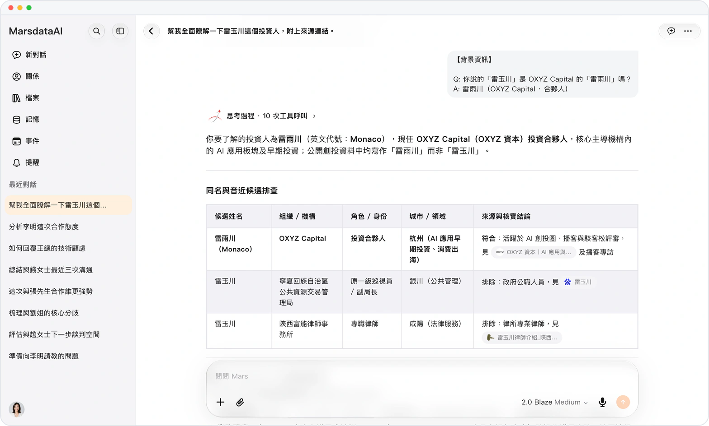

*示意圖，使用虛構演示資料。*

### [2 GB 長錄音，每句話都能定位](releases/crm-2026-10-19-long-recordings.zh-HK.md)

**預覽** · 2026-10-19 · `0.1.1.6479`

音視頻上限提高到 2 GB，超過 20 分鐘的錄音也能問到每一句、定位到幾分幾秒。

*示意圖，使用虛構演示資料。*

### [一組圖片，一條整潔消息](releases/crm-2026-10-18-picture-grids-and-gallery.zh-HK.md)

**預覽** · 2026-10-18 · `0.1.1.6118`

一起發送的多張圖片合成一個整潔網格，點任意圖塊就能在圖庫裏翻看，對話不再被刷屏。

*示意圖，使用虛構演示資料。*

### [用 Apple ID，一點就登錄](releases/crm-2026-10-17-sign-in-with-apple.zh-HK.md)

**預覽** · 2026-10-17 · `0.1.1.5950`

iOS 支持用 Apple 登錄：用已有的 Apple ID 一點進入，不用另設密碼。

*示意圖，使用虛構演示資料。*

### [健康數據在手機，到哪兒都能問](releases/crm-2026-10-17-apple-health-sync.zh-HK.md)

**預覽** · 2026-10-17 · `0.1.1.5950`

iOS 把 Apple 健康每日彙總同步到 Mars，在網頁和其他設備上也能問健康問題。

*示意圖，使用虛構演示資料。*

### [睡眠、飲水、營養，健康回答更完整](releases/crm-2026-10-17-richer-health-answers.zh-HK.md)

**預覽** · 2026-10-17 · `0.1.1.5950`

健康問答新增睡眠階段、飲水、熱量、蛋白質與碳水，體脂秤讀數完整保存，回答參考的數據更全面。

*示意圖，使用虛構演示資料。*

### [拿不準時，Mars 先問你](releases/crm-2026-10-17-question-panel.zh-HK.md)

**預覽** · 2026-10-17 · `0.1.1.5950`

需要你做決定時，Mars 在提問面板裏一次問清最多五個問題，嚴格按你的選擇繼續，長任務少走彎路。

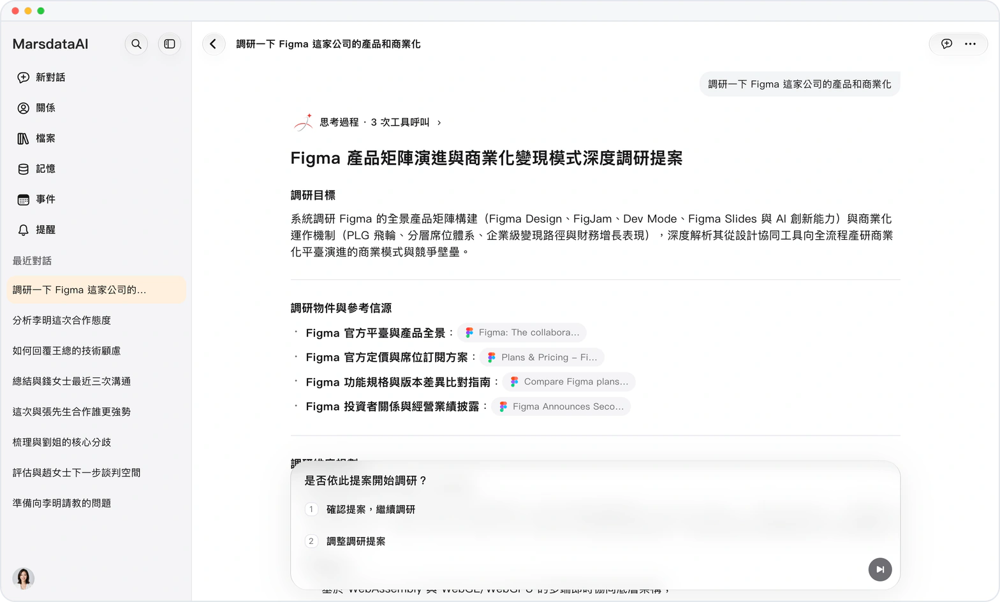

*示意圖，使用虛構演示資料。*

### [長對話一搜就到，回答操作一處搞定](releases/crm-2026-10-17-find-in-chat-and-a-new-answer-menu.zh-HK.md)

**預覽** · 2026-10-17 · `0.1.1.5950`

長對話裏一搜就到；回答菜單集中了分支對話、朗讀、切換模型、重試與聯網搜索，操作一處搞定。

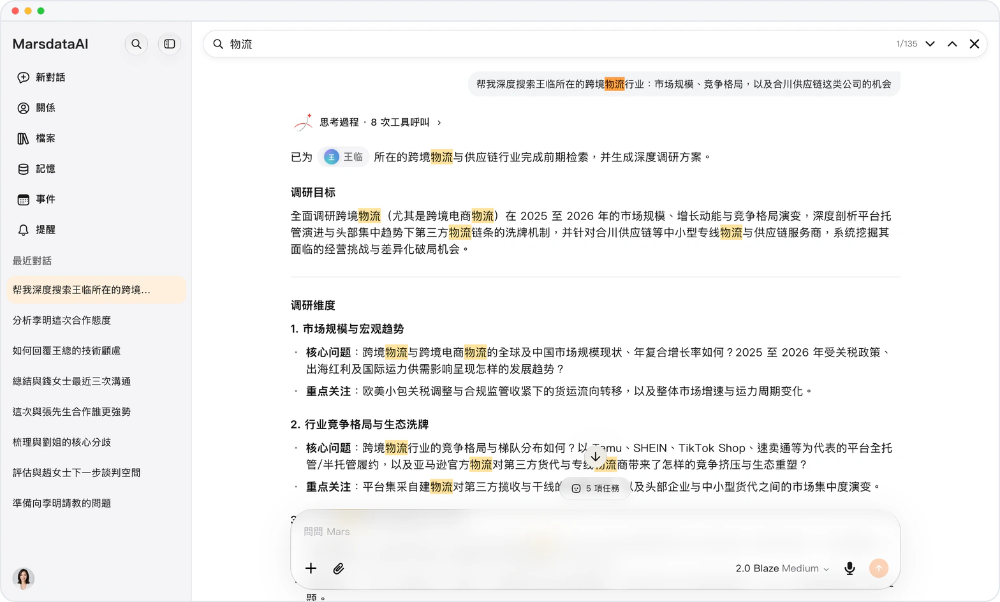

*示意圖，使用虛構演示資料。*

### [到點了，Mars 自己開工](releases/crm-2026-10-17-reminders-that-start-a-conversation.zh-HK.md)

**預覽** · 2026-10-17 · `0.1.1.5950`

提醒到點，Mars 按你寫好的提示詞自動開啓對話，每日復盤、定期檢查不用再手動發起。

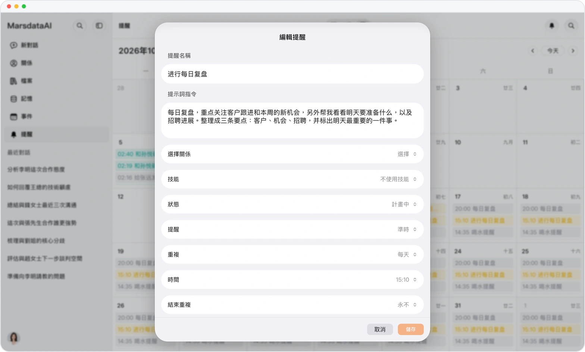

*示意圖，使用虛構演示資料。*

### [回答還在寫，圖表已經畫出來](releases/crm-2026-10-17-live-charts-and-diagrams.zh-HK.md)

**預覽** · 2026-10-17 · `0.1.1.5950`

圖表與流程圖隨回答實時畫出，附帶洞察與追問，可全屏細看，趨勢一眼看懂。

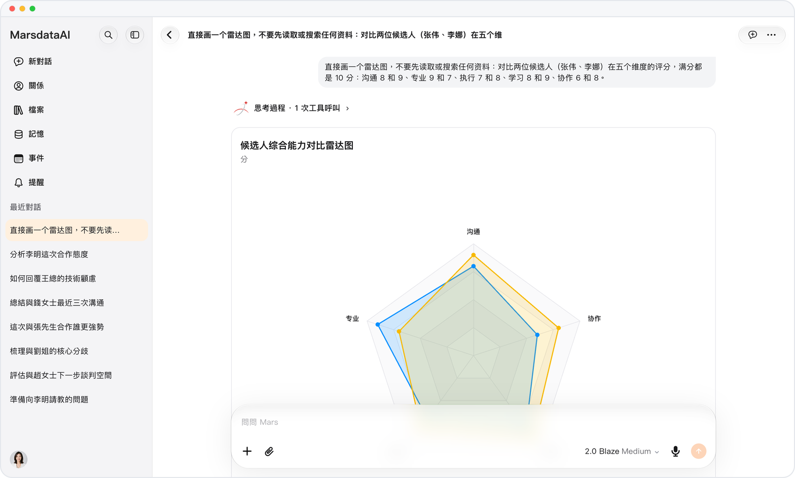

*示意圖，使用虛構演示資料。*

### [iWork、WPS 文件，對話裏直接看](releases/crm-2026-10-17-iwork-and-wps-previews.zh-HK.md)

**預覽** · 2026-10-17 · `0.1.1.5950`

Keynote、Pages、Numbers 和 WPS 文件在對話裏直接顯示首頁，不用另裝軟件就能確認內容。

*示意圖，使用虛構演示資料。*

### [哪段對話在等你，一眼看出](releases/crm-2026-10-17-conversation-status-at-a-glance.zh-HK.md)

**預覽** · 2026-10-17 · `0.1.1.5950`

近期對話顯示進度環、未讀圓點和完成提示，哪段對話在等你，不用點開就知道。

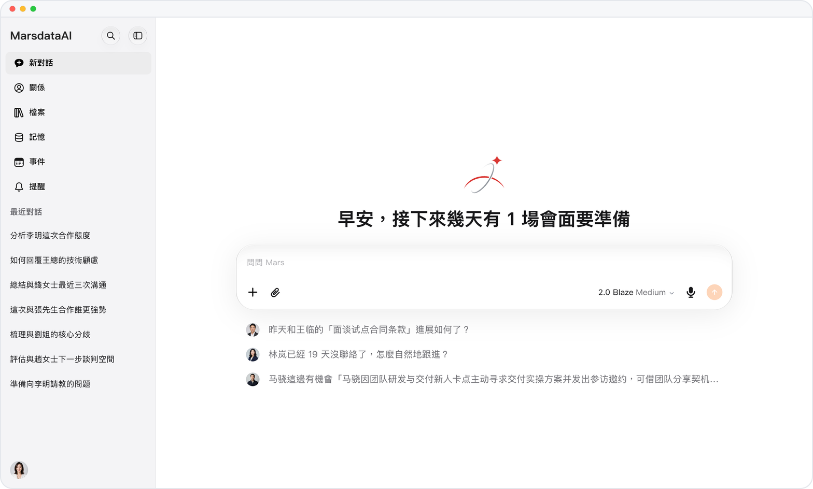

*示意圖，使用虛構演示資料。*

### [日程提醒，直接發到微信](releases/crm-2026-10-17-wechat-event-reminders.zh-HK.md)

**預覽** · 2026-10-17 · `0.1.1.5950`

日程提醒直接發到你綁定的微信，在每天都打開的地方收到提醒，重要日程不再錯過。

### [打開列表，就知道今天該聯繫誰](releases/crm-2026-10-17-relationship-activity-lines.zh-HK.md)

**預覽** · 2026-10-17 · `0.1.1.5950`

關係列表每一行顯示近期動態和最近一次互動的時間，打開列表就知道今天該聯繫誰。

*示意圖，使用虛構演示資料。*

### [一個人的信息，分組清楚好找](releases/crm-2026-10-17-clearer-information-groups.zh-HK.md)

**預覽** · 2026-10-17 · `0.1.1.5950`

一個人的信息拆成「事業與團隊」「技術與工具」「觀念與偏好」，每組更短，想找的一眼就到。

*示意圖，使用虛構演示資料。*

### [Keynote、Pages、Numbers 也能改](releases/crm-2026-10-17-convert-iwork-files.zh-HK.md)

**預覽** · 2026-10-17 · `0.1.1.5950`

讓 Mars 修改 Keynote、Pages 或 Numbers 文件，它轉換成 Office 副本再改，原件保持不變。

*示意圖，使用虛構演示資料。*

### [設備借出去，Mars 照樣上鎖](releases/crm-2026-10-15-privacy-lock.zh-HK.md)

**預覽** · 2026-10-15 · `0.1.1.5585`

隱私鎖：用 6 位隱私密碼、面容 ID / 觸控 ID 或通行密鑰解鎖 Mars，設備借給別人也不怕。

*示意圖，使用虛構演示資料。*

### [更高一檔的 Mars-2.0 Blaze](releases/crm-2026-10-15-mars-2-0-blaze.zh-HK.md)

**預覽** · 2026-10-15 · `0.1.1.5585`

新增頂級模型 Mars-2.0 Blaze，位於 Flare 與 Ember 之上，關鍵問題隨時換上更高一檔。

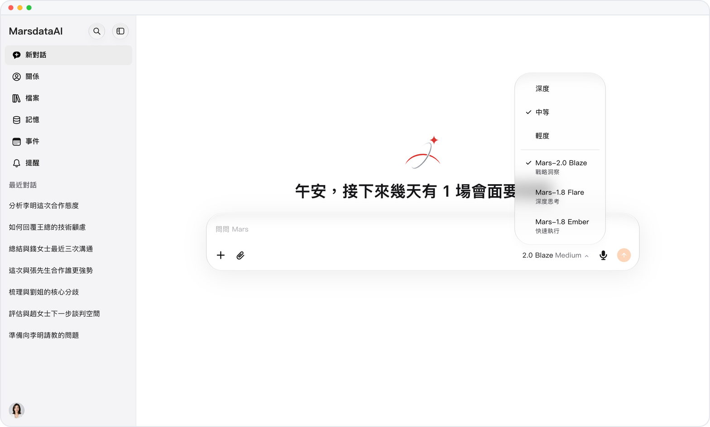

*示意圖，使用虛構演示資料。*

### [網頁、iOS 都能訂閲，用熟悉的方式付](releases/crm-2026-10-15-plans-on-web-and-ios.zh-HK.md)

**預覽** · 2026-10-15 · `0.1.1.5585`

網頁用 Stripe Checkout、iOS 用 App Store 訂閲，在哪兒用就在哪兒訂，優惠券和優惠代碼各自兑換。

*示意圖，使用虛構演示資料。*

### [點一下踩，問題直達客服](releases/crm-2026-10-15-feedback-from-thumbs-down.zh-HK.md)

**預覽** · 2026-10-15 · `0.1.1.5585`

點一下踩就能反饋，報告連同整段對話發給客服，不用截圖、不用重述。

*示意圖，使用虛構演示資料。*

### [深度研究，每一步都看得見](releases/crm-2026-10-15-deep-research-you-can-follow.zh-HK.md)

**預覽** · 2026-10-15 · `0.1.1.5585`

深度研究的每位助手以卡片實時展示步驟，調研提案由你確認，過程看得見、方向你把關。

*示意圖，使用虛構演示資料。*

### [複雜想法，畫成一眼能懂的圖](releases/crm-2026-10-15-structured-diagrams.zh-HK.md)

**預覽** · 2026-10-15 · `0.1.1.5585`

Mars 能畫流程圖、思維導圖、時序圖和時間線，複雜想法一眼看懂；手機網頁可下載為 PNG。

*示意圖，使用虛構演示資料。*

### [Mars 的成果，直接存成文件](releases/crm-2026-10-15-write-files-to-the-library.zh-HK.md)

**預覽** · 2026-10-15 · `0.1.1.5585`

Mars 把成果寫成 Markdown、文本和 JSON 文件存進資料庫，隨時預覽或打印，不再散落在對話裏。

*示意圖，使用虛構演示資料。*

### [手一滑，目標和技能也不會丟](releases/crm-2026-10-15-safer-deletes.zh-HK.md)

**預覽** · 2026-10-15 · `0.1.1.5585`

刪除目標或技能前先確認，誤觸不會再丟東西，網頁與 iOS 都適用。

*示意圖，使用虛構演示資料。*

### [自己説過的話，長按就能再用](releases/crm-2026-10-15-long-press-your-messages.zh-HK.md)

**預覽** · 2026-10-15 · `0.1.1.5585`

長按自己的消息即可複製、選擇或分享，説過的話不用重打。

*示意圖，使用虛構演示資料。*

### [郵件裏的答案，Mars 幫你找](releases/crm-2026-10-13-gmail-read-only.zh-HK.md)

**預覽** · 2026-10-13 · `0.1.1.5222`

以只讀方式連接 Gmail，Mars 在對話中幫你搜索和閲讀郵件，收件箱原封不動。

### [現有聯繫人，一次帶進 Mars](releases/crm-2026-10-13-import-contacts.zh-HK.md)

**預覽** · 2026-10-13 · `0.1.1.5222`

從「連接平台」導入你選定的 Google 或 iPhone 聯繫人，不用一個個重新錄入。

*示意圖，使用虛構演示資料。*

### [手機上的信息，回答實時用上](releases/crm-2026-10-13-live-iphone-data.zh-HK.md)

**預覽** · 2026-10-13 · `0.1.1.5222`

在 iOS 上，Mars 按你逐項授權實時讀取通訊錄、日曆和 Apple 健康與健身數據，回答用得上手機裏的信息。

*示意圖，使用虛構演示資料。*

### [手機號加密碼，登錄清清楚楚](releases/crm-2026-10-13-phone-and-password-sign-in.zh-HK.md)

**預覽** · 2026-10-13 · `0.1.1.5222`

網頁支持手機號加密碼登錄；需要安全驗證時説明原因，登錄過程清清楚楚。

*示意圖，使用虛構演示資料。*

### [iPhone 上的圖表，清晰順手](releases/crm-2026-10-13-native-charts-on-ios.zh-HK.md)

**預覽** · 2026-10-13 · `0.1.1.5222`

iOS 上的圖表與流程圖原生繪製、清晰順手；選中回答文字即可引用或朗讀。

*示意圖，使用虛構演示資料。*

### [切走應用，回答照樣寫完](releases/crm-2026-10-13-answers-that-keep-going.zh-HK.md)

**預覽** · 2026-10-13 · `0.1.1.5222`

切換到其他應用，回答照樣寫完；某一輪失敗，可在同一對話中重試。

*示意圖，使用虛構演示資料。*

### [額度用完，做好的結果照樣交付](releases/crm-2026-10-13-graceful-credit-limits.zh-HK.md)

**預覽** · 2026-10-13 · `0.1.1.5222`

額度用完時，當前這一輪已完成的結果照樣交付，之後才暫停新消息，已投入的不會白費。

*示意圖，使用虛構演示資料。*

### [第一眼，就是你的語言](releases/crm-2026-10-13-your-language-from-the-start.zh-HK.md)

**預覽** · 2026-10-13 · `0.1.1.5222`

首次啓動就跟隨設備語言，打開即可看懂；不支持的語言使用英文。

*示意圖，使用虛構演示資料。*

### [Mars 裝進 iPhone 和 iPad](releases/crm-2026-10-10-mars-for-ios.zh-HK.md)

**預覽** · 2026-10-10 · `0.1.1.4799`

Mars iOS 應用上線：側邊抽屜、滑動操作、iPad 桌面工作區，生成圖片和深度研究隨身可用。

*示意圖，使用虛構演示資料。*

### [任務完成，Mars 主動告訴你](releases/crm-2026-10-10-native-notifications.zh-HK.md)

**預覽** · 2026-10-10 · `0.1.1.4799`

開啓任務完成通知，任務一完成就提醒你；iOS 只需授權一次，網頁與 iOS 都能調整。

*示意圖，使用虛構演示資料。*

### [日期按你的習慣來](releases/crm-2026-10-10-week-start-and-date-format.zh-HK.md)

**預覽** · 2026-10-10 · `0.1.1.4799`

設置每週起始日和日期格式，網頁與 iOS 的事件都按你的習慣顯示。

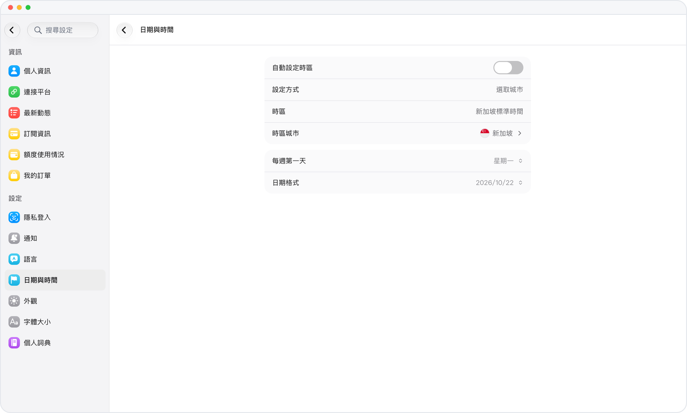

*示意圖，使用虛構演示資料。*

### [按類型和階段，管好每段關係](releases/crm-2026-10-10-relationship-types.zh-HK.md)

**預覽** · 2026-10-10 · `0.1.1.4799`

關係按類型分組，設置各自的階段與里程碑，按類型或階段篩選，每段關係走到哪步一目瞭然。

### [改過的文件，每一版都留得住](releases/crm-2026-10-10-revised-office-files.zh-HK.md)

**預覽** · 2026-10-10 · `0.1.1.4799`

修訂後的 Word、Excel、PowerPoint 另存為新文檔，原版不被覆蓋；Word 修改以修訂痕跡呈現，先審後收。

*示意圖，使用虛構演示資料。*

### [淺色、深色，隨你選](releases/crm-2026-10-10-appearance-settings.zh-HK.md)

**預覽** · 2026-10-10 · `0.1.1.4799`

「外觀」頁可選跟隨系統、淺色或深色，Mars 跟着你的習慣來；語言設置單獨成頁。

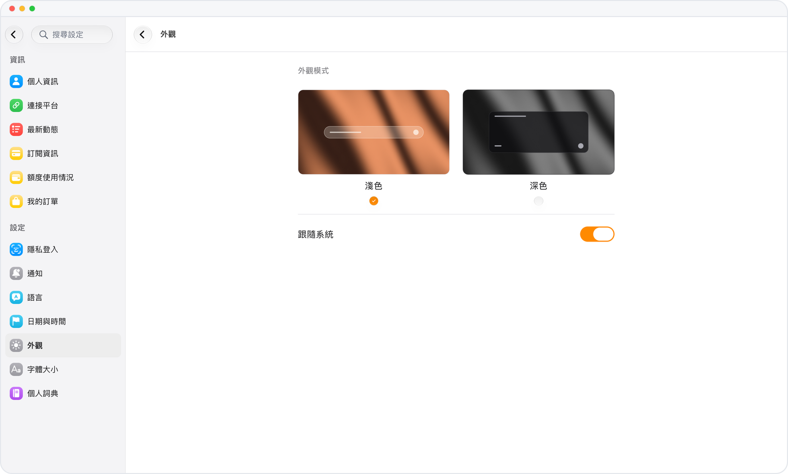

*示意圖，使用虛構演示資料。*

### [壓縮包裏有什麼，不解壓就知道](releases/crm-2026-10-10-archive-previews.zh-HK.md)

**預覽** · 2026-10-10 · `0.1.1.4799`

預覽 RAR 和 ZIP 文件即可列出包內文件，不用下載解壓就知道里面有什麼。

*示意圖，使用虛構演示資料。*

### [人在哪裏，時間就對到哪裏](releases/crm-2026-10-07-time-zone-setting.zh-HK.md)

**預覽** · 2026-10-07 · `0.1.1.4285`

時區可跟隨設備或選擇城市，對話、提醒、事件與用量記錄都按你所在地顯示，不用換算時差。

*示意圖，使用虛構演示資料。*

### [不開着 Mars，也不錯過消息](releases/crm-2026-10-07-notifications-page.zh-HK.md)

**預覽** · 2026-10-07 · `0.1.1.4285`

設置中的「通知」頁集中管理瀏覽器推送、回答完成提醒和日程提醒，不開着 Mars 也不錯過。

*示意圖，使用虛構演示資料。*

### [週期安排，設一次就夠](releases/crm-2026-10-07-repeating-events.zh-HK.md)

**預覽** · 2026-10-07 · `0.1.1.4285`

事件和提醒可按提前量、重複規則、星期、時間和結束日期自動重複，週期安排設一次就夠。

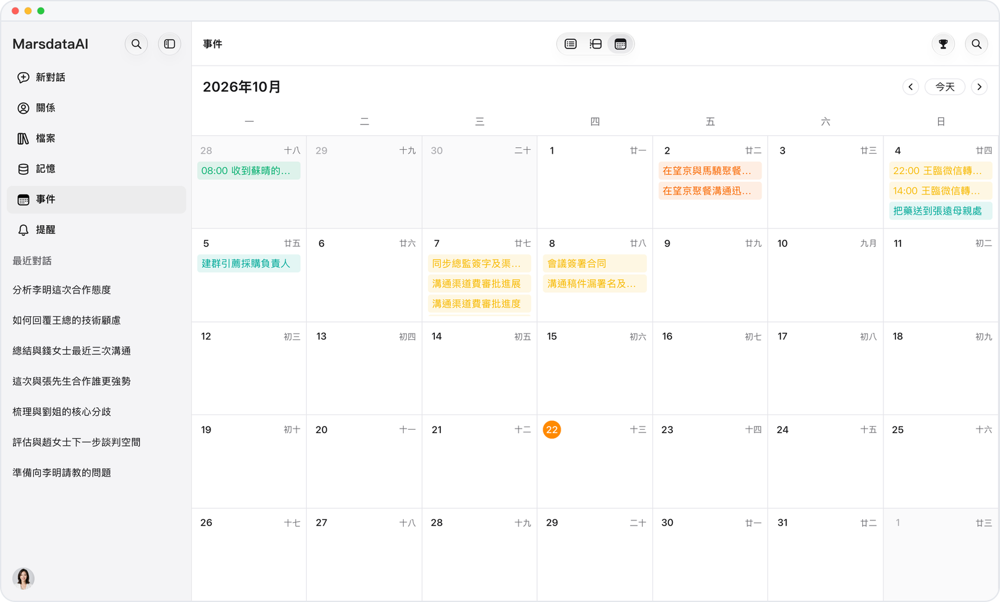

*示意圖，使用虛構演示資料。*

### [字號隨你調，長對話讀得舒服](releases/crm-2026-10-07-text-size.zh-HK.md)

**預覽** · 2026-10-07 · `0.1.1.4285`

一個字體大小設置，統一縮放對話、聯繫人、記憶、事件、資料庫和設置頁，長對話讀得更舒服。

*示意圖，使用虛構演示資料。*

### [分享隨時收回，舊回答一搜就到](releases/crm-2026-10-07-stop-sharing-and-wider-search.zh-HK.md)

**預覽** · 2026-10-07 · `0.1.1.4285`

分享鏈接可隨時「取消分享」收回；工作區搜索覆蓋對話正文，憑一句原話就能找回舊回答。

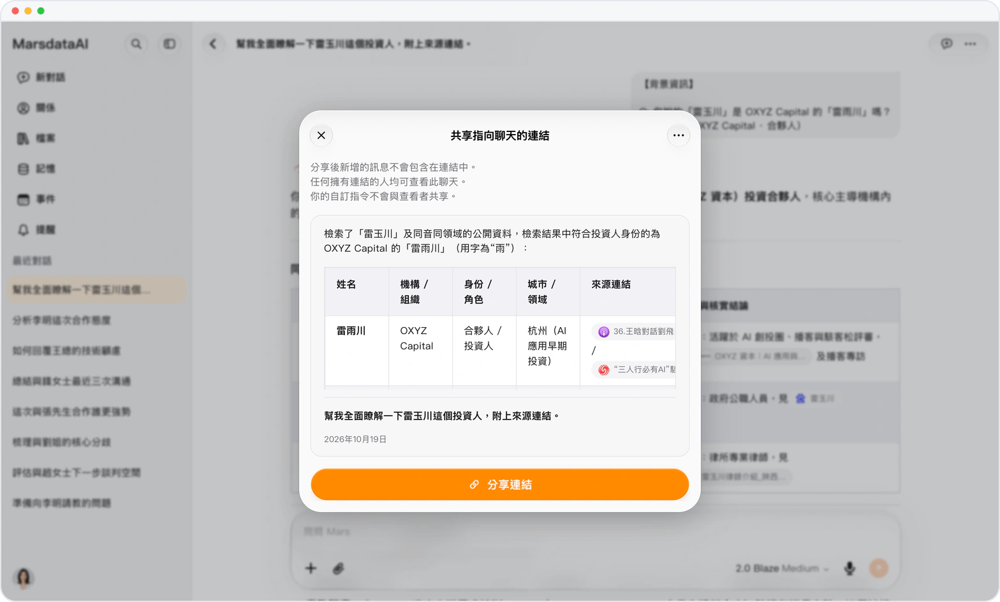

*示意圖，使用虛構演示資料。*

### [誰和誰認識，Mars 幫你記着](releases/crm-2026-10-07-relationships-between-contacts.zh-HK.md)

**預覽** · 2026-10-07 · `0.1.1.4285`

記錄兩位聯繫人之間的關係，各有類型與摘要，誰和誰認識清清楚楚。

### [用量高峯和退款，一頁看清](releases/crm-2026-10-07-usage-records.zh-HK.md)

**預覽** · 2026-10-07 · `0.1.1.4285`

用量記錄支持日、周、月視圖，標出高峯與低谷時段和退款，可按調用類型篩選，花在哪裏一頁看清。

*示意圖，使用虛構演示資料。*

### [日曆記下真正發生的事](releases/crm-2026-10-07-event-status.zh-HK.md)

**預覽** · 2026-10-07 · `0.1.1.4285`

事件可標記為計劃中、已發生或已取消，日曆記下真正發生的事；滑動或右鍵即可完成、編輯、刪除。

*示意圖，使用虛構演示資料。*

### [關於你的信息，一個主題一張卡](releases/crm-2026-09-30-grouped-personal-memory.zh-HK.md)

**預覽** · 2026-09-30 · `0.1.1.3581`

個人記憶按主題合併成一張張卡片，空字段不再佔行，關於你的信息一處看全。

*示意圖，使用虛構演示資料。*

### [每條信息，都能回到出處核對](releases/crm-2026-09-28-what-mars-learned-with-sources.zh-HK.md)

**預覽** · 2026-09-28 · `0.1.1.3543`

聯繫人頁面列出 Mars 瞭解到的信息，每條附原話和來源鏈接，自動識別的由你確認，有據可查。

*示意圖，使用虛構演示資料。*

### [看一天的同時，整月盡收眼底](releases/crm-2026-09-23-month-events-beside-the-day.zh-HK.md)

**預覽** · 2026-09-23 · `0.1.1.3475`

日視圖旁列出整月日程，小日曆用圓點標出有日程的日子，哪天忙一目瞭然。

*示意圖，使用虛構演示資料。*

### [PDF 一路往下滾，像讀長文一樣](releases/crm-2026-09-12-continuous-pdf-reading.zh-HK.md)

**預覽** · 2026-09-12 · `0.1.1.3383`

資料庫裏的 PDF 一路往下滾着讀，縮略圖一點就跳頁；文件都以首頁作縮略圖，一眼認出。

*示意圖，使用虛構演示資料。*

### [方案並排比，買前看清楚](releases/crm-2026-09-04-a-clearer-plans-page.zh-HK.md)

**預覽** · 2026-09-04 · `0.1.1.3352`

新的訂閲頁三個方案並排比較，權益一點就看全，購買欄固定在底部，付款前就清楚能得到什麼。

*示意圖，使用虛構演示資料。*

<!-- mars-crm-preview:end -->

## 已正式上線的歷史更新

**Marsdata AI**（亦稱 Mars Agent）的每一次產品變化。Marsdata 是一個替你維護關係的 AI。本倉庫鏡像自 [https://marsdata.ai/changelog](https://marsdata.ai/changelog)。

> 內容以官網為準：[https://marsdata.ai/changelog](https://marsdata.ai/changelog)

## [從更新日誌登錄，完成後回到原來的位置。](releases/2026-08-15-sign-in-from-the-changelog-and-return-right.zh-HK.md)

`0.1.1.2928` · 2026-08-15

- **修復** — 從更新日誌頁登錄時，登錄完成後現在會直接回到更新日誌，不會再被送到首頁。已經登錄後直接打開更新日誌的行為保持不變。

## [讓 Mars 幫你整理 Atlas，並重新連好每一個關係圈層。](releases/2026-08-15-ask-mars-to-curate-your-atlas-and-reconnect.zh-HK.md)

`0.1.1.2922` · 2026-08-15

- **新功能** — 你現在可以直接讓 Mars 幫你整理 Atlas——把某個人移到正確圈層、置頂或隱藏人物、調整圈層的突出程度，以及確認或忽略一段關係，不再需要手動改檔案。
- **改進** — Atlas 現在會依據完整的人物名冊來組織關係圈層。無論一個人來自結構化檔案還是關係歷史，都能參與歸類；當其中一處資料不完整時，恢復回來的聯繫人也會重新回到所屬圈層，而不是一直停留在未關聯狀態。
- **改進** — 關係圈層現在更容易瀏覽和定位。每一行都有清晰的顏色標記，收起圈層列表時搜索框寬度保持穩定，預覽也會使用與 Atlas 本身一致的關係視圖。

## [Atlas 把你的關係組織成清晰而鮮活的圈層。](releases/2026-08-13-atlas-turns-your-relationships-into-distinct-living-circles.zh-HK.md)

`0.1.1.2873` · 2026-08-13

- **新功能** — Atlas 現在會把你的關係圖譜組織成一個個清晰的圈層。每個圈層都有自己的顏色，聚焦後會顯示其中的人；同一個人如果橫跨你生活裏的多個部分，也可以同時出現在多個圈層中。Mars 暫時無法歸類的人仍會以未分組星球留在圖上，不會再被塞進一個帶有敷衍意味的兜底分類。
- **改進** — 暱稱、新名字和無法確定的對應關係，不會再被默認合併成同一個人。身份不明確時，Mars 會先請你確認，再合併檔案、展示個人信息或寫入新內容；而一個明確的新人物仍然可以直接加入，不會卡在反覆確認裏。
- **修復** — 在同一條消息裏告訴 Mars 兩個人的情況，每個人的更新現在都會保留各自的結果。即使其中一項需要進一步確認，已經成功的內容也會繼續保存；合併後再拆分時會恢復到正確檔案；如果只完成了一部分，Mars 會如實説明，不再籠統地説全部成功。
- **改進** — 網頁端回答不再被一條統一的簡短規則強行壓縮。問題需要背景和解釋時，Mars 現在可以完整展開；簡單問題仍然可以保持簡潔。

## [你想發送的話，現在可以直接複製。](releases/2026-08-11-the-words-you-mean-to-send-now-arrive.zh-HK.md)

`0.1.1.2820` · 2026-08-11

- **新功能** — 當 Mars 寫出一段你要發出去的話——開場、回覆、一句用來把事情説圓的消息——它現在會單獨成卡，帶自己的複製按鈕，複製到的就是你要發的那段話本身：沒有標題、沒有解釋、沒有引號。普通回答和整段複製保持原樣。目前先上網頁端。
- **新功能** — 問 Mars 該不該做某件事，它現在會同時算兩本賬：一本是現實的代價與結果，另一本是這個選擇對「你是誰」意味着什麼的那條私人規則。第二本賬只從你真正説過的話裏搭起來，用假設的語氣而不是下判決，並且指出哪一個觀察就能推翻它——而當它不知道對方會怎麼反應時，它會問你，而不是替對方編一個反應。
- **改進** — 再次開啓深度研究時，現在會直接開一個新的空對話，而不是彈窗問你要不要在當前這輪裏重啓。第一次開啓、關閉該模式、以及免費版的升級提示都和原來一樣。
- **修復** — 回答重新逐字出現。一個本來只該處理運行記錄請求的安全層，把逐字輸出的通道也一起匹配上了，於是它把每個字都攢着，最後一次性回放整段——實測是先靜默十五秒，然後三十條事件在三毫秒內湧出。模型一直都在正常逐字輸出。
- **修復** — 回答途中鎖屏，回來時文字會繼續走。原先「保護正在生成的回答不被覆蓋」這條規則認的是連接而不是這次運行，所以後台一斷連，一份更早的存檔就接管了顯示，畫面上的文字因此卡住——或者一段一段地跳。
- **修復** — 一輪結束後沒有內容可顯示時，Mars 現在會明説。當模型「想完了但沒開口」，你會看到一條明確的重試提示，並且這條提示會留在對話裏，而不是一閃而過——取代原來的空氣泡。另外，沒能恢復出來的回覆不會再被標成「已成功完成」。
- **修復** — 圖片、視頻、文檔重新能被模型讀到。八月初有一段時間，每個上傳都在送進模型的路上被靜默丟掉：文件存下來了、在你自己的氣泡裏也顯示出來了，然後模型轉頭問你要一張你剛剛已經發過的截圖。
- **修復** — 以前會變成一堆源碼的圖表和思維導圖，現在能正常畫出來。當底層描述缺了括號、帶了全角標點或不可見字符、或者整段擠在一行時，現在會先修好再渲染，而不是把源碼攤給你、或者報一句「轉換失敗」。真正讀不懂的內容仍然退回代碼顯示，不會瞎猜。
- **改進** — Mars 只在真的寫進去之後才説「已記下」。現在每一次寫入某個人的檔案都會帶回一張回執，沒有回執的説法會在給你看之前被糾正——「記下了」不再是模型出於禮貌就能説出口的話。
- **改進** — 一口氣告訴 Mars 關於某個人的六件事，六件都會被記下。它們原先會被拆成六次互相搶佔的寫入，只有一次落庫、其餘撞上單輪上限被丟掉——而回答卻把六件都確認了一遍。現在一次寫入就帶上全部字段，每個字段各自蓋上授權它的那句原話。
- **修復** — 刪除一個人時，現在也會一併清掉他曾用過的稱呼。整節點刪除以前會留下別名表裏仍然寫着這個人，底層文件夾也是沒核對就報「已刪除」；這兩處現在都會在報成功之前核實，真的殘留下來的部分會明確告訴你這是一次未刪淨的刪除，而不是乾淨收場。
- **修復** — 日誌條目讀回來的時間就是它發生的時間。原先北京時間晚上十點寫下的一條，讀出來是凌晨兩點，而且有一段時間當天的條目其實根本沒落到記錄裏。刪除一條偏好現在是真的刪掉，不再只是清掉文字、把那行數據留在原地。
- **修復** — 再次提到一筆早前的轉賬，Mars 會先問你，而不是直接記成第二筆。原先重述一筆時間較久的付款會繞過查重那一步；另外，還在等你確認的條目有可能被當成已結清算進總額裏。
- **修復** — 手機號的綁定和解綁現在真的能用了。首次綁定從來就沒把驗證碼發出去過；解綁會把你踢下線、號碼卻還留着；「解綁」按鈕則對每一次點擊都回一句登錄已失效。現在這兩個操作還並排排成了實心膠囊按鈕，和下面一行的微信綁定面板用同一套視覺語言。
- **改進** — 歡迎頁打開時不再等它背後的活幹完。原先頁面要先當場生成那份關係解讀——八個掃描器加一次計費的撰寫調用——才肯響應，而在這期間進來的第二個請求還得排在第一個後面。現在它直接給出已經備好的內容，下一批在頁面加載完之後再準備。
- **修復** — iPhone 上已登錄的用户不會再落到一個畫了一半的頁面上。Safari 完全沒有實現緩存判斷所依賴的那個接口，於是已登錄的 iOS 用户被髮到了頁面的匿名副本——發版之後就是上一版的副本，它引用的資源地址已經不存在了——結果加載出來只有頂欄，既沒有輸入框也沒有側邊欄。現在這道判斷不再依賴那個接口，加載失敗的頁面也會自己重新載入。

## [你認識的每一個人，都成為一份結構化檔案。](releases/2026-08-01-every-person-you-know-becomes-a-structured-record.zh-HK.md)

`0.1.1.2598` · 2026-08-01

- **新功能** — 你告訴 Mars 的每一個人，現在都以結構化檔案保存——每條信息都是獨立字段，旁邊並列着這個人的互動日誌、往來賬本和變更記錄。改一條只改這一條；刪一條，這個人以及其餘信息、歷史記錄原樣保留。
- **改進** — 一個人只有一個節點。同一個人不再被拆成多條記錄，「相親對象」這類稱呼也不會再被當成一個人；同一筆轉賬只入賬一次。
- **改進** — Mars 自動記錄的信息現在帶有置信度。有把握把兩條判定為同一個人、同一筆錢時，它會明確告訴你，而不是悄悄合併；沒把握時——尤其涉及金額——會先暫存並來問你，還在等你確認的條目不計入總額。
- **改進** — 你的個人記憶——目標、偏好、自我檔案——現在每一輪都被完整讀取，而不是隻檢索出其中一部分，Mars 不會再漏掉你已經説過的事。
- **修復** — 刪除就是真的刪除。你刪掉的人或某條信息不會再從舊副本里復活，Mars 也不會再把已經刪掉的數值當成現狀複述出來。
- **新功能** — 歡迎頁的關係卡片從「向你提問」變成「給你答案」。點一下，Mars 直接給出它已經做好的分析——誰最近冷下來了、還有哪些承諾沒兑現、剛認識的人裏誰最值得繼續跟進——而不是丟給你一個空白輸入框。
- **新功能** — 在對話裏 @ 某個人，Mars 現在讀取的是這個人的結構化檔案——字段、最近往來、賬本——你剛剛修正或刪除的信息，下一句回答裏就會體現。
- **新功能** — 發一張聊天或轉賬截圖，裏面的事實會自動沉澱進這個人的檔案——包括完全不涉及金額的往來，這類記錄以前沒有落腳點。
- **新功能** — 登錄不再需要密碼——沒有註冊流程，也沒有密碼要記。已經設過密碼的用户，入口仍留在登錄卡片上。
- **新功能** — 新增繁體中文（香港）：產品界面、官網頁面與關係相關視圖均已完整支持。
- **修復** — 對已完成的研究報告追問時，Mars 會基於報告本身作答，而不是把整個研究重做一遍。長任務進行中刷新頁面，也能重新實時看到進展，而不是一片安靜直到任務結束。
- **修復** — 導入的技能重新可以被找到——此前部分技能導入後雖然保存成功，卻始終無法被調用，等於靜默失效。

## [在對話裏直接 @ 一個人。](releases/2026-07-24-mention-a-person-right-inside-the-chat.zh-HK.md)

`0.1.1.2383` · 2026-07-24

- **新功能** — 現在可以在對話裏直接 @ 一個人——輸入 @ 就會默認打開「關係」列表，把你和 Mars 聊過的人一鍵帶進消息，對方的關鍵信息會自動附帶。
- **新功能** — 上傳一張聊天截圖，Mars 會讀懂對話風格，並主動幫你把它存成專屬這個人的「回覆教練」——一鍵就變成可複用的技能，之後隨時用 / 調用。
- **改進** — 存好回覆教練後，Mars 現在會主動給你一條確認——存了什麼、下次會自動認出這個人、以及怎麼調用——再也不用猜到底存沒存上。
- **新功能** — @ 某個人時，消息裏會直接展示一張豐富的關係卡片——最近的信息、最新的往來記錄和一段簡短檔案摘要，不再只是一個光禿禿的名字標籤。

## [三大模型全面升級為 1.7。](releases/2026-07-22-all-three-models-step-up-to-1-7.zh-HK.md)

`0.1.1.2353` · 2026-07-22

- **新功能** — 三大模型全面升級：1.6 升級為 1.7。mini 換上新一代極速模型；think 和 pro 雙雙搭載本週剛發佈的最新旗艦引擎——think 側重響應速度，pro 側重最深的推理深度。複雜分析和長任務明顯更聰明，且單次回答的消耗反而更低。
- **改進** — 記憶也變聰明瞭——從對話中自動記錄人物和事實的引擎同步升級為新一代模型，Mars 記住的內容更準確、更有條理。

## [Atlas · 關係星雲上線了。](releases/2026-07-20-atlas-relation-nebula-is-live.zh-HK.md)

`0.1.1.2324` · 2026-07-20

- **新功能** — 全新「Atlas · 關係星雲」——你的人際關係 3D 星圖。你和 Mars 聊過的每個人都是一顆星；點一下飛近聚焦，這個人的關鍵信息會像衞星一樣環繞在旁，再點一下打開完整檔案。支持搜索、快捷跳轉和全屏模式，桌面端和手機都專門調校過。
- **新功能** — 深度研究報告也進入了星圖——每個研究主題是一顆行星，環繞的衞星就是當次研究各篇文檔的標題；點開行星即可瀏覽並閲讀全部文檔，包括完整報告和每個維度章節。
- **新功能** — 支持 +86 手機號登錄——短信驗證碼帶實時有效期倒計時。設置裏新增「賬號與安全」：可綁定、更換或解綁手機號、修改密碼，還能直接在應用內閲讀隱私政策。
- **新功能** — 現在完整支持上傳 PowerPoint（.pptx/.ppt）、Word（.doc）和 Excel（.xls）文件——Mars 會真正讀取其中的內容，而不再跳過。
- **新功能** — 複製回覆時現在會保留排版——標題、表格和列表能幹淨地粘貼進文檔，圖表和示意圖也會作為圖片一併帶上。
- **改進** — 從歷史打開對話更快也更可靠了——冷啓動打開不再卡頓，加載骨架屏總會正常退出而不是一直掛着，從歡迎頁跳轉歷史對話偶發白屏的問題也已修復。
- **改進** — 頁面加載更快，高峯時段回覆起步更早——首次訪問的歡迎頁幾乎秒開，高負載下的響應啓動時間提升了一個數量級。
- **修復** — 輸入框裏打了一半的文字現在能在頁面刷新後保留——草稿按對話保存，誤刷新不再吃掉你的消息。
- **修復** — 圖表與公式渲染修復：四象限圖現在渲染為清晰的交互式圖表，時間線圖能容忍更多格式瑕疵，跨行的塊級公式也能正確渲染而不再顯示原始符號。

## [每個你提到的人，都會有一份自己的檔案。](releases/2026-07-06-everyone-you-mention-now-gets-their-own-dossier.zh-HK.md)

`0.1.1.2173` · 2026-07-06

- **新功能** — Mars 現在會自動為你提到的每個人建立結構化檔案——身份、背景、關係脈絡、關鍵互動和綜合價值判斷會從對話中自動提取到獨立的數據記錄裏，並在人物頁上彙總呈現。你已經告訴過 Mars 的細節不會再被新信息悄悄覆蓋；當兩條記錄被確認是同一個人時，合併後雙方的信息也會完整保留。
- **新功能** — 當你聊到一個 Mars 已經認識的人時，這場對話會自動歸入這個人的文件夾——關於同一個人的內容自動聚在一處，不用手動整理。
- **改進** — 人物詳情頁在電腦上的排版更清爽了——互動記錄、人物畫像和關鍵信息改為三欄並排展示，不再一路下拉；重複出現的畫像文本已去掉；記憶面板的標題和新寫入的記憶內容現在也會跟隨你選擇的語言。
- **改進** — 打開對話更可靠了——修復了對話可能永遠卡在加載骨架屏上的問題（多發生在服務剛重啓後、或恰好在切換對話的瞬間）；加載畫面現在總會在幾秒內退出。
- **改進** — 對話中在 Wi-Fi 和蜂窩網絡之間切換時恢復明顯更快了——滯留在舊網絡上的請求會被立即中斷並重試，而不再一直掛着不動。
- **改進** — 服務器現在能自動檢測並恢復一種罕見的內部卡死狀況——此前這種情況會讓所有人的回覆掛起，需要人工介入才能恢復。
- **修復** — 上傳的 Excel（.xlsx）文件現在會被真正讀取和分析——此前文件會在傳輸途中被靜默丟棄，Mars 可能因此轉而分析到不相關的數據。
- **修復** — 一批渲染修復：像「$6,000$」的金額和「$1/3$」的分數現在能正確渲染為公式，而不是顯示成美元符號；標籤裏帶中文引號的流程圖不再畫不出來；缺少結尾標記的圖表塊也能正常渲染，而不是顯示原始代碼。
- **改進** — 歡迎頁在 iPhone 上更順滑了——發光動畫在所有設備上都以全畫質渲染（可見的色帶瑕疵消失了）；輸入框在 Safari 裏展開時不再突然跳動；點擊輸入框彈出鍵盤時，頁面也不會再被頂得亂跑。

## [「項目」上線，把一攤事集中在一個空間裏。](releases/2026-06-23-projects-keep-one-topic-in-one-clean-space.zh-HK.md)

`0.1.1.2098` · 2026-06-23

- **新功能** — 「項目」上線了——你可以把相關的對話歸到一起，讓一整個主題、一個人、或一攤事務集中放在一個清爽的空間裏，而不再散落在長長的對話列表中。打開一個項目，屬於它的內容會一併呈現在你眼前。
- **新功能** — 每個項目現在會自動把裏面各場對話中出現的圖片和媒體收攏到一起——你在某個主題下分享過的照片和文件會集中顯示，不用再手動整理。
- **新功能** — 你現在可以給項目起名字、挑一個顏色，並隨時在一個簡單的設置面板裏重命名或刪除它——讓每個項目一眼就能區分開。
- **改進** — 項目視圖的排版更清爽了——標題欄在滾動時固定不動，側邊欄會自動收起，把更多空間留給你的內容。

## [Mars 現在能感知你們之間流逝的時間。](releases/2026-06-18-mars-now-feels-the-time-that-passed-between.zh-HK.md)

`0.1.1.2018` · 2026-06-18

- **新功能** — Mars 現在能感知一段對話裏的時間流逝了。當你隔了幾天再回來，它會注意到這中間過了多久，而不是當作什麼都沒發生、接着講舊劇情——也就不會再催你去做一件可能早已過去的事。它會先算一下距離上次聊天過了多長時間，在繼續之前先確認一下哪些情況可能已經變了。
- **改進** — Mars 在「拿不準的事」上更誠實了。隔了較長時間之後，它不再自顧自地沿用過時的假設，而是會先問問你現在進展到哪一步了——大大減少了那種「拿着好幾天前的舊信息繼續辦事」的張冠李戴。

## [首頁更流暢，回答更貼題。](releases/2026-06-14-a-smoother-home-screen-answers-shaped-to-the.zh-HK.md)

`0.1.1.1967` · 2026-06-14

- **改進** — 首頁現在更流暢、也更省電了——歡迎頁上那團發光動畫會在較舊或較慢的手機上自動變輕，不再卡頓；當你把它滑出屏幕時也會自動「歇一下」。整體看起來也更乾淨了一點。
- **改進** — Mars 現在會用更貼合你問題的方式來回答——你問「怎麼做」，它會先把答案給你；你想聽某件事該怎麼決定，它會先帶你把思路理一遍；而當你只是想找人説説時，它會先好好聽、先回應你的心情。

## [記憶面板變成了一張關係圖譜。](releases/2026-06-13-the-memory-panel-became-a-relationship-graph.zh-HK.md)

`0.1.1.1959` · 2026-06-13

- **新功能** — 記憶面板現在會以「關係圖譜」呈現：Mars 記住的人和話題圍繞中心節點排列，每個節點的大小反映它掌握的詳細程度，點擊任一人物即可打開完整檔案。Mars 在「記什麼」上也更謹慎了：不會再把本屬於別人的特徵記到你名下；當你刪除一個人物或一個記憶文件夾時，它們現在會真正被刪除，而不會再從過往聊天記錄裏悄悄重新長出來。
- **新功能** — 選中回覆裏的任意文字，現在會彈出一個小工具欄——你可以把它直接引用到下一條消息裏，或者讓它朗讀出來。按鈕文字會跟隨你選擇的語言。
- **改進** — 打開歷史對話、在多個對話之間切換明顯更快了——列表會逐步渲染，剛打開過的對話幾乎瞬間就能看到內容。它也更穩健了：在你剛打開 App 時偶發的一次短暫卡頓，不再會讓「下滑加載更多」失靈、也不會讓文件夾裏的對話消失——列表會在你繼續下滑時自動恢復。
- **改進** — App 的首屏加載更快、也更乾淨了——訪客現在會立即看到真正的首頁，而不是先閃一下灰色骨架；已登錄用户也不會再在進入工作區之前瞬間閃過未登錄的介紹頁。
- **改進** — 上傳大體積或較長的視頻現在穩定可靠了——之前的時長限制已取消，視頻也不再需要在瀏覽器裏重新壓縮後才能發送，上傳佔位會立即出現，讓你看得到正在進行。同時修復了 iPhone 上視頻上傳可能卡住、遲遲傳不完的問題。
- **改進** — 較長、較複雜的任務現在結束得更體面——當 Mars 觸及內部安全上限時，會給你一個真正可用的答案，而不是一句籠統的「已停止」；它也不會再把已經完成的動作（比如保存你的數據）誤判為失敗。
- **改進** — 加強了對你賬號和數據的保護——修復了幾個信息可能被跨賬號訪問的問題，強化了應對 Mars 為你閲讀的頁面中隱藏惡意內容的防護，並收緊了你數據沙箱的安全防護。
- **改進** — 彈窗確認、提醒以及「額度已用完」的提示，現在都會按你選擇的語言顯示，而不是固定一種語言。
- **改進** — 在 iPhone 和 iPad 上，從主屏幕啓動 Mars 現在會直接進入與 App 風格一致的深色啓動頁，而不是先閃一下白屏。
- **修復** — 停止按鈕現在能可靠地停下正在生成的回覆；在 Mars 生成第一個回覆的過程中就開始輸入新消息，也不會再意外創建出一個重複的對話。
- **修復** — 生成圖片更順了——圖片生成過程中佔位圖不再閃爍；當 Mars 一次生成多張圖片時，它們現在會以畫廊形式一起展示。
- **修復** — 寫在表格單元格里的數學公式，現在能正常渲染，而不是顯示成原始代碼。
- **修復** — 抖音直播數據裏顯示的時間現在是正確的了——之前會偏差八個小時。
- **修復** — 使用 Apple 登錄並選擇隱藏（中轉）郵箱時，不再會偶爾把兩個獨立的賬號合併成一個。
- **修復** — 存儲面板更穩定、信息也更全了——在高分辨率 Windows 屏幕上不再抖動，並且現在會列出內置的數據表以及你在每張表裏的行數。

## [需要操作瀏覽器的長任務，從頭到尾更穩了。](releases/2026-06-01-long-browser-tasks-now-hold-together-end-to.zh-HK.md)

`0.1.1.1828` · 2026-06-01

- **改進** — 長任務、尤其是需要 Mars 幫你操作瀏覽器的任務（登錄某個網站、逐頁點擊瀏覽、抓取數據），現在能從頭到尾穩定完成了。此前同一個對話有時會在中途被悄悄交接到不同的服務器，導致瀏覽器裏已登錄的會話丟失、瀏覽器任務卡住或失敗。現在每個對話都會固定在同一處處理，瀏覽器會話也會共享，因此瀏覽器能保持登錄狀態，在長對話中接着之前的進度繼續操作。

## [Deep Research 重寫：更深，也更安全。](releases/2026-05-26-deep-research-rewritten-deeper-and-safer.zh-HK.md)

`0.1.1.1803` · 2026-05-26

- **新功能** — Deep Research（深度研究）模式做了一輪重寫，更深也更安全：現在會先做一輪快速預搜索再讓你確認研究問題（讓候選問題真正貼合可查到的資料），收集來源後還會跑一輪交叉核驗；過程中會把長報告增量備份到雲端，萬一最終合成被網絡波動或關掉頁面打斷，草稿可以恢復，不用從零再來。另外，這個模式現在會等你真正確認了問題再開始動手，而且如果最終報告寫得過於稀薄，會被自動攔下不直接拋給你
- **修復** — 之前一段時間內偶爾出現「打開後只剩空骨架屏」的對話現在已經能正常加載；同時修復了一個更隱蔽的問題——單個異常對話會把整個側欄列表 500 掉。受影響過的對話現在應該都能打開，側欄列表也會穩定顯示
- **改進** — 朗讀播放更像人在唸回覆了——播放按鈕不再把 JSON 大括號、代碼圍欄、特殊 HTML 格式塊也念出來；推送通知的預覽正文也用上了同一套清理，鎖屏看到的提示文字現在是自然的語句，不再是裸 markdown
- **修復** — Mermaid 圖表現在能在較舊的 iPhone（iOS 16）上正常渲染——修復了之前在這些設備上圖表顯示空白的兼容性問題
- **修復** — 數學公式裏同時出現轉義貨幣符號和數字的寫法（比如「$\$72億$」）現在不再渲染成一個紅色 LaTeX 報錯，公式會正常顯示
- **修復** — 推送通知現在能穩定地送達你啓用過的每一台設備——此前的實現存在一個競態：多台設備會悄悄互相把對方的訂閲置為失效，導致「任務完成」推送對一些用户長時間收不到。現在訂閲按設備獨立跟蹤，全局收斂
- **改進** — 微信視頻號登錄流程更順：當 Mars 打開一個需要你登錄的視頻號頁面時，右側面板現在會自動接管讓你完成登錄，登完之後任務繼續。面板在沒東西可顯示時也不會再以空白麪板形式出現；同一對話裏你已登錄的憑據現在也會正確地傳給後續會話
- **修復** — 較長 AI 回覆中偶爾出現的「空白灰色段落框」不再出現
- **修復** — 側欄頂部的對話標題在第一輪迴復時不再會先顯示一個臨時猜測再切換到正式標題——現在標題會從你的第一條消息一次性確定，避免來回閃爍

---

[English](./CHANGELOG.md) · [简体中文](./CHANGELOG.zh-CN.md)
