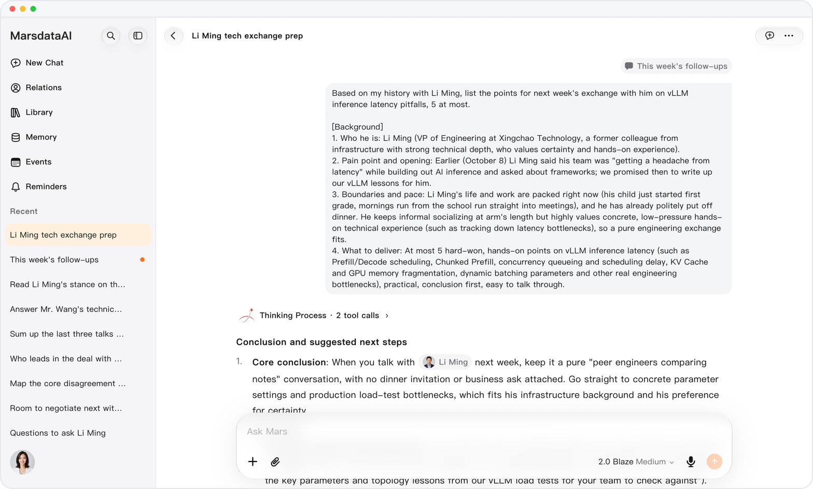

<!-- mars-crm-preview:start -->
# Mars — product updates

> **Preview** — These features are available in the preview version and have not been generally released.

[Explore the preview](https://marsdata.ai) · [English](./README.md) · [简体中文](./README.zh-CN.md) · [繁體中文](./README.zh-HK.md)

## Preview updates

*Illustration using fictional demo data.*

- **2026-10-31** · [Mars hands work to a fresh conversation](releases/crm-2026-10-31-conversations-that-hand-off-work.md) · Preview · `0.1.1.9443`
- **2026-10-31** · [The insights you need, filtered first](releases/crm-2026-10-31-filter-relationship-insights.md) · Preview · `0.1.1.9443`
- **2026-10-28** · [Mars, inside your Feishu](releases/crm-2026-10-28-mars-in-feishu.md) · Preview · `0.1.1.8920`
- **2026-10-28** · [Build on what Mars already said](releases/crm-2026-10-28-quote-past-conversations.md) · Preview · `0.1.1.8920`
- **2026-10-27** · [Ask once, land on the right setting](releases/crm-2026-10-27-open-settings-from-an-answer.md) · Preview · `0.1.1.8292`
- **2026-10-26** · [Mars on your Mac, room to see it all](releases/crm-2026-10-26-mars-for-mac.md) · Preview · `0.1.1.8385`
- **2026-10-26** · [From their handle to a chat in one tap](releases/crm-2026-10-26-open-social-accounts-in-one-tap.md) · Preview · `0.1.1.8385`
- **2026-10-25** · [Add your thought mid-answer](releases/crm-2026-10-25-add-to-a-running-answer.md) · Preview · `0.1.1.8208`
- **2026-10-25** · [What a role pays, from live postings](releases/crm-2026-10-25-what-a-role-pays.md) · Preview · `0.1.1.8208`
- **2026-10-24** · [Mars in one tap, no app to open](releases/crm-2026-10-24-mars-widgets-on-iphone.md) · Preview · `0.1.1.7959`
- **2026-10-24** · [One request, a deck ready to present](releases/crm-2026-10-24-mars-makes-decks-and-documents.md) · Preview · `0.1.1.7959`
- **2026-10-23** · [Mars reads the web, never your login](releases/crm-2026-10-23-read-pages-without-your-login.md) · Preview · `0.1.1.7618`
- **2026-10-23** · [What's worth your time comes first](releases/crm-2026-10-23-sort-by-value.md) · Preview · `0.1.1.7618`
- **2026-10-22** · [Know what they say on camera](releases/crm-2026-10-22-mars-watches-social-videos.md) · Preview · `0.1.1.7433`
- **2026-10-22** · [Share only with the people you choose](releases/crm-2026-10-22-share-links-with-a-password.md) · Preview · `0.1.1.7433`
- **2026-10-21** · [See every day of your trip on one map](releases/crm-2026-10-21-plan-trips-on-a-map.md) · Preview · `0.1.1.6886`
- **2026-10-20** · [Diagrams: 86% lighter, near-instant](releases/crm-2026-10-20-faster-adaptive-diagrams.md) · Preview · `0.1.1.6573`
- **2026-10-19** · [Know every source before you click](releases/crm-2026-10-19-cited-link-titles.md) · Preview · `0.1.1.6479`
- **2026-10-19** · [2 GB recordings, every moment findable](releases/crm-2026-10-19-long-recordings.md) · Preview · `0.1.1.6479`
- **2026-10-18** · [A batch of pictures, one tidy message](releases/crm-2026-10-18-picture-grids-and-gallery.md) · Preview · `0.1.1.6118`
- **2026-10-17** · [Sign in with the Apple ID you have](releases/crm-2026-10-17-sign-in-with-apple.md) · Preview · `0.1.1.5950`
- **2026-10-17** · [Apple Health summaries, everywhere](releases/crm-2026-10-17-apple-health-sync.md) · Preview · `0.1.1.5950`
- **2026-10-17** · [Health answers that see more of your day](releases/crm-2026-10-17-richer-health-answers.md) · Preview · `0.1.1.5950`
- **2026-10-17** · [Mars asks before it guesses](releases/crm-2026-10-17-question-panel.md) · Preview · `0.1.1.5950`
- **2026-10-17** · [Find any line, act on any answer](releases/crm-2026-10-17-find-in-chat-and-a-new-answer-menu.md) · Preview · `0.1.1.5950`
- **2026-10-17** · [On time, Mars gets started on its own](releases/crm-2026-10-17-reminders-that-start-a-conversation.md) · Preview · `0.1.1.5950`
- **2026-10-17** · [Charts that draw as the answer arrives](releases/crm-2026-10-17-live-charts-and-diagrams.md) · Preview · `0.1.1.5950`
- **2026-10-17** · [iWork and WPS files, right in the chat](releases/crm-2026-10-17-iwork-and-wps-previews.md) · Preview · `0.1.1.5950`
- **2026-10-17** · [See which conversation needs you](releases/crm-2026-10-17-conversation-status-at-a-glance.md) · Preview · `0.1.1.5950`
- **2026-10-17** · [Event reminders, right in WeChat](releases/crm-2026-10-17-wechat-event-reminders.md) · Preview · `0.1.1.5950`
- **2026-10-17** · [Know who to reach today](releases/crm-2026-10-17-relationship-activity-lines.md) · Preview · `0.1.1.5950`
- **2026-10-17** · [Find what you know about anyone, fast](releases/crm-2026-10-17-clearer-information-groups.md) · Preview · `0.1.1.5950`
- **2026-10-17** · [Apple files? Mars still makes the edit](releases/crm-2026-10-17-convert-iwork-files.md) · Preview · `0.1.1.5950`
- **2026-10-15** · [Lend your device, keep Mars locked](releases/crm-2026-10-15-privacy-lock.md) · Preview · `0.1.1.5585`
- **2026-10-15** · [Step up to Mars-2.0 Blaze](releases/crm-2026-10-15-mars-2-0-blaze.md) · Preview · `0.1.1.5585`
- **2026-10-15** · [Subscribe the way you already pay](releases/crm-2026-10-15-plans-on-web-and-ios.md) · Preview · `0.1.1.5585`
- **2026-10-15** · [One thumbs-down, straight to support](releases/crm-2026-10-15-feedback-from-thumbs-down.md) · Preview · `0.1.1.5585`
- **2026-10-15** · [Deep research you can watch](releases/crm-2026-10-15-deep-research-you-can-follow.md) · Preview · `0.1.1.5585`
- **2026-10-15** · [Complex ideas, clear at a glance](releases/crm-2026-10-15-structured-diagrams.md) · Preview · `0.1.1.5585`
- **2026-10-15** · [Keep what Mars makes as real files](releases/crm-2026-10-15-write-files-to-the-library.md) · Preview · `0.1.1.5585`
- **2026-10-15** · [A slip won't cost you a goal or skill](releases/crm-2026-10-15-safer-deletes.md) · Preview · `0.1.1.5585`
- **2026-10-15** · [Reuse your own words with one long-press](releases/crm-2026-10-15-long-press-your-messages.md) · Preview · `0.1.1.5585`
- **2026-10-13** · [Let Mars find the answer in your Gmail](releases/crm-2026-10-13-gmail-read-only.md) · Preview · `0.1.1.5222`
- **2026-10-13** · [Bring the contacts you already have](releases/crm-2026-10-13-import-contacts.md) · Preview · `0.1.1.5222`
- **2026-10-13** · [Answers that use your iPhone, live](releases/crm-2026-10-13-live-iphone-data.md) · Preview · `0.1.1.5222`
- **2026-10-13** · [Phone sign-in, no guesswork](releases/crm-2026-10-13-phone-and-password-sign-in.md) · Preview · `0.1.1.5222`
- **2026-10-13** · [Charts that feel at home on iPhone](releases/crm-2026-10-13-native-charts-on-ios.md) · Preview · `0.1.1.5222`
- **2026-10-13** · [Switch apps. Your answer keeps going.](releases/crm-2026-10-13-answers-that-keep-going.md) · Preview · `0.1.1.5222`
- **2026-10-13** · [Out of credits? Keep finished work](releases/crm-2026-10-13-graceful-credit-limits.md) · Preview · `0.1.1.5222`
- **2026-10-13** · [Your language from the first screen](releases/crm-2026-10-13-your-language-from-the-start.md) · Preview · `0.1.1.5222`
- **2026-10-10** · [Mars in your pocket, on iPhone and iPad](releases/crm-2026-10-10-mars-for-ios.md) · Preview · `0.1.1.4799`
- **2026-10-10** · [Know when a task is done](releases/crm-2026-10-10-native-notifications.md) · Preview · `0.1.1.4799`
- **2026-10-10** · [Dates that read the way you do](releases/crm-2026-10-10-week-start-and-date-format.md) · Preview · `0.1.1.4799`
- **2026-10-10** · [Every relationship, by type and stage](releases/crm-2026-10-10-relationship-types.md) · Preview · `0.1.1.4799`
- **2026-10-10** · [Every revision kept, every edit approved](releases/crm-2026-10-10-revised-office-files.md) · Preview · `0.1.1.4799`
- **2026-10-10** · [Light, dark or automatic: your call](releases/crm-2026-10-10-appearance-settings.md) · Preview · `0.1.1.4799`
- **2026-10-10** · [See inside a RAR or ZIP, no unpacking](releases/crm-2026-10-10-archive-previews.md) · Preview · `0.1.1.4799`
- **2026-10-07** · [Times that match wherever you are](releases/crm-2026-10-07-time-zone-setting.md) · Preview · `0.1.1.4285`
- **2026-10-07** · [Hear about answers and events in time](releases/crm-2026-10-07-notifications-page.md) · Preview · `0.1.1.4285`
- **2026-10-07** · [Set a routine once, and it repeats](releases/crm-2026-10-07-repeating-events.md) · Preview · `0.1.1.4285`
- **2026-10-07** · [Your text size, comfortable reading](releases/crm-2026-10-07-text-size.md) · Preview · `0.1.1.4285`
- **2026-10-07** · [Revoke a link, find any old answer](releases/crm-2026-10-07-stop-sharing-and-wider-search.md) · Preview · `0.1.1.4285`
- **2026-10-07** · [Keep track of who knows whom](releases/crm-2026-10-07-relationships-between-contacts.md) · Preview · `0.1.1.4285`
- **2026-10-07** · [Peak hours and refunds on one page](releases/crm-2026-10-07-usage-records.md) · Preview · `0.1.1.4285`
- **2026-10-07** · [A calendar of what really happened](releases/crm-2026-10-07-event-status.md) · Preview · `0.1.1.4285`
- **2026-09-30** · [What Mars knows, one card per topic](releases/crm-2026-09-30-grouped-personal-memory.md) · Preview · `0.1.1.3581`
- **2026-09-28** · [Every fact Mars learned, with its source](releases/crm-2026-09-28-what-mars-learned-with-sources.md) · Preview · `0.1.1.3543`
- **2026-09-23** · [See the whole month beside the day](releases/crm-2026-09-23-month-events-beside-the-day.md) · Preview · `0.1.1.3475`
- **2026-09-12** · [Read a PDF like a long page](releases/crm-2026-09-12-continuous-pdf-reading.md) · Preview · `0.1.1.3383`
- **2026-09-04** · [Compare plans, then buy with confidence](releases/crm-2026-09-04-a-clearer-plans-page.md) · Preview · `0.1.1.3352`

<!-- mars-crm-preview:end -->

## Previously released product history

Every change we ship to **Marsdata AI** (also known as Mars Agent), the AI that maintains your relationships. This repository mirrors the changelog published at [https://marsdata.ai/changelog](https://marsdata.ai/changelog).

> Canonical source of record: [https://marsdata.ai/changelog](https://marsdata.ai/changelog)

**[All releases](./CHANGELOG.md)** · [Try Marsdata AI](https://marsdata.ai) · Questions? Ask in the discussions of [marsdata-ai](https://github.com/Mars-CRM-Agent/marsdata-ai/discussions)

## All releases

- **2026-08-15** · [Sign in from the changelog and return right where you started.](releases/2026-08-15-sign-in-from-the-changelog-and-return-right.md) · `0.1.1.2928`
- **2026-08-15** · [Ask Mars to curate your Atlas and reconnect every relationship circle.](releases/2026-08-15-ask-mars-to-curate-your-atlas-and-reconnect.md) · `0.1.1.2922`
- **2026-08-13** · [Atlas turns your relationships into distinct, living circles.](releases/2026-08-13-atlas-turns-your-relationships-into-distinct-living-circles.md) · `0.1.1.2873`
- **2026-08-11** · [The words you mean to send now arrive ready to copy.](releases/2026-08-11-the-words-you-mean-to-send-now-arrive.md) · `0.1.1.2820`
- **2026-08-01** · [Every person you know becomes a structured record.](releases/2026-08-01-every-person-you-know-becomes-a-structured-record.md) · `0.1.1.2598`
- **2026-07-24** · [Mention a person right inside the chat.](releases/2026-07-24-mention-a-person-right-inside-the-chat.md) · `0.1.1.2383`
- **2026-07-22** · [All three models step up to 1.7.](releases/2026-07-22-all-three-models-step-up-to-1-7.md) · `0.1.1.2353`
- **2026-07-20** · [Atlas · Relation Nebula is live.](releases/2026-07-20-atlas-relation-nebula-is-live.md) · `0.1.1.2324`
- **2026-07-06** · [Everyone you mention now gets their own dossier.](releases/2026-07-06-everyone-you-mention-now-gets-their-own-dossier.md) · `0.1.1.2173`
- **2026-06-23** · [Projects — keep one topic in one clean space.](releases/2026-06-23-projects-keep-one-topic-in-one-clean-space.md) · `0.1.1.2098`
- **2026-06-18** · [Mars now feels the time that passed between you.](releases/2026-06-18-mars-now-feels-the-time-that-passed-between.md) · `0.1.1.2018`
- **2026-06-14** · [A smoother home screen, answers shaped to the question.](releases/2026-06-14-a-smoother-home-screen-answers-shaped-to-the.md) · `0.1.1.1967`
- **2026-06-13** · [The memory panel became a relationship graph.](releases/2026-06-13-the-memory-panel-became-a-relationship-graph.md) · `0.1.1.1959`
- **2026-06-01** · [Long browser tasks now hold together end to end.](releases/2026-06-01-long-browser-tasks-now-hold-together-end-to.md) · `0.1.1.1828`
- **2026-05-26** · [Deep Research, rewritten — deeper and safer.](releases/2026-05-26-deep-research-rewritten-deeper-and-safer.md) · `0.1.1.1803`

---

[简体中文](./README.zh-CN.md) · [繁體中文](./README.zh-HK.md)
