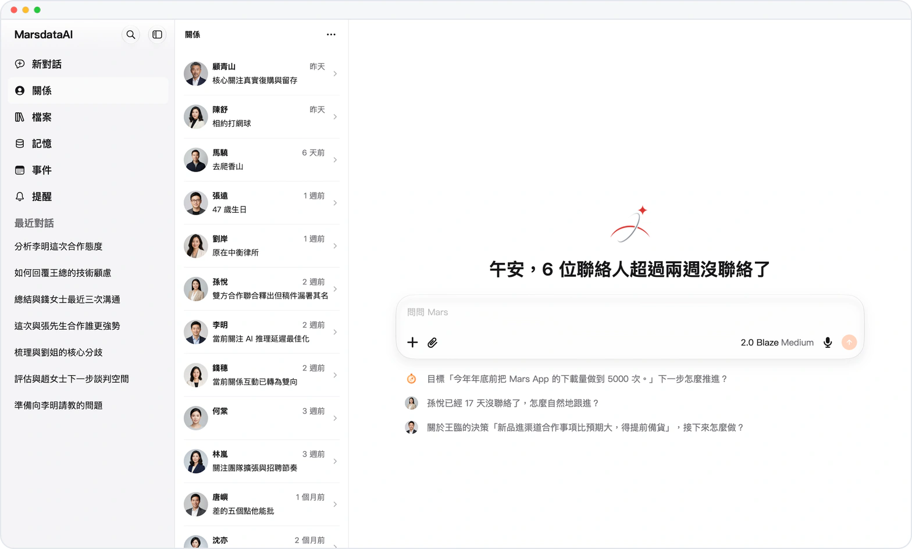

<!-- mars-crm-preview:start -->
# Mars — 產品更新

> **預覽** — 以下功能目前處於預覽階段，尚未正式上線。

[體驗預覽版](https://canary.marsdata.ai) · [English](./README.md) · [简体中文](./README.zh-CN.md) · [繁體中文](./README.zh-HK.md)

## 預覽版更新

*示意圖，使用虛構演示資料。*

- **2026-10-26** · [Mars Mac 原生應用](releases/crm-2026-10-26-mars-for-mac.zh-HK.md) · 預覽 · `0.1.1.8344`
- **2026-10-25** · [回答中隨時補充](releases/crm-2026-10-25-add-to-a-running-answer.zh-HK.md) · 預覽 · `0.1.1.8208`
- **2026-10-25** · [從最新招聘查職位薪資](releases/crm-2026-10-25-what-a-role-pays.zh-HK.md) · 預覽 · `0.1.1.8208`
- **2026-10-24** · [iPhone 和 Mac 桌面小組件](releases/crm-2026-10-24-mars-widgets-on-iphone.zh-HK.md) · 預覽 · `0.1.1.7959`
- **2026-10-24** · [Mars 製作演示文稿和文檔](releases/crm-2026-10-24-mars-makes-decks-and-documents.zh-HK.md) · 預覽 · `0.1.1.7959`
- **2026-10-23** · [不登錄讀取網頁](releases/crm-2026-10-23-read-pages-without-your-login.zh-HK.md) · 預覽 · `0.1.1.7618`
- **2026-10-23** · [按價值排序](releases/crm-2026-10-23-sort-by-value.zh-HK.md) · 預覽 · `0.1.1.7618`
- **2026-10-22** · [Mars 看懂社交媒體視頻](releases/crm-2026-10-22-mars-watches-social-videos.zh-HK.md) · 預覽 · `0.1.1.7433`
- **2026-10-22** · [帶密碼的分享鏈接](releases/crm-2026-10-22-share-links-with-a-password.zh-HK.md) · 預覽 · `0.1.1.7433`
- **2026-10-21** · [在地圖上規劃行程](releases/crm-2026-10-21-plan-trips-on-a-map.zh-HK.md) · 預覽 · `0.1.1.6886`
- **2026-10-20** · [更快、自適應的圖表](releases/crm-2026-10-20-faster-adaptive-diagrams.zh-HK.md) · 預覽 · `0.1.1.6573`
- **2026-10-19** · [引用鏈接顯示真實標題](releases/crm-2026-10-19-cited-link-titles.zh-HK.md) · 預覽 · `0.1.1.6479`
- **2026-10-19** · [長錄音與大文件](releases/crm-2026-10-19-long-recordings.zh-HK.md) · 預覽 · `0.1.1.6479`
- **2026-10-18** · [圖片網格與圖庫](releases/crm-2026-10-18-picture-grids-and-gallery.zh-HK.md) · 預覽 · `0.1.1.6118`
- **2026-10-17** · [用 Apple 登錄](releases/crm-2026-10-17-sign-in-with-apple.zh-HK.md) · 預覽 · `0.1.1.5950`
- **2026-10-17** · [Apple 健康同步](releases/crm-2026-10-17-apple-health-sync.zh-HK.md) · 預覽 · `0.1.1.5950`
- **2026-10-17** · [更完整的健康問答](releases/crm-2026-10-17-richer-health-answers.zh-HK.md) · 預覽 · `0.1.1.5950`
- **2026-10-17** · [提問面板](releases/crm-2026-10-17-question-panel.zh-HK.md) · 預覽 · `0.1.1.5950`
- **2026-10-17** · [聊天內查找與新回答菜單](releases/crm-2026-10-17-find-in-chat-and-a-new-answer-menu.zh-HK.md) · 預覽 · `0.1.1.5950`
- **2026-10-17** · [到點開啓對話的提醒](releases/crm-2026-10-17-reminders-that-start-a-conversation.zh-HK.md) · 預覽 · `0.1.1.5950`
- **2026-10-17** · [實時繪製的圖表](releases/crm-2026-10-17-live-charts-and-diagrams.zh-HK.md) · 預覽 · `0.1.1.5950`
- **2026-10-17** · [iWork 與 WPS 預覽](releases/crm-2026-10-17-iwork-and-wps-previews.zh-HK.md) · 預覽 · `0.1.1.5950`
- **2026-10-17** · [對話狀態一目瞭然](releases/crm-2026-10-17-conversation-status-at-a-glance.zh-HK.md) · 預覽 · `0.1.1.5950`
- **2026-10-17** · [微信日程提醒](releases/crm-2026-10-17-wechat-event-reminders.zh-HK.md) · 預覽 · `0.1.1.5950`
- **2026-10-17** · [關係列表顯示最新動態](releases/crm-2026-10-17-relationship-activity-lines.zh-HK.md) · 預覽 · `0.1.1.5950`
- **2026-10-17** · [更清晰的信息分組](releases/crm-2026-10-17-clearer-information-groups.zh-HK.md) · 預覽 · `0.1.1.5950`
- **2026-10-17** · [編輯 Keynote、Pages 和 Numbers 文件](releases/crm-2026-10-17-convert-iwork-files.zh-HK.md) · 預覽 · `0.1.1.5950`
- **2026-10-15** · [隱私鎖](releases/crm-2026-10-15-privacy-lock.zh-HK.md) · 預覽 · `0.1.1.5585`
- **2026-10-15** · [Mars-2.0 Blaze](releases/crm-2026-10-15-mars-2-0-blaze.zh-HK.md) · 預覽 · `0.1.1.5585`
- **2026-10-15** · [網頁與 iOS 套餐](releases/crm-2026-10-15-plans-on-web-and-ios.zh-HK.md) · 預覽 · `0.1.1.5585`
- **2026-10-15** · [點踩即可反饋](releases/crm-2026-10-15-feedback-from-thumbs-down.zh-HK.md) · 預覽 · `0.1.1.5585`
- **2026-10-15** · [看得見過程的深度研究](releases/crm-2026-10-15-deep-research-you-can-follow.zh-HK.md) · 預覽 · `0.1.1.5585`
- **2026-10-15** · [結構化圖表](releases/crm-2026-10-15-structured-diagrams.zh-HK.md) · 預覽 · `0.1.1.5585`
- **2026-10-15** · [寫入資料庫](releases/crm-2026-10-15-write-files-to-the-library.zh-HK.md) · 預覽 · `0.1.1.5585`
- **2026-10-15** · [更安全的刪除](releases/crm-2026-10-15-safer-deletes.zh-HK.md) · 預覽 · `0.1.1.5585`
- **2026-10-15** · [長按自己的消息](releases/crm-2026-10-15-long-press-your-messages.zh-HK.md) · 預覽 · `0.1.1.5585`
- **2026-10-13** · [只讀連接 Gmail](releases/crm-2026-10-13-gmail-read-only.zh-HK.md) · 預覽 · `0.1.1.5222`
- **2026-10-13** · [導入聯繫人](releases/crm-2026-10-13-import-contacts.zh-HK.md) · 預覽 · `0.1.1.5222`
- **2026-10-13** · [實時讀取 iPhone 數據](releases/crm-2026-10-13-live-iphone-data.zh-HK.md) · 預覽 · `0.1.1.5222`
- **2026-10-13** · [手機號與密碼登錄](releases/crm-2026-10-13-phone-and-password-sign-in.zh-HK.md) · 預覽 · `0.1.1.5222`
- **2026-10-13** · [iOS 原生圖表](releases/crm-2026-10-13-native-charts-on-ios.zh-HK.md) · 預覽 · `0.1.1.5222`
- **2026-10-13** · [回答不中斷](releases/crm-2026-10-13-answers-that-keep-going.zh-HK.md) · 預覽 · `0.1.1.5222`
- **2026-10-13** · [額度用完也不丟結果](releases/crm-2026-10-13-graceful-credit-limits.zh-HK.md) · 預覽 · `0.1.1.5222`
- **2026-10-13** · [首次啓動即用你的語言](releases/crm-2026-10-13-your-language-from-the-start.zh-HK.md) · 預覽 · `0.1.1.5222`
- **2026-10-10** · [Mars iOS 應用](releases/crm-2026-10-10-mars-for-ios.zh-HK.md) · 預覽 · `0.1.1.4799`
- **2026-10-10** · [原生通知](releases/crm-2026-10-10-native-notifications.zh-HK.md) · 預覽 · `0.1.1.4799`
- **2026-10-10** · [每週起始日與日期格式](releases/crm-2026-10-10-week-start-and-date-format.zh-HK.md) · 預覽 · `0.1.1.4799`
- **2026-10-10** · [關係類型](releases/crm-2026-10-10-relationship-types.zh-HK.md) · 預覽 · `0.1.1.4799`
- **2026-10-10** · [修訂 Office 文件](releases/crm-2026-10-10-revised-office-files.zh-HK.md) · 預覽 · `0.1.1.4799`
- **2026-10-10** · [外觀設置](releases/crm-2026-10-10-appearance-settings.zh-HK.md) · 預覽 · `0.1.1.4799`
- **2026-10-10** · [壓縮包預覽](releases/crm-2026-10-10-archive-previews.zh-HK.md) · 預覽 · `0.1.1.4799`
- **2026-10-07** · [時區設置](releases/crm-2026-10-07-time-zone-setting.zh-HK.md) · 預覽 · `0.1.1.4285`
- **2026-10-07** · [通知設置頁](releases/crm-2026-10-07-notifications-page.zh-HK.md) · 預覽 · `0.1.1.4285`
- **2026-10-07** · [重複事件](releases/crm-2026-10-07-repeating-events.zh-HK.md) · 預覽 · `0.1.1.4285`
- **2026-10-07** · [字體大小](releases/crm-2026-10-07-text-size.zh-HK.md) · 預覽 · `0.1.1.4285`
- **2026-10-07** · [取消分享與更廣的搜索](releases/crm-2026-10-07-stop-sharing-and-wider-search.zh-HK.md) · 預覽 · `0.1.1.4285`
- **2026-10-07** · [聯繫人之間的關係](releases/crm-2026-10-07-relationships-between-contacts.zh-HK.md) · 預覽 · `0.1.1.4285`
- **2026-10-07** · [用量記錄](releases/crm-2026-10-07-usage-records.zh-HK.md) · 預覽 · `0.1.1.4285`
- **2026-10-07** · [事件狀態](releases/crm-2026-10-07-event-status.zh-HK.md) · 預覽 · `0.1.1.4285`
- **2026-09-30** · [個人記憶按組歸整](releases/crm-2026-09-30-grouped-personal-memory.zh-HK.md) · 預覽 · `0.1.1.3581`
- **2026-09-28** · [已瞭解的信息與來源](releases/crm-2026-09-28-what-mars-learned-with-sources.zh-HK.md) · 預覽 · `0.1.1.3543`
- **2026-09-23** · [日視圖旁看整月日程](releases/crm-2026-09-23-month-events-beside-the-day.zh-HK.md) · 預覽 · `0.1.1.3475`
- **2026-09-12** · [連續閲讀 PDF](releases/crm-2026-09-12-continuous-pdf-reading.zh-HK.md) · 預覽 · `0.1.1.3383`
- **2026-09-04** · [更清楚的訂閲頁](releases/crm-2026-09-04-a-clearer-plans-page.zh-HK.md) · 預覽 · `0.1.1.3352`

<!-- mars-crm-preview:end -->

## 已正式上線的歷史更新

**Marsdata AI**（亦稱 Mars Agent）的每一次產品變化。Marsdata 是一個替你維護關係的 AI。本倉庫鏡像自 [https://marsdata.ai/changelog](https://marsdata.ai/changelog)。

> 內容以官網為準：[https://marsdata.ai/changelog](https://marsdata.ai/changelog)

**[全部更新](./CHANGELOG.zh-HK.md)** · [開始使用 Marsdata AI](https://marsdata.ai) · 有問題？到這裏提問： [marsdata-ai](https://github.com/Mars-CRM-Agent/marsdata-ai/discussions)

## 全部更新

- **2026-08-15** · [從更新日誌登錄，完成後回到原來的位置。](releases/2026-08-15-sign-in-from-the-changelog-and-return-right.zh-HK.md) · `0.1.1.2928`
- **2026-08-15** · [讓 Mars 幫你整理 Atlas，並重新連好每一個關係圈層。](releases/2026-08-15-ask-mars-to-curate-your-atlas-and-reconnect.zh-HK.md) · `0.1.1.2922`
- **2026-08-13** · [Atlas 把你的關係組織成清晰而鮮活的圈層。](releases/2026-08-13-atlas-turns-your-relationships-into-distinct-living-circles.zh-HK.md) · `0.1.1.2873`
- **2026-08-11** · [你想發送的話，現在可以直接複製。](releases/2026-08-11-the-words-you-mean-to-send-now-arrive.zh-HK.md) · `0.1.1.2820`
- **2026-08-01** · [你認識的每一個人，都成為一份結構化檔案。](releases/2026-08-01-every-person-you-know-becomes-a-structured-record.zh-HK.md) · `0.1.1.2598`
- **2026-07-24** · [在對話裏直接 @ 一個人。](releases/2026-07-24-mention-a-person-right-inside-the-chat.zh-HK.md) · `0.1.1.2383`
- **2026-07-22** · [三大模型全面升級為 1.7。](releases/2026-07-22-all-three-models-step-up-to-1-7.zh-HK.md) · `0.1.1.2353`
- **2026-07-20** · [Atlas · 關係星雲上線了。](releases/2026-07-20-atlas-relation-nebula-is-live.zh-HK.md) · `0.1.1.2324`
- **2026-07-06** · [每個你提到的人，都會有一份自己的檔案。](releases/2026-07-06-everyone-you-mention-now-gets-their-own-dossier.zh-HK.md) · `0.1.1.2173`
- **2026-06-23** · [「項目」上線，把一攤事集中在一個空間裏。](releases/2026-06-23-projects-keep-one-topic-in-one-clean-space.zh-HK.md) · `0.1.1.2098`
- **2026-06-18** · [Mars 現在能感知你們之間流逝的時間。](releases/2026-06-18-mars-now-feels-the-time-that-passed-between.zh-HK.md) · `0.1.1.2018`
- **2026-06-14** · [首頁更流暢，回答更貼題。](releases/2026-06-14-a-smoother-home-screen-answers-shaped-to-the.zh-HK.md) · `0.1.1.1967`
- **2026-06-13** · [記憶面板變成了一張關係圖譜。](releases/2026-06-13-the-memory-panel-became-a-relationship-graph.zh-HK.md) · `0.1.1.1959`
- **2026-06-01** · [需要操作瀏覽器的長任務，從頭到尾更穩了。](releases/2026-06-01-long-browser-tasks-now-hold-together-end-to.zh-HK.md) · `0.1.1.1828`
- **2026-05-26** · [Deep Research 重寫：更深，也更安全。](releases/2026-05-26-deep-research-rewritten-deeper-and-safer.zh-HK.md) · `0.1.1.1803`

---

[English](./README.md) · [简体中文](./README.zh-CN.md)
