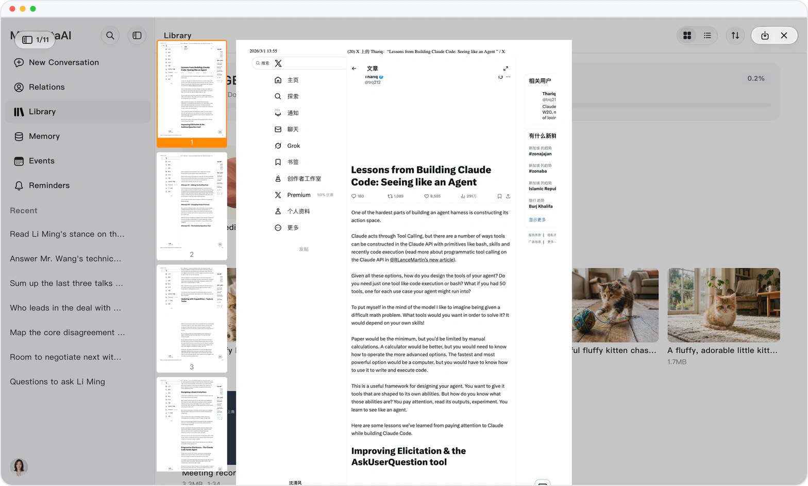

# Read a PDF like a long page

> **Preview** · 2026-09-12 · `0.1.1.3383`
> These features are available in the preview version and have not been generally released.

Page-by-page PDF reading is slow, and finding one page is slower.

In the Library, PDF pages follow one another instead of turning one at a time, and a row of page thumbnails jumps you straight to the page you want. PDF and Office files also show their first page as a thumbnail, so you can spot a file without opening each one.

Find the right page, and the right file, at a glance.

*Illustration using fictional demo data.*

[Explore the preview](https://canary.marsdata.ai/changelog/continuous-pdf-reading) · [All updates](../README.md)

[简体中文](./crm-2026-09-12-continuous-pdf-reading.zh-CN.md) · [繁體中文](./crm-2026-09-12-continuous-pdf-reading.zh-HK.md)
