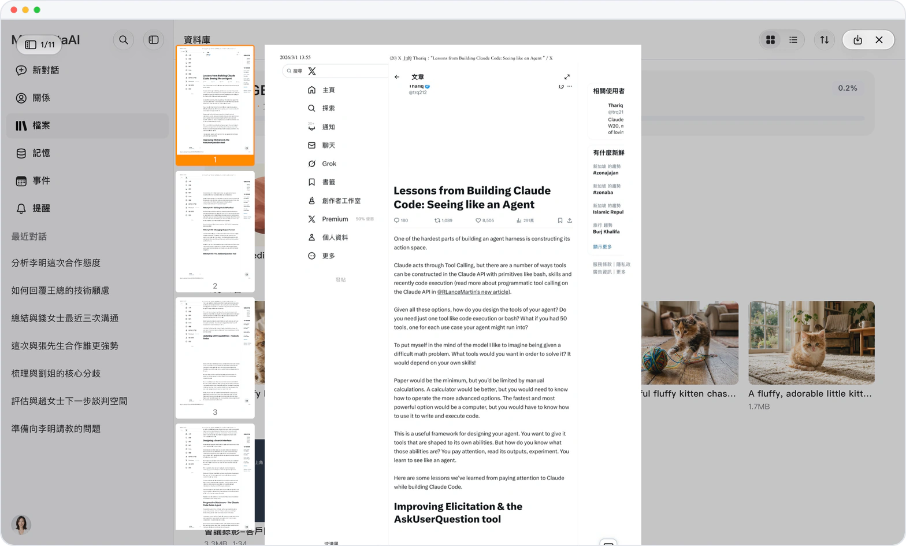

# PDF 一路往下滾，像讀長文一樣

> **預覽** · 2026-09-12 · `0.1.1.3383`
> 以下功能目前處於預覽階段，尚未正式上線。

讀 PDF 還在一頁頁翻，找某一頁更是費勁？

在資料庫讀 PDF，頁面一頁接一頁排下來，不用逐頁翻；一排頁面縮略圖可以直接跳到想看的頁。PDF 和 Office 文件在資料庫裏也以首頁作為縮略圖，找文件不用一個個點開。

一眼找到要看的那一頁，也一眼認出要找的那個文件。

*示意圖，使用虛構演示資料。*

[體驗預覽版](https://marsdata.ai/changelog/continuous-pdf-reading) · [全部更新](../README.zh-HK.md)

[English](./crm-2026-09-12-continuous-pdf-reading.md) · [简体中文](./crm-2026-09-12-continuous-pdf-reading.zh-CN.md)
