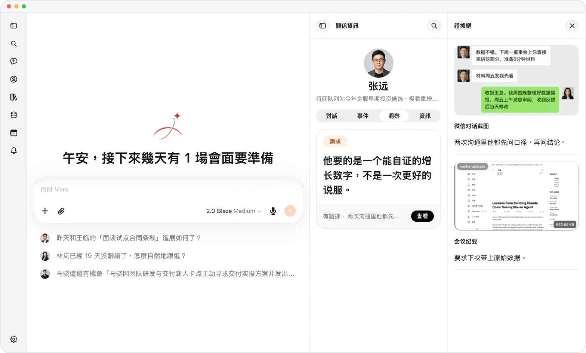

# 每條信息，都能回到出處核對

> **預覽** · 2026-09-28 · `0.1.1.3543`
> 以下功能目前處於預覽階段，尚未正式上線。

Mars 記住了這條信息，可它是從哪裏來的？

每個聯繫人頁面都會顯示 Mars 瞭解到的信息：事實和關係信號按主題排列，新的在前，每條都附原話和來源消息或文件的鏈接。Mars 自動識別的信息會等你採用或修改。不是來路不明的結論，每一條都有據可查、由你把關。

每一條信息都能回到出處核對，放心使用。

*示意圖，使用虛構演示資料。*

[體驗預覽版](https://canary.marsdata.ai/changelog/what-mars-learned-with-sources) · [全部更新](../README.zh-HK.md)

[English](./crm-2026-09-28-what-mars-learned-with-sources.md) · [简体中文](./crm-2026-09-28-what-mars-learned-with-sources.zh-CN.md)
