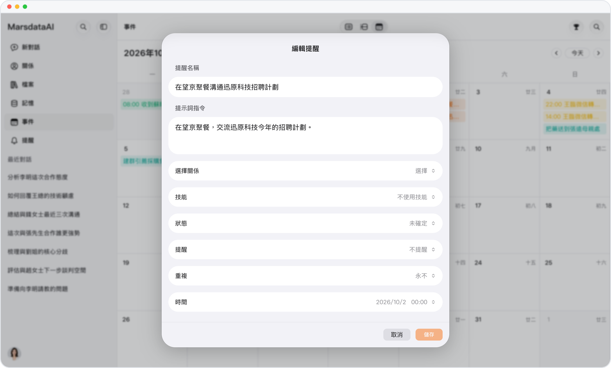

# 事件狀態

> **預覽** · 2026-10-07 · `0.1.1.4285`
> 以下功能目前處於預覽階段，尚未正式上線。

為每個事件標記「計劃中」「已發生」或「已取消」，讓日曆保持準確。

事件現有三種狀態：計劃中、已發生或已取消。滑動或右鍵點擊事件，即可完成、編輯或刪除。

日曆記錄的是實際發生的事，而不只是計劃中的安排。

*示意圖，使用虛構演示資料。*

[體驗預覽版](https://canary.marsdata.ai/changelog/event-status) · [全部更新](../README.zh-HK.md)

[English](./crm-2026-10-07-event-status.md) · [简体中文](./crm-2026-10-07-event-status.zh-CN.md)
