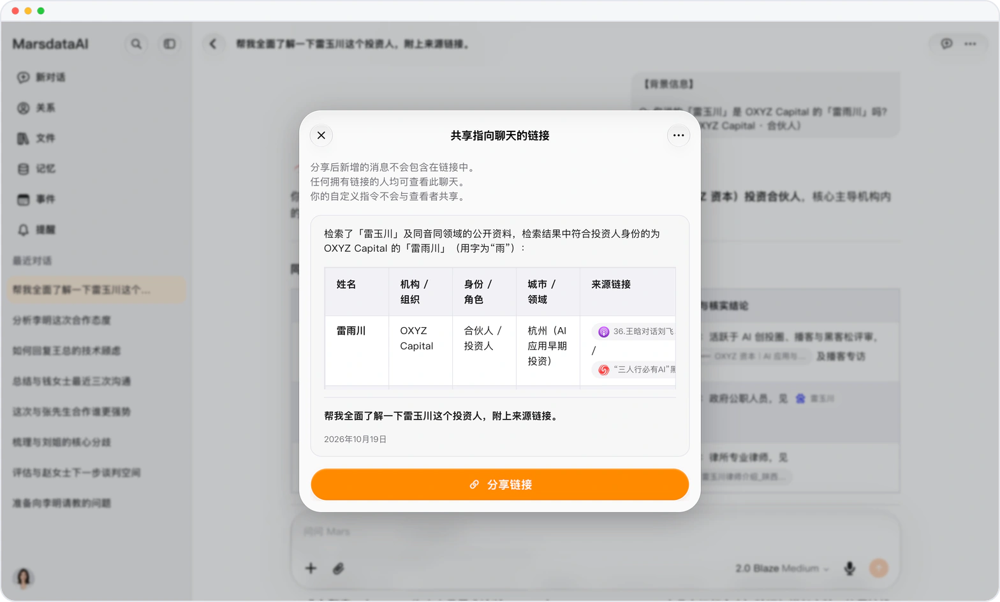

# 分享随时收回，旧回答一搜就到

> **预览** · 2026-10-07 · `0.1.1.4285`
> 以下功能目前处于预览阶段，尚未正式上线。

链接分享出去就收不回？想找的那句回答也搜不到？

分享链接现在提供「取消分享」，一点就关闭该链接。工作区搜索也覆盖对话正文，凭记得的一句原话就能找到旧回答。分享的主动权在你手里，查找也不再只靠对话标题。

随时关闭分享，凭一句原话找回旧回答。

*示意图，使用虚构演示数据。*

[体验预览版](https://canary.marsdata.ai/changelog/stop-sharing-and-wider-search) · [全部更新](../README.zh-CN.md)

[English](./crm-2026-10-07-stop-sharing-and-wider-search.md) · [繁體中文](./crm-2026-10-07-stop-sharing-and-wider-search.zh-HK.md)
