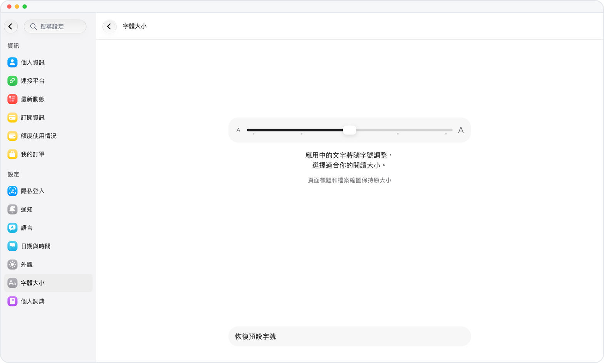

# 字號隨你調，長對話讀得舒服

> **預覽** · 2026-10-07 · `0.1.1.4285`
> 以下功能目前處於預覽階段，尚未正式上線。

信息一多，小字讀久了眼睛累？

字體大小設置可以統一縮放對話、聯繫人頁、記憶、事件、資料庫和設置中的文字。調整一次，這些頁面一起跟着變，不用每頁單獨調。

用你順眼的字號，讀長對話和信息密集的頁面都更輕鬆。

*示意圖，使用虛構演示資料。*

[體驗預覽版](https://marsdata.ai/changelog/text-size) · [全部更新](../README.zh-HK.md)

[English](./crm-2026-10-07-text-size.md) · [简体中文](./crm-2026-10-07-text-size.zh-CN.md)
