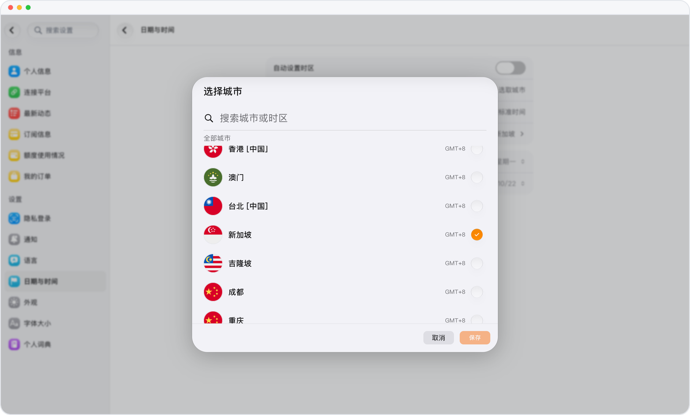

# 时区设置

> **预览** · 2026-10-07 · `0.1.1.4285`
> 以下功能目前处于预览阶段，尚未正式上线。

让对话、提醒、事件和用量记录按你所在的时区显示。

可跟随设备时区，也可在设置中选择城市。对话、提醒、事件和用量记录均按你选择的时区显示时间。

日期和时间与你所在地一致，提醒会在你预期的时刻到达。

*示意图，使用虚构演示数据。*

[体验预览版](https://canary.marsdata.ai/changelog/time-zone-setting) · [全部更新](../README.zh-CN.md)

[English](./crm-2026-10-07-time-zone-setting.md) · [繁體中文](./crm-2026-10-07-time-zone-setting.zh-HK.md)
