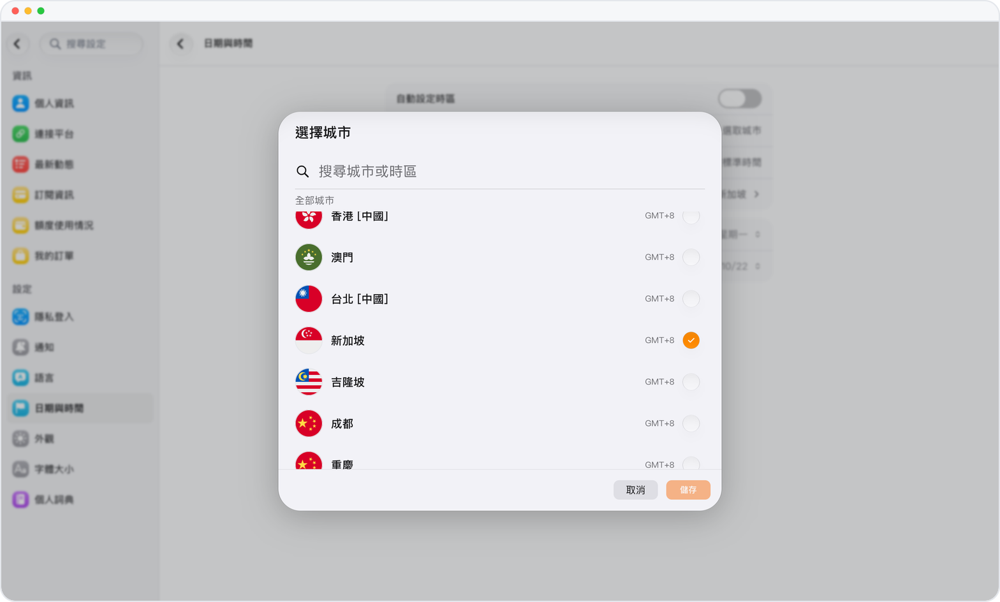

# 人在哪裏，時間就對到哪裏

> **預覽** · 2026-10-07 · `0.1.1.4285`
> 以下功能目前處於預覽階段，尚未正式上線。

出差換了時區，提醒卻還按老時間響？

可以跟隨設備時區，也可以在設置中選擇城市。對話、提醒、事件和用量記錄，都按你選擇的時區顯示時間。不用自己換算時差。

日期和時間與你所在地一致，提醒準時在你預期的時刻到達。

*示意圖，使用虛構演示資料。*

[體驗預覽版](https://marsdata.ai/changelog/time-zone-setting) · [全部更新](../README.zh-HK.md)

[English](./crm-2026-10-07-time-zone-setting.md) · [简体中文](./crm-2026-10-07-time-zone-setting.zh-CN.md)
