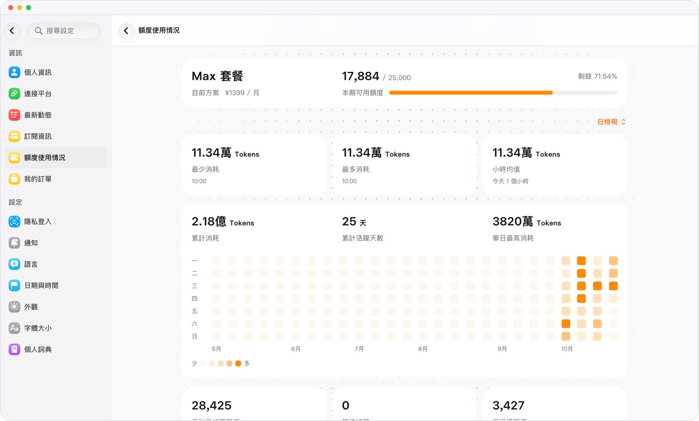

# 用量高峯和退款，一頁看清

> **預覽** · 2026-10-07 · `0.1.1.4285`
> 以下功能目前處於預覽階段，尚未正式上線。

額度花在哪裏、什麼時候用得多，心裏沒數？

用量記錄支持按日、周、月查看，標出用得多和用得少的時段，列出退款，並可按調用類型排序和篩選。不用自己翻流水對賬。

在一處找到用量高峯，順手核對退款。

*示意圖，使用虛構演示資料。*

[體驗預覽版](https://canary.marsdata.ai/changelog/usage-records) · [全部更新](../README.zh-HK.md)

[English](./crm-2026-10-07-usage-records.md) · [简体中文](./crm-2026-10-07-usage-records.zh-CN.md)
