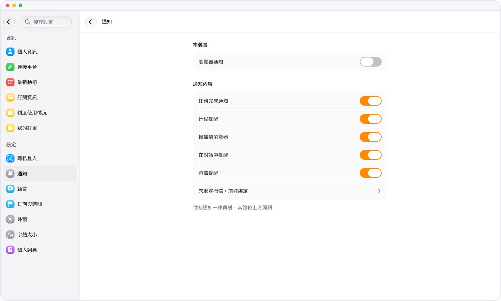

# 任務完成，Mars 主動告訴你

> **預覽** · 2026-10-10 · `0.1.1.4799`
> 以下功能目前處於預覽階段，尚未正式上線。

交代完任務，還得時不時回來看好了沒有？

開啓任務完成通知後，Mars 做完任務會主動提醒你。iOS 只請求一次權限；打開「任務完成通知」一行，在網頁或 iOS 上都能修改通知設置。不用反覆切回來查看。

任務一完成就知道，不用反覆查看 Mars。

*示意圖，使用虛構演示資料。*

[體驗預覽版](https://marsdata.ai/changelog/native-notifications) · [全部更新](../README.zh-HK.md)

[English](./crm-2026-10-10-native-notifications.md) · [简体中文](./crm-2026-10-10-native-notifications.zh-CN.md)
