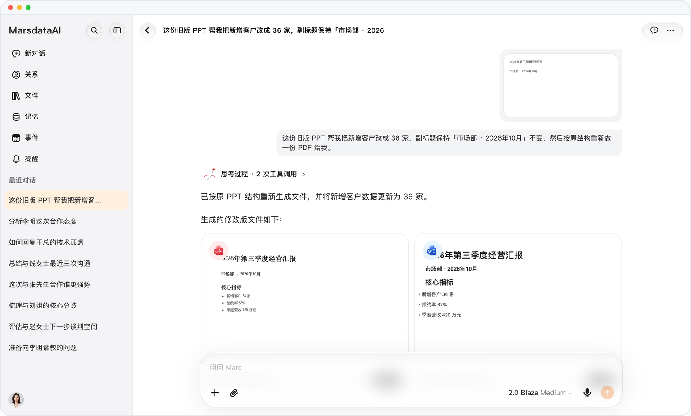

# 改过的文件，每一版都留得住

> **预览** · 2026-10-10 · `0.1.1.4799`
> 以下功能目前处于预览阶段，尚未正式上线。

让人改文件，最怕改完找不回原版。

让 Mars 修改 Word、Excel 或 PowerPoint 文件，修订版会作为新文档保存到资料库；Word 修订以修订痕迹显示，你可以逐条接受或拒绝。原版不被覆盖，改了哪里一清二楚。

每个版本都保留，Word 修改先审后收。

*示意图，使用虚构演示数据。*

[体验预览版](https://marsdata.ai/changelog/revised-office-files) · [全部更新](../README.zh-CN.md)

[English](./crm-2026-10-10-revised-office-files.md) · [繁體中文](./crm-2026-10-10-revised-office-files.zh-HK.md)
