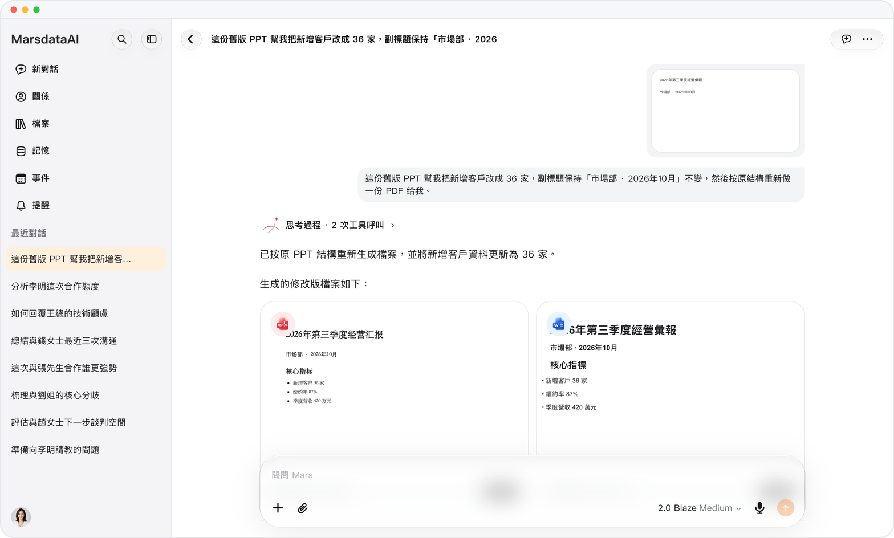

# 修訂 Office 文件

> **預覽** · 2026-10-10 · `0.1.1.4799`
> 以下功能目前處於預覽階段，尚未正式上線。

修改後的 Word、Excel 和 PowerPoint 文件，會以新文檔保存到資料庫。

修訂 Office 文件後，Mars 會將其保存為資料庫中的新文檔。Word 修訂以修訂痕跡顯示，你可以接受或拒絕。

每個版本都會保留，接受 Word 修改前也可先行審閲。

*示意圖，使用虛構演示資料。*

[體驗預覽版](https://canary.marsdata.ai/changelog/revised-office-files) · [全部更新](../README.zh-HK.md)

[English](./crm-2026-10-10-revised-office-files.md) · [简体中文](./crm-2026-10-10-revised-office-files.zh-CN.md)
