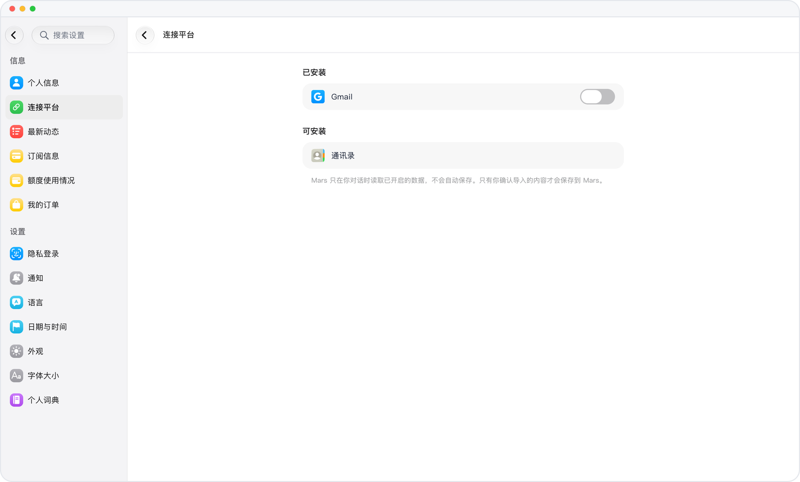

# 只读连接 Gmail

> **预览** · 2026-10-13 · `0.1.1.5222`
> 以下功能目前处于预览阶段，尚未正式上线。

以只读方式连接 Gmail，Mars 即可在对话中搜索和阅读邮件。

以只读权限连接你的 Gmail 账户。在对话中，Mars 可以搜索你的邮件，并阅读你指定的邮件，但不会更改收件箱。

回答可以参考你的邮件，而 Mars 无法修改邮件。

*示意图，使用虚构演示数据。*

[体验预览版](https://canary.marsdata.ai/changelog/gmail-read-only) · [全部更新](../README.zh-CN.md)

[English](./crm-2026-10-13-gmail-read-only.md) · [繁體中文](./crm-2026-10-13-gmail-read-only.zh-HK.md)
