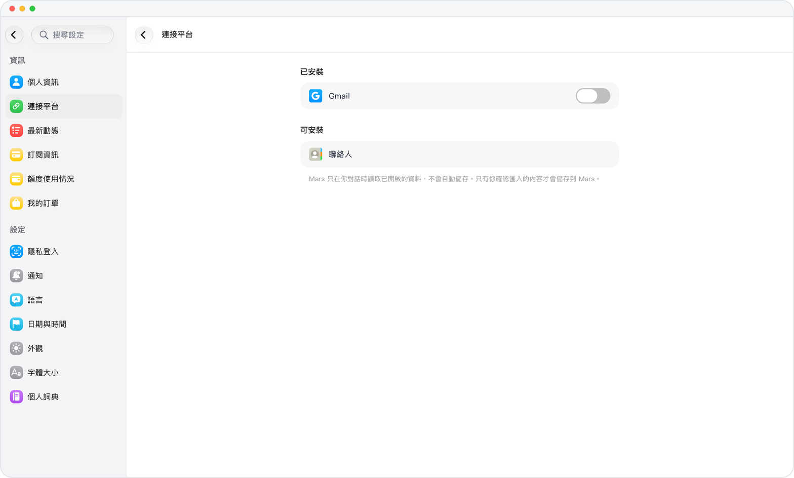

# 只讀連接 Gmail

> **預覽** · 2026-10-13 · `0.1.1.5222`
> 以下功能目前處於預覽階段，尚未正式上線。

以只讀方式連接 Gmail，Mars 即可在對話中搜索和閲讀郵件。

以只讀權限連接你的 Gmail 賬户。在對話中，Mars 可以搜索你的郵件，並閲讀你指定的郵件，但不會更改收件箱。

回答可以參考你的郵件，而 Mars 無法修改郵件。

*示意圖，使用虛構演示資料。*

[體驗預覽版](https://canary.marsdata.ai/changelog/gmail-read-only) · [全部更新](../README.zh-HK.md)

[English](./crm-2026-10-13-gmail-read-only.md) · [简体中文](./crm-2026-10-13-gmail-read-only.zh-CN.md)
