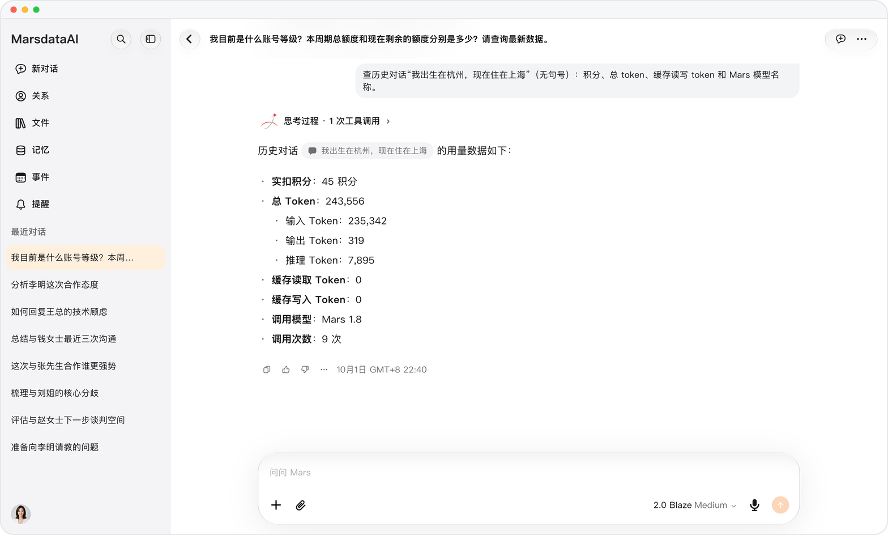

# 额度用完，做好的结果照样交付

> **预览** · 2026-10-13 · `0.1.1.5222`
> 以下功能目前处于预览阶段，尚未正式上线。

额度刚好用完，跑了一半的结果就白费了？

额度用完时，Mars 会完成当前轮次中已经开始的工作，并交付这些结果，之后新消息才暂停发送。已经投入的那一轮不会白跑。

额度耗尽时，正在进行的那一轮结果依然到手。

*示意图，使用虚构演示数据。*

[体验预览版](https://canary.marsdata.ai/changelog/graceful-credit-limits) · [全部更新](../README.zh-CN.md)

[English](./crm-2026-10-13-graceful-credit-limits.md) · [繁體中文](./crm-2026-10-13-graceful-credit-limits.zh-HK.md)
