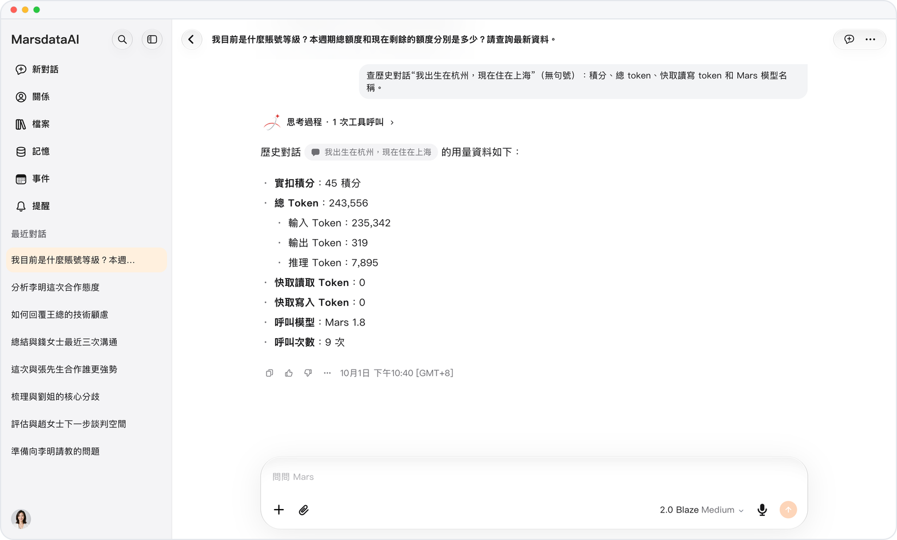

# 額度用完也不丟結果

> **預覽** · 2026-10-13 · `0.1.1.5222`
> 以下功能目前處於預覽階段，尚未正式上線。

額度用完時，Mars 仍會交付已完成的當前輪次結果。

Mars 會完成當前輪次中已經開始的工作，並交付這些結果。之後，新消息將暫停發送。

額度耗盡時，正在進行的輪次結果依然保留。

*示意圖，使用虛構演示資料。*

[體驗預覽版](https://canary.marsdata.ai/changelog/graceful-credit-limits) · [全部更新](../README.zh-HK.md)

[English](./crm-2026-10-13-graceful-credit-limits.md) · [简体中文](./crm-2026-10-13-graceful-credit-limits.zh-CN.md)
