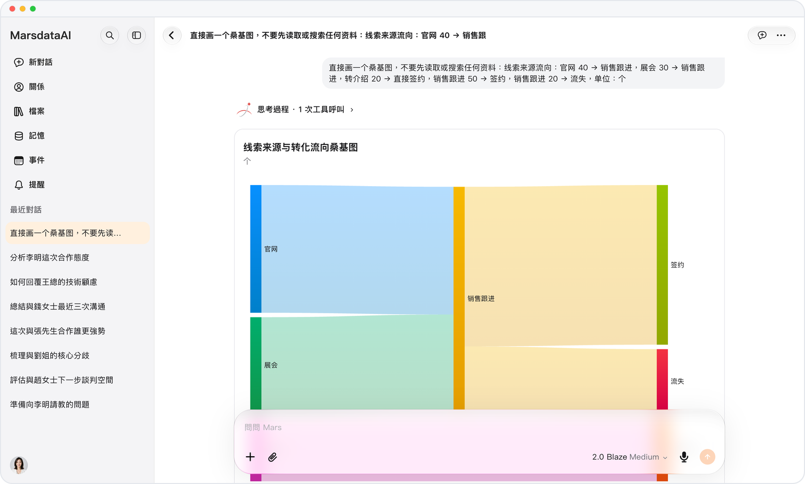

# iPhone 上的圖表，清晰順手

> **預覽** · 2026-10-13 · `0.1.1.5222`
> 以下功能目前處於預覽階段，尚未正式上線。

手機上看圖表，總覺得不夠清楚？

回答中的圖表與流程圖，採用 iOS 原生圖形繪製。選中回答裏的部分文字，就能引用或朗讀。圖表看得清，想要的那句話也拿得走。

圖表在 iPhone 上呈現原生效果，選中的文字也方便複用。

*示意圖，使用虛構演示資料。*

[體驗預覽版](https://canary.marsdata.ai/changelog/native-charts-on-ios) · [全部更新](../README.zh-HK.md)

[English](./crm-2026-10-13-native-charts-on-ios.md) · [简体中文](./crm-2026-10-13-native-charts-on-ios.zh-CN.md)
