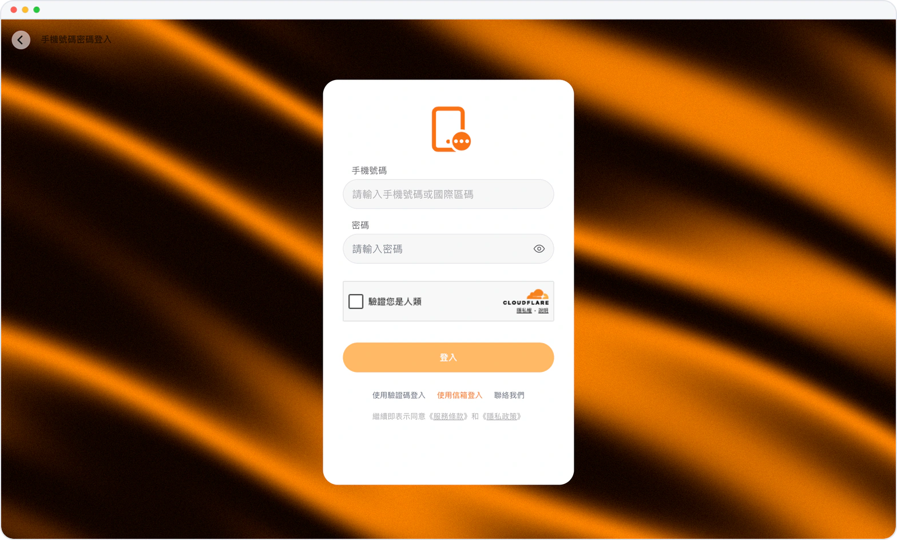

# 手機號與密碼登錄

> **預覽** · 2026-10-13 · `0.1.1.5222`
> 以下功能目前處於預覽階段，尚未正式上線。

在網頁上使用手機號和密碼登錄。

在網頁登錄頁選擇手機號加密碼。當 Mars 需要安全驗證時，驗證頁會説明需要驗證的原因。

即使需要額外的安全驗證，登錄過程也清晰明瞭。

*示意圖，使用虛構演示資料。*

[體驗預覽版](https://canary.marsdata.ai/changelog/phone-and-password-sign-in) · [全部更新](../README.zh-HK.md)

[English](./crm-2026-10-13-phone-and-password-sign-in.md) · [简体中文](./crm-2026-10-13-phone-and-password-sign-in.zh-CN.md)
