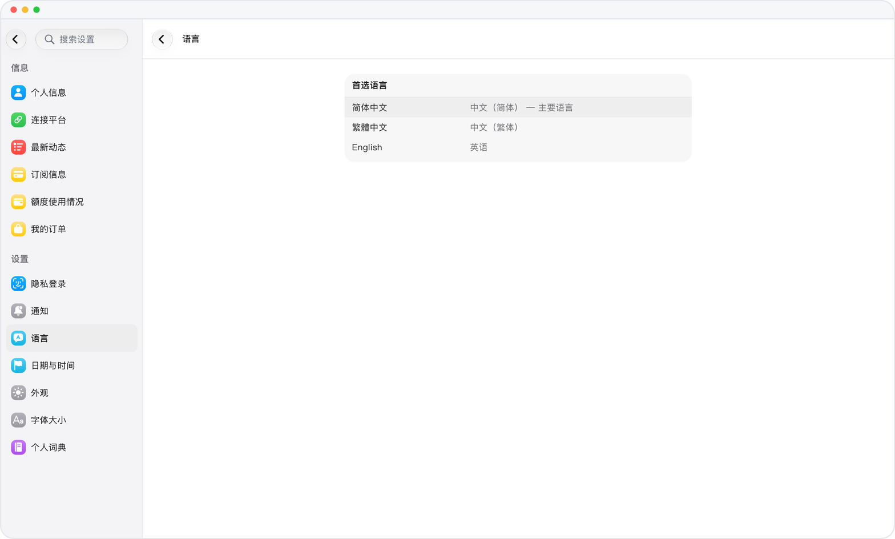

# 第一眼，就是你的语言

> **预览** · 2026-10-13 · `0.1.1.5222`
> 以下功能目前处于预览阶段，尚未正式上线。

新应用一打开满屏外语，还得先找语言设置？

首次启动时，Mars 自动跟随设备语言；如果设备语言暂不支持，就使用英文。不用先去设置里切换，打开就能看懂。

打开就能用熟悉的语言开始。

*示意图，使用虚构演示数据。*

[体验预览版](https://marsdata.ai/changelog/your-language-from-the-start) · [全部更新](../README.zh-CN.md)

[English](./crm-2026-10-13-your-language-from-the-start.md) · [繁體中文](./crm-2026-10-13-your-language-from-the-start.zh-HK.md)
