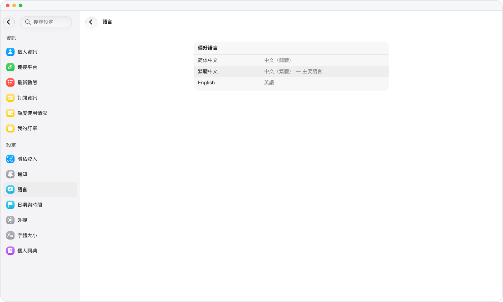

# 第一眼，就是你的語言

> **預覽** · 2026-10-13 · `0.1.1.5222`
> 以下功能目前處於預覽階段，尚未正式上線。

新應用一打開滿屏外語，還得先找語言設置？

首次啓動時，Mars 自動跟隨設備語言；如果設備語言暫不支持，就使用英文。不用先去設置裏切換，打開就能看懂。

打開就能用熟悉的語言開始。

*示意圖，使用虛構演示資料。*

[體驗預覽版](https://marsdata.ai/changelog/your-language-from-the-start) · [全部更新](../README.zh-HK.md)

[English](./crm-2026-10-13-your-language-from-the-start.md) · [简体中文](./crm-2026-10-13-your-language-from-the-start.zh-CN.md)
