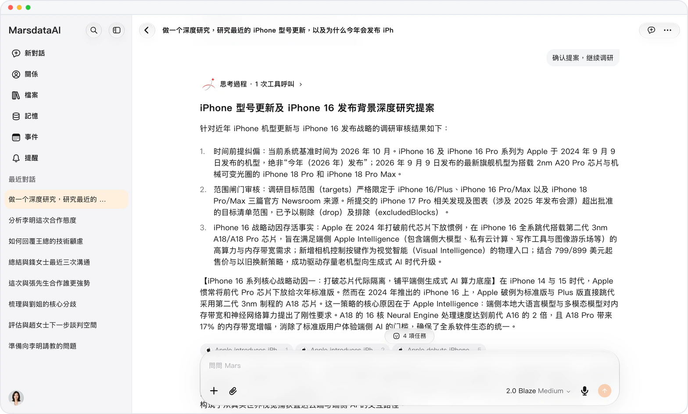

# 看得見過程的深度研究

> **預覽** · 2026-10-15 · `0.1.1.5585`
> 以下功能目前處於預覽階段，尚未正式上線。

看清每位研究助手在工作時做了什麼。

每位研究助手以卡片顯示，並實時呈現其步驟。它的調研提案以問題卡片形式出現，由你確認。

你可以跟隨研究過程，並確認研究方向。

*示意圖，使用虛構演示資料。*

[體驗預覽版](https://canary.marsdata.ai/changelog/deep-research-you-can-follow) · [全部更新](../README.zh-HK.md)

[English](./crm-2026-10-15-deep-research-you-can-follow.md) · [简体中文](./crm-2026-10-15-deep-research-you-can-follow.zh-CN.md)
