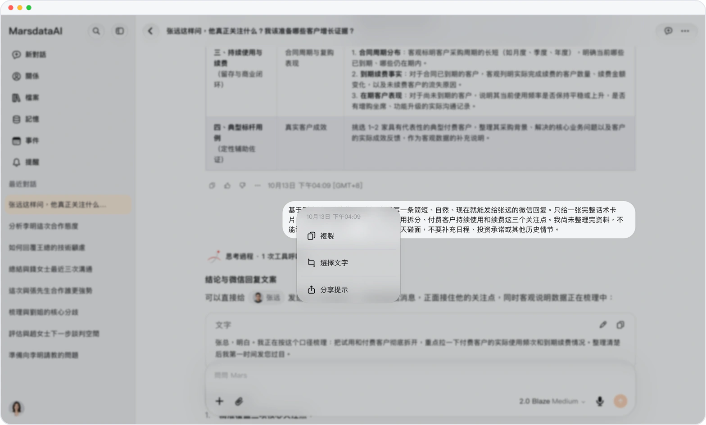

# 長按自己的消息

> **預覽** · 2026-10-15 · `0.1.1.5585`
> 以下功能目前處於預覽階段，尚未正式上線。

長按自己發送的消息，即可複製、選擇或分享。

按住你寫下的消息即可打開選項菜單。你可以複製整條消息、選擇其中一部分，或分享它。

複用自己的文字只需一次長按，無需重新輸入。

*示意圖，使用虛構演示資料。*

[體驗預覽版](https://canary.marsdata.ai/changelog/long-press-your-messages) · [全部更新](../README.zh-HK.md)

[English](./crm-2026-10-15-long-press-your-messages.md) · [简体中文](./crm-2026-10-15-long-press-your-messages.zh-CN.md)
