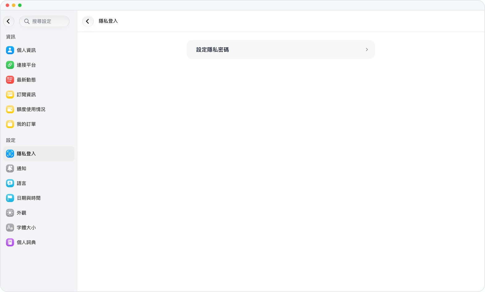

# 隱私鎖

> **預覽** · 2026-10-15 · `0.1.1.5585`
> 以下功能目前處於預覽階段，尚未正式上線。

即使在共用或已解鎖的設備上，也讓 Mars 保持私密。

在設置中設置 6 位隱私密碼。之後 Mars 打開前會要求輸入該密碼；在 iOS 上可改用面容 ID 或觸控 ID，在網頁上可改用通行密鑰。

別人拿起你的設備時，你的對話和記憶依然只屬於你。

*示意圖，使用虛構演示資料。*

[體驗預覽版](https://canary.marsdata.ai/changelog/privacy-lock) · [全部更新](../README.zh-HK.md)

[English](./crm-2026-10-15-privacy-lock.md) · [简体中文](./crm-2026-10-15-privacy-lock.zh-CN.md)
