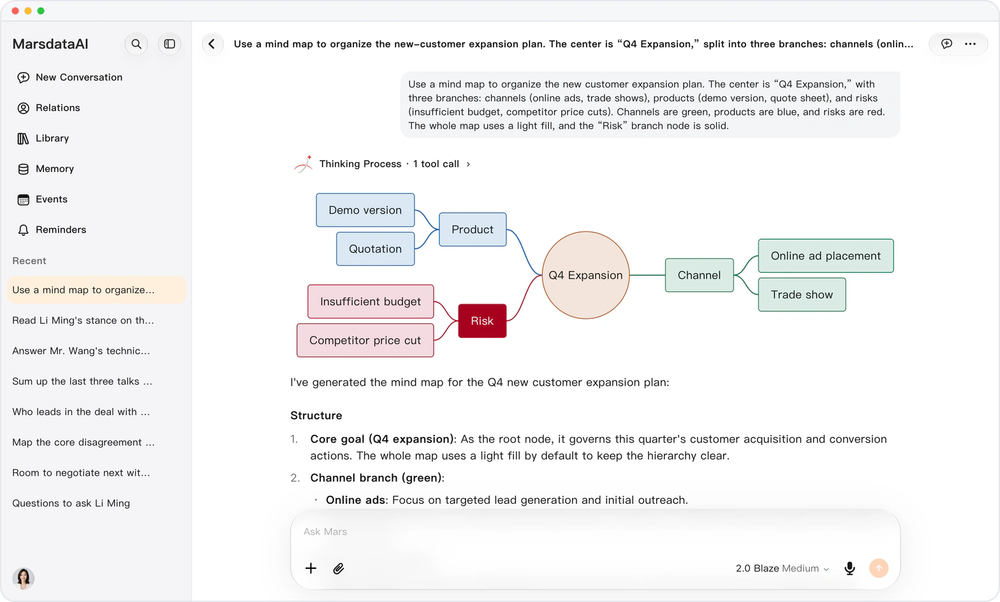

# Structured diagrams

> **Preview** · 2026-10-15 · `0.1.1.5585`
> These features are available in the preview version and have not been generally released.

Turn answers into flowcharts, mind maps, sequence and timeline diagrams.

Mars now draws structured diagrams: flowcharts, mind maps, sequence diagrams and timelines. On mobile web, download any diagram as a PNG.

Complex ideas become a diagram you can read at a glance.

*Illustration using fictional demo data.*

[Explore the preview](https://canary.marsdata.ai/changelog/structured-diagrams) · [All updates](../README.md)

[简体中文](./crm-2026-10-15-structured-diagrams.zh-CN.md) · [繁體中文](./crm-2026-10-15-structured-diagrams.zh-HK.md)
