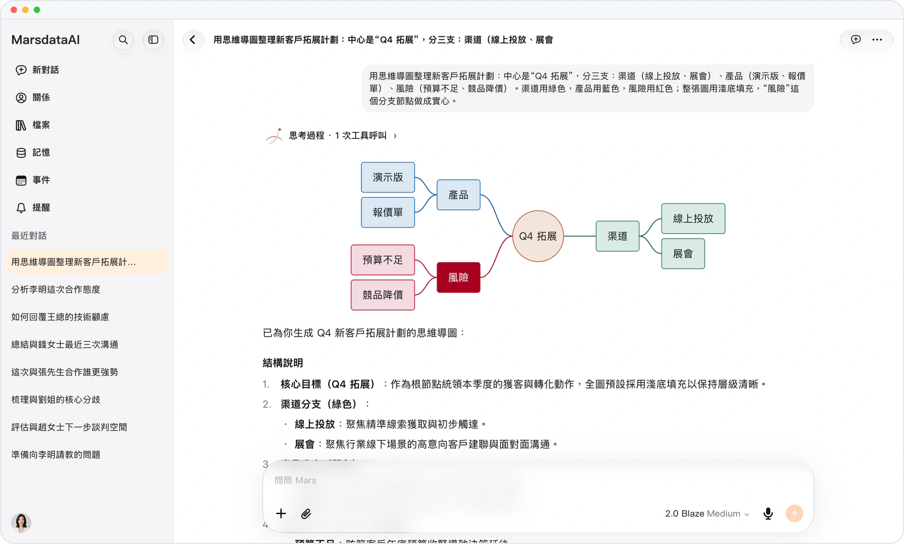

# 結構化圖表

> **預覽** · 2026-10-15 · `0.1.1.5585`
> 以下功能目前處於預覽階段，尚未正式上線。

將回答轉換為流程圖、思維導圖、時序圖和時間線。

Mars 現可繪製結構化圖表：流程圖、思維導圖、時序圖和時間線。在手機網頁上，可將任意圖表下載為 PNG。

複雜想法變成一眼可讀的圖表。

*示意圖，使用虛構演示資料。*

[體驗預覽版](https://canary.marsdata.ai/changelog/structured-diagrams) · [全部更新](../README.zh-HK.md)

[English](./crm-2026-10-15-structured-diagrams.md) · [简体中文](./crm-2026-10-15-structured-diagrams.zh-CN.md)
