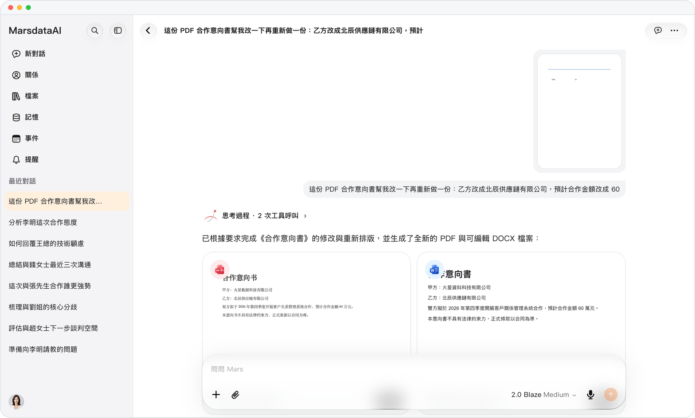

# Mars 的成果，直接存成文件

> **預覽** · 2026-10-15 · `0.1.1.5585`
> 以下功能目前處於預覽階段，尚未正式上線。

好用的回答散落在各個對話裏，回頭就找不到？

Mars 可以把結果寫成 Markdown、文本和 JSON 文件，保存到資料庫。你可以在富文本預覽中打開，也可以直接打印。不用複製粘貼到別處，成果集中在一個地方。

生成的成果集中保存，隨時閲讀或打印。

*示意圖，使用虛構演示資料。*

[體驗預覽版](https://canary.marsdata.ai/changelog/write-files-to-the-library) · [全部更新](../README.zh-HK.md)

[English](./crm-2026-10-15-write-files-to-the-library.md) · [简体中文](./crm-2026-10-15-write-files-to-the-library.zh-CN.md)
