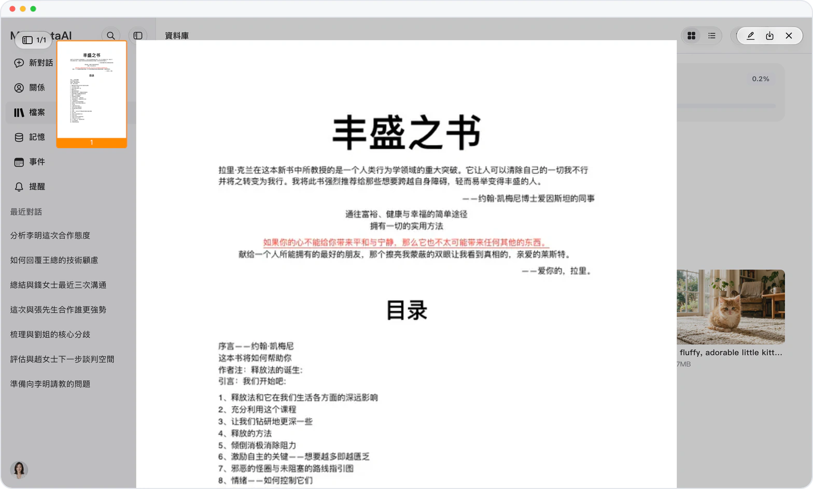

# iWork、WPS 文件，對話裏直接看

> **預覽** · 2026-10-17 · `0.1.1.5950`
> 以下功能目前處於預覽階段，尚未正式上線。

同事發來 Keynote 或 WPS 文件，打不開也看不了？

在對話中查看 Keynote、Pages、Numbers 和 WPS 文件，Mars 會顯示每個文件的首頁。如需編輯 iWork 文件，Mars 會先將其轉換為 Office 格式。不用另裝軟件，一眼確認是不是你要的那份。

處理 iWork 和 WPS 文件之前，一眼確認內容。

*示意圖，使用虛構演示資料。*

[體驗預覽版](https://marsdata.ai/changelog/iwork-and-wps-previews) · [全部更新](../README.zh-HK.md)

[English](./crm-2026-10-17-iwork-and-wps-previews.md) · [简体中文](./crm-2026-10-17-iwork-and-wps-previews.zh-CN.md)
