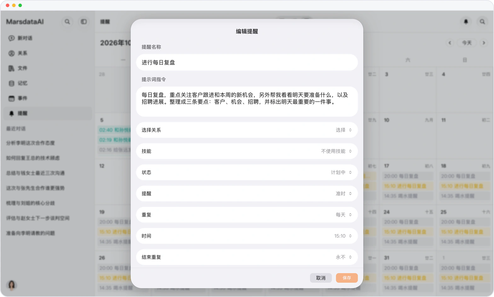

# 到点了，Mars 自己开工

> **预览** · 2026-10-17 · `0.1.1.5950`
> 以下功能目前处于预览阶段，尚未正式上线。

每天的复盘、定期的检查，总要记得自己去开？

提醒到时，Mars 会用你写下的提示词自动开启一段对话。你还可以在提醒编辑器中创建「每日复盘」技能。写一次提示词，之后每次都不用再手动发起。

定期检查自动开始，不用先打开 Mars。

*示意图，使用虚构演示数据。*

[体验预览版](https://canary.marsdata.ai/changelog/reminders-that-start-a-conversation) · [全部更新](../README.zh-CN.md)

[English](./crm-2026-10-17-reminders-that-start-a-conversation.md) · [繁體中文](./crm-2026-10-17-reminders-that-start-a-conversation.zh-HK.md)
