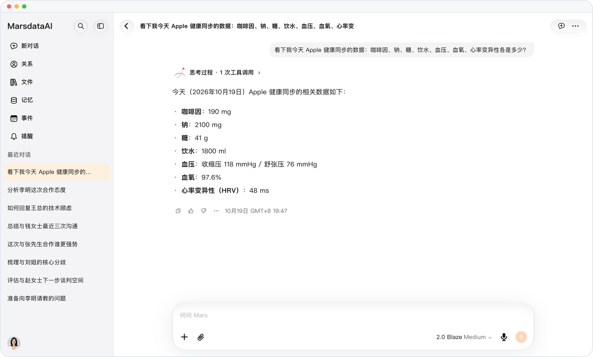

# 更完整的健康问答

> **预览** · 2026-10-17 · `0.1.1.5950`
> 以下功能目前处于预览阶段，尚未正式上线。

获得涵盖睡眠阶段、饮水、能量和蛋白质的健康回答。

健康回答现已包含睡眠阶段、饮水、饮食热量、蛋白质和碳水化合物。体脂秤称重时，读数会连同体脂、肌肉和水分一并保存。

回答可参考更多健康数据，体脂秤读数也更完整。

*示意图，使用虚构演示数据。*

[体验预览版](https://canary.marsdata.ai/changelog/richer-health-answers) · [全部更新](../README.zh-CN.md)

[English](./crm-2026-10-17-richer-health-answers.md) · [繁體中文](./crm-2026-10-17-richer-health-answers.zh-HK.md)
