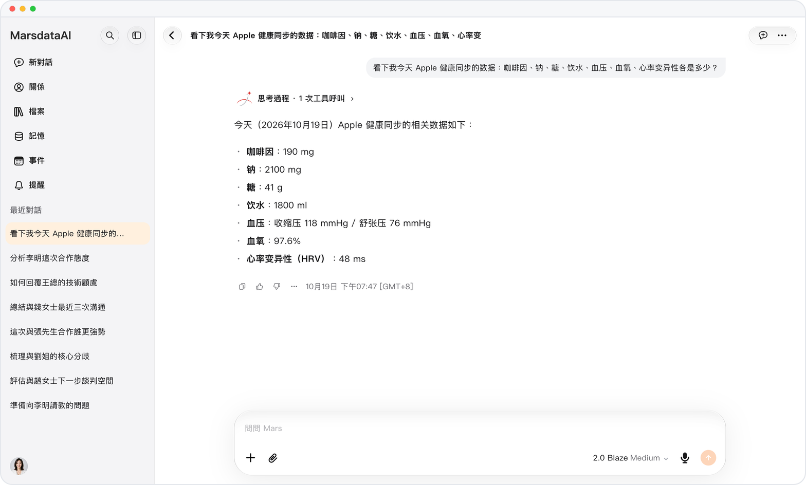

# 更完整的健康問答

> **預覽** · 2026-10-17 · `0.1.1.5950`
> 以下功能目前處於預覽階段，尚未正式上線。

獲得涵蓋睡眠階段、飲水、能量和蛋白質的健康回答。

健康回答現已包含睡眠階段、飲水、飲食熱量、蛋白質和碳水化合物。體脂秤稱重時，讀數會連同體脂、肌肉和水分一併保存。

回答可參考更多健康數據，體脂秤讀數也更完整。

*示意圖，使用虛構演示資料。*

[體驗預覽版](https://canary.marsdata.ai/changelog/richer-health-answers) · [全部更新](../README.zh-HK.md)

[English](./crm-2026-10-17-richer-health-answers.md) · [简体中文](./crm-2026-10-17-richer-health-answers.zh-CN.md)
