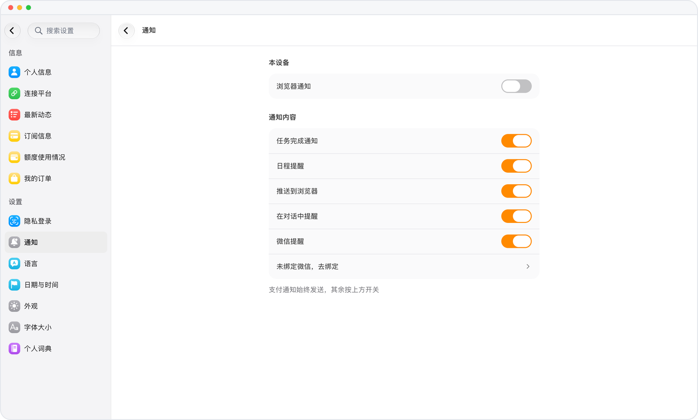

# 微信日程提醒

> **预览** · 2026-10-17 · `0.1.1.5950`
> 以下功能目前处于预览阶段，尚未正式上线。

日程提醒除了在 Mars 里出现，也会发到你的微信。

Mars 会把每条日程提醒发送到你绑定的每个微信。在网页或 iOS 的「通知」中可以开启或关闭微信提醒。微信绑定失效时，Mars 会提示你，提醒仍会通过其他渠道送达。

提醒出现在你每天都在用的地方。

*示意图，使用虚构演示数据。*

[体验预览版](https://canary.marsdata.ai/changelog/wechat-event-reminders) · [全部更新](../README.zh-CN.md)

[English](./crm-2026-10-17-wechat-event-reminders.md) · [繁體中文](./crm-2026-10-17-wechat-event-reminders.zh-HK.md)
