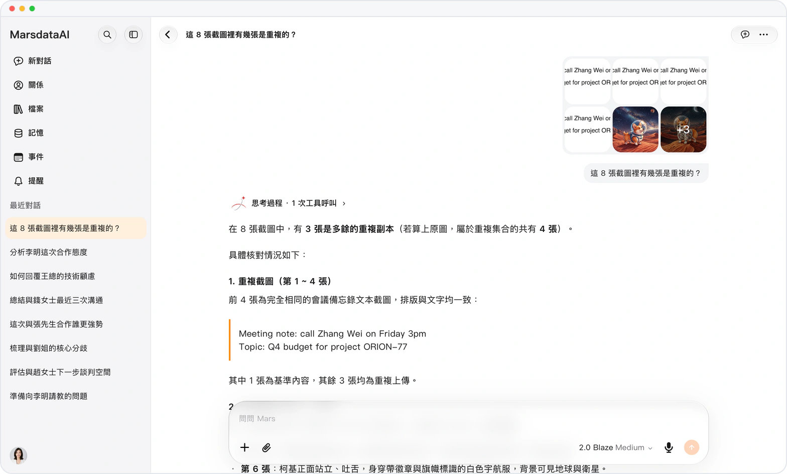

# 一組圖片，一條整潔消息

> **預覽** · 2026-10-18 · `0.1.1.6118`
> 以下功能目前處於預覽階段，尚未正式上線。

連發一組截圖，對話就被刷屏？

一起發送的兩張或更多圖片，會在你的問題上方顯示為一個網格，網頁和 iOS 一致。點擊任意圖塊，包括「+N」圖塊，即可打開包含這條消息全部圖片的圖庫，下方有縮略圖。不再一張張刷屏，翻看時也不用在對話裏上下找。

一組截圖就是一條消息，發得整齊，看得順手。

*示意圖，使用虛構演示資料。*

[體驗預覽版](https://marsdata.ai/changelog/picture-grids-and-gallery) · [全部更新](../README.zh-HK.md)

[English](./crm-2026-10-18-picture-grids-and-gallery.md) · [简体中文](./crm-2026-10-18-picture-grids-and-gallery.zh-CN.md)
