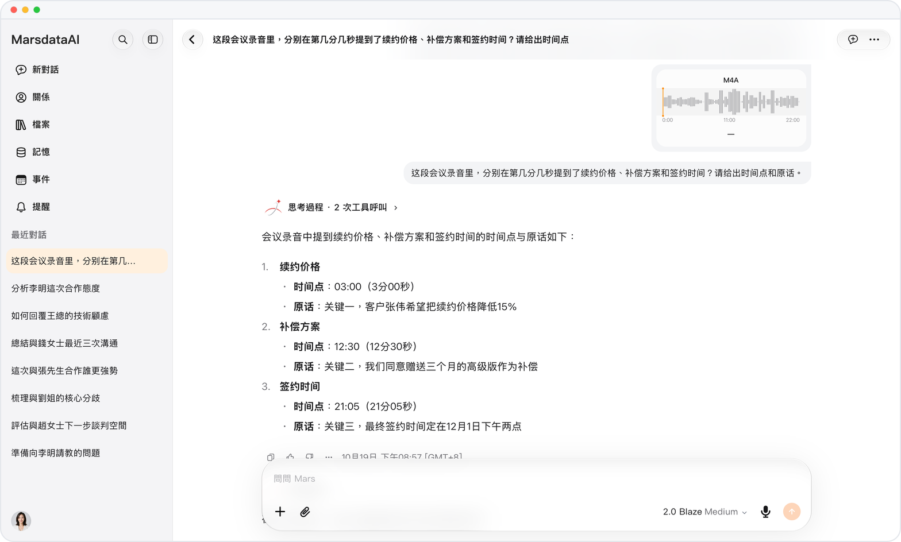

# 2 GB 長錄音，每句話都能定位

> **預覽** · 2026-10-19 · `0.1.1.6479`
> 以下功能目前處於預覽階段，尚未正式上線。

會議錄了一整場，提問卻只能查到開頭？

對話中發送的音頻和視頻上限從 15 MB 提高到 2 GB。超過 20 分鐘的錄音會分段轉寫再拼接，Mars 能告訴你錄音中任何位置説了什麼、在第幾分幾秒。不用先剪成小段再上傳，也不用拖着進度條一點點找。

整場會議，也能得到和短片段一樣精確的回答。

*示意圖，使用虛構演示資料。*

[體驗預覽版](https://marsdata.ai/changelog/long-recordings) · [全部更新](../README.zh-HK.md)

[English](./crm-2026-10-19-long-recordings.md) · [简体中文](./crm-2026-10-19-long-recordings.zh-CN.md)
