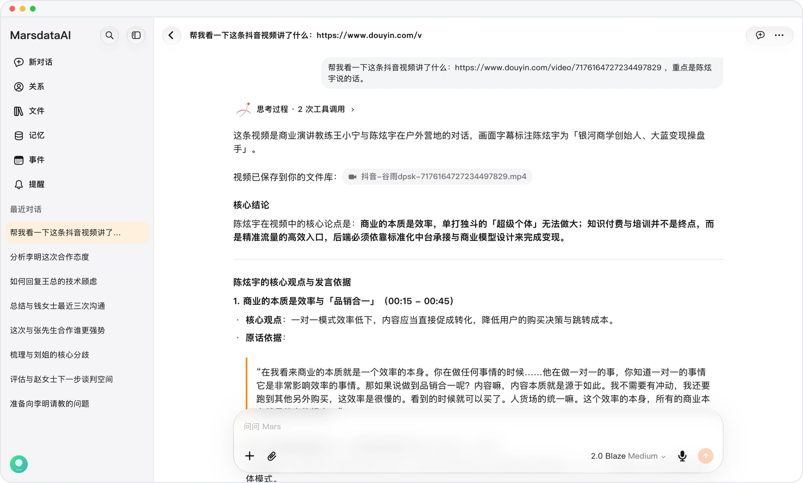

# Mars 替你看视频

> **预览** · 2026-10-22 · `0.1.1.7385`
> 以下功能目前处于预览阶段，尚未正式上线。

不用自己看完，也能知道一个人在视频里说了什么。

让 Mars 了解一个人时，它会先看这个人在抖音或小红书上互动最多的一两条视频，再写资料。你也可以直接发一条视频链接，问它讲了什么。回答会总结视频内容，引用说话人的原话和画面字幕，并标出出现的分秒。Mars 只根据视频里展示或说出的内容认人，不会凭发布账号下结论。相关的视频会存进你的文件库，并在回答中附上链接；思考过程里能看到 Mars 查过的帖子、账号和视频。支持 10 分钟、30 MB 以内的视频。

知道一个人在镜头前到底说了什么，视频也留在你的文件里。

*示意图，使用虚构演示数据。*

*示意图，使用虚构演示数据。*

[体验预览版](https://canary.marsdata.ai/changelog/mars-watches-social-videos) · [全部更新](../README.zh-CN.md)

[English](./crm-2026-10-22-mars-watches-social-videos.md) · [繁體中文](./crm-2026-10-22-mars-watches-social-videos.zh-HK.md)
