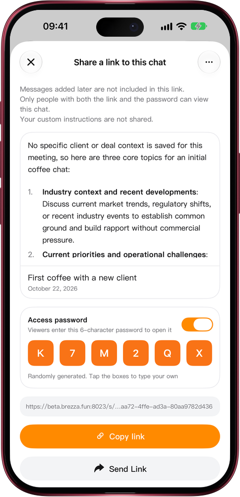

# Share only with the people you choose

> **Preview** · 2026-10-22 · `0.1.1.7433`
> These features are available in the preview version and have not been generally released.

Once a link is forwarded, who knows who opens it? Now you decide.

Open a conversation's share sheet and turn on Access password. Mars creates a random six-character password, or tap the boxes to type your own. Anyone who opens the link enters the password before the conversation appears, so send the two separately; a forwarded link alone opens nothing. After ten wrong attempts the link pauses for a while. Once a conversation is shared, its menu shows View share, where you can read or change the password or turn it off at any time.

Share with confidence: only the people you choose can read it.

*Illustration using fictional demo data.*

*Illustration using fictional demo data.*

[Explore the preview](https://canary.marsdata.ai/changelog/share-links-with-a-password) · [All updates](../README.md)

[简体中文](./crm-2026-10-22-share-links-with-a-password.zh-CN.md) · [繁體中文](./crm-2026-10-22-share-links-with-a-password.zh-HK.md)
