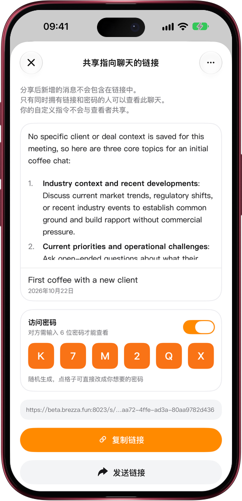

# 带密码的分享链接

> **预览** · 2026-10-22 · `0.1.1.7433`
> 以下功能目前处于预览阶段，尚未正式上线。

分享对话时，决定谁能看到。

打开对话的分享面板，开启「访问密码」。Mars 会随机生成 6 位密码，也可以点格子改成你想要的密码。对方打开链接后，要先输入密码才能看到对话，所以请把密码和链接分开发送。连续输错 10 次，链接会暂时锁定。对话分享后，菜单里会出现「查看分享」，随时可以查看、修改或关闭密码。

放心分享对话，不必担心被其他人看到。

*示意图，使用虚构演示数据。*

*示意图，使用虚构演示数据。*

[体验预览版](https://canary.marsdata.ai/changelog/share-links-with-a-password) · [全部更新](../README.zh-CN.md)

[English](./crm-2026-10-22-share-links-with-a-password.md) · [繁體中文](./crm-2026-10-22-share-links-with-a-password.zh-HK.md)
