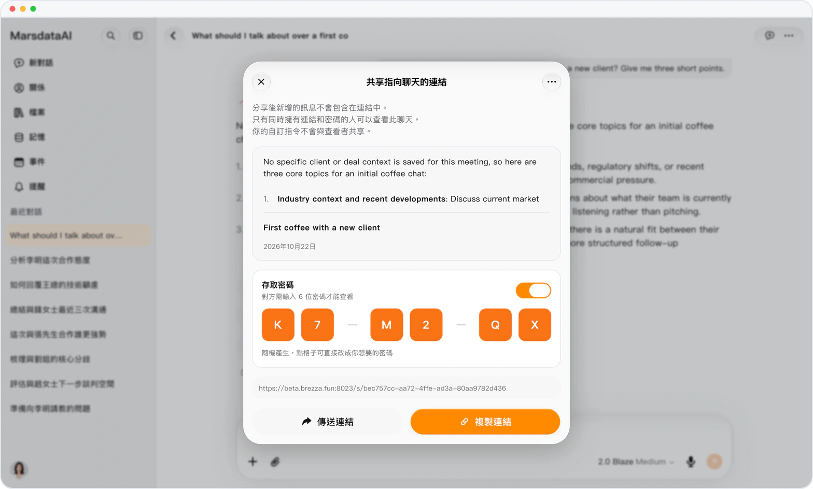
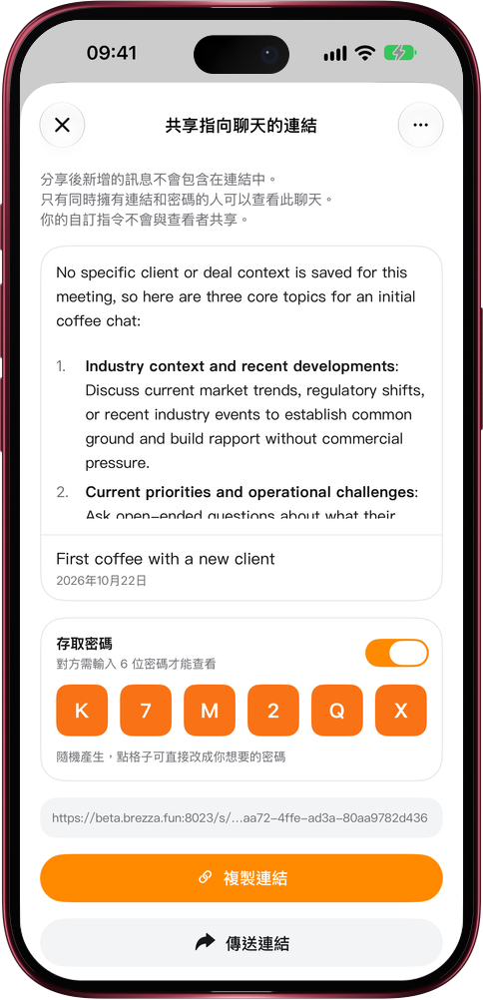

# 分享對話，只給你想給的人看

> **預覽** · 2026-10-22 · `0.1.1.7433`
> 以下功能目前處於預覽階段，尚未正式上線。

鏈接一轉發，就不知道落到誰手裏？

打開對話的分享面板，開啓「訪問密碼」。Mars 隨機生成 6 位密碼，也可以點格子改成你想要的。對方打開鏈接後，要先輸入密碼才能看到對話，所以請把密碼和鏈接分開發送；就算鏈接被轉發，沒有密碼也打不開。連續輸錯 10 次，鏈接會暫時鎖定。對話分享後，菜單裏會出現「查看分享」，隨時可以查看、修改或關閉密碼。

放心分享，看到對話的只有你選中的人。

*示意圖，使用虛構演示資料。*

*示意圖，使用虛構演示資料。*

[體驗預覽版](https://marsdata.ai/changelog/share-links-with-a-password) · [全部更新](../README.zh-HK.md)

[English](./crm-2026-10-22-share-links-with-a-password.md) · [简体中文](./crm-2026-10-22-share-links-with-a-password.zh-CN.md)
