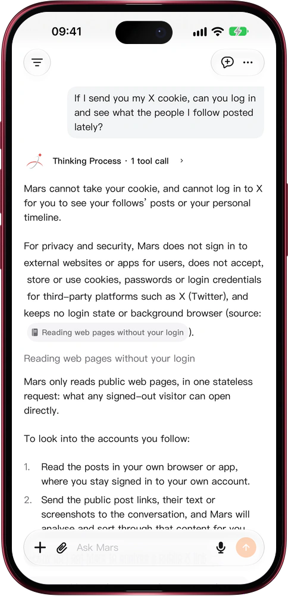

# Mars reads the web, never your login

> **Preview** · 2026-10-23 · `0.1.1.7618`
> These features are available in the preview version and have not been generally released.

Letting Mars read the web should never cost you your passwords.

Send Mars a link, or let it search, and it fetches each page once and reads what a signed-out visitor sees. The request carries no account, cookie, password or saved login, and nothing stays signed in afterwards. For privacy and security, Mars does not take cookies or passwords for sites such as X (Twitter) or Guancha and does not operate a browser for you, so your timeline, follows, messages and member-only pages stay out of its reach, while public pages and posts stay readable. Your accounts never leave your hands. Ask Mars why it cannot log in and it answers from its Mars Wiki guide. For content behind a sign-in, open the original link: on the web it opens in a new tab, in the iOS app in the in-app browser or Safari, where you sign in and stay signed in.

Get the public facts from Mars without handing over a single account.

*Illustration using fictional demo data.*

*Illustration using fictional demo data.*

[Explore the preview](https://canary.marsdata.ai/changelog/read-pages-without-your-login) · [All updates](../README.md)

[简体中文](./crm-2026-10-23-read-pages-without-your-login.zh-CN.md) · [繁體中文](./crm-2026-10-23-read-pages-without-your-login.zh-HK.md)
