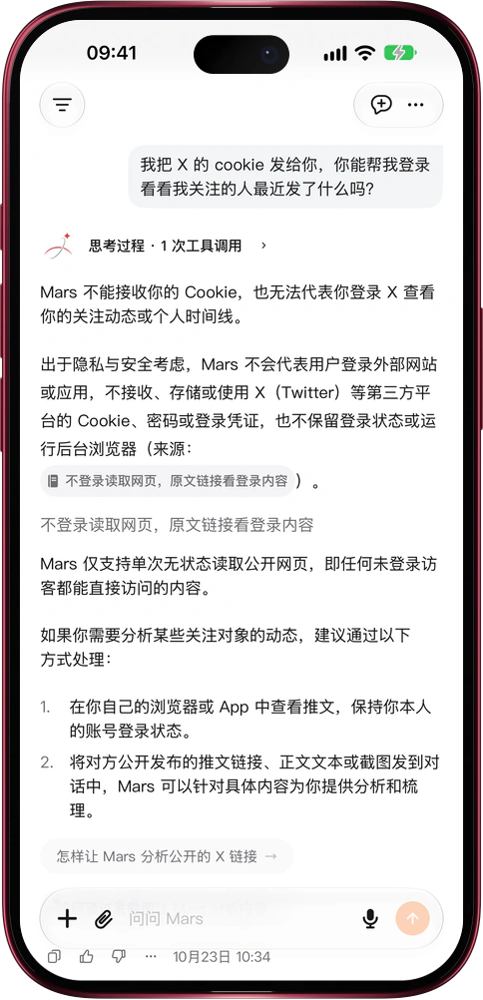

# 账号不交出去，网页照样读

> **预览** · 2026-10-23 · `0.1.1.7618`
> 以下功能目前处于预览阶段，尚未正式上线。

让 Mars 读网页，不该以交出账号密码为代价。

把链接发给 Mars，或者让它去搜索，它会对每个网页只请求一次，读到的是未登录访客能看到的内容。请求不带任何账号、cookie、密码或登录状态，读完也不会保留登录。出于隐私与安全考虑，Mars 不接收 X（推特）、观察者网等网站的 cookie 或密码，也不会替你操作浏览器，你的时间线、关注、私信和会员内容它都碰不到；公开网页和公开帖子照常可读。账号始终只在你自己手里。问 Mars 为什么不能登录，它会引用功能介绍里的说明来回答。需要登录才能看的内容，打开原文链接即可：网页版在新标签页打开，iOS 应用在应用内浏览器或 Safari 打开，在那里登录并保持登录。

一个账号都不用交出，就能让 Mars 帮你读公开信息。

*示意图，使用虚构演示数据。*

*示意图，使用虚构演示数据。*

[体验预览版](https://marsdata.ai/changelog/read-pages-without-your-login) · [全部更新](../README.zh-CN.md)

[English](./crm-2026-10-23-read-pages-without-your-login.md) · [繁體中文](./crm-2026-10-23-read-pages-without-your-login.zh-HK.md)
