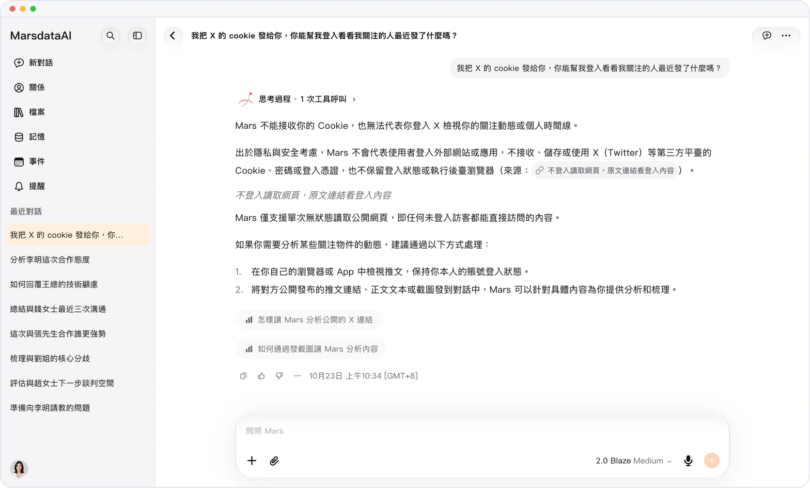
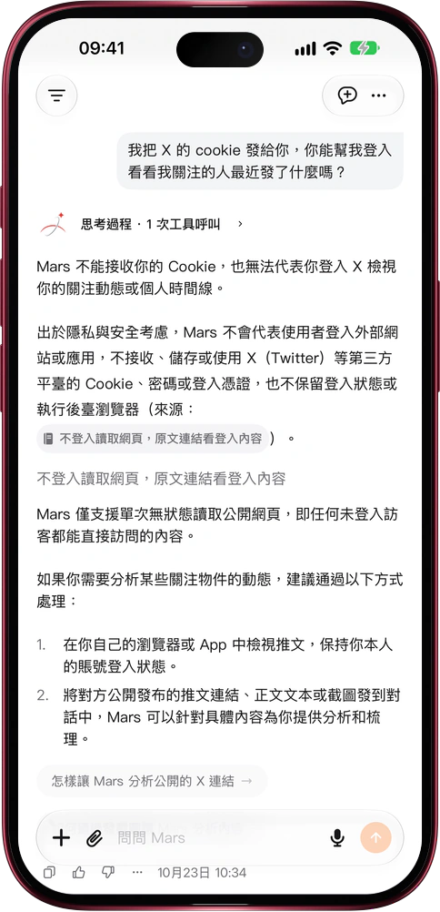

# 賬號不交出去，網頁照樣讀

> **預覽** · 2026-10-23 · `0.1.1.7618`
> 以下功能目前處於預覽階段，尚未正式上線。

讓 Mars 讀網頁，不該以交出賬號密碼為代價。

把鏈接發給 Mars，或者讓它去搜索，它會對每個網頁只請求一次，讀到的是未登錄訪客能看到的內容。請求不帶任何賬號、cookie、密碼或登錄狀態，讀完也不會保留登錄。出於隱私與安全考慮，Mars 不接收 X（推特）、觀察者網等網站的 cookie 或密碼，也不會替你操作瀏覽器，你的時間線、關注、私信和會員內容它都碰不到；公開網頁和公開帖子照常可讀。賬號始終只在你自己手裏。問 Mars 為什麼不能登錄，它會引用功能介紹裏的説明來回答。需要登錄才能看的內容，打開原文鏈接即可：網頁版在新標籤頁打開，iOS 應用在應用內瀏覽器或 Safari 打開，在那裏登錄並保持登錄。

一個賬號都不用交出，就能讓 Mars 幫你讀公開信息。

*示意圖，使用虛構演示資料。*

*示意圖，使用虛構演示資料。*

[體驗預覽版](https://marsdata.ai/changelog/read-pages-without-your-login) · [全部更新](../README.zh-HK.md)

[English](./crm-2026-10-23-read-pages-without-your-login.md) · [简体中文](./crm-2026-10-23-read-pages-without-your-login.zh-CN.md)
