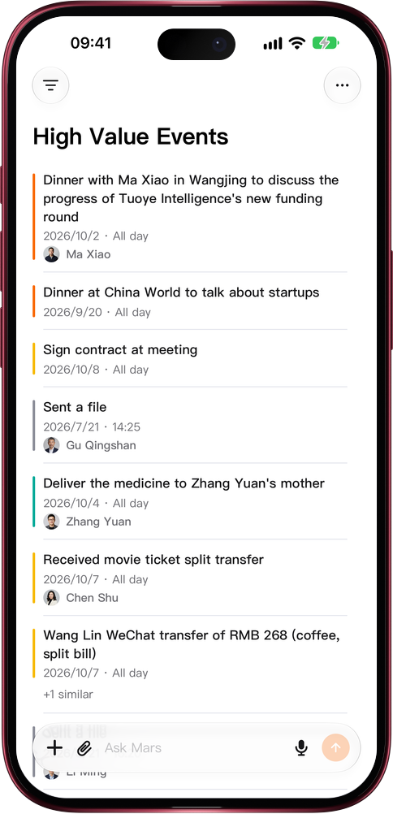

# What's worth your time comes first

> **Preview** · 2026-10-23 · `0.1.1.7618`
> These features are available in the preview version and have not been generally released.

When routine logistics crowd the list, the deal that matters gets buried.

Open the Events menu and pick Sort by value, just below Time order. The list becomes High-value events: signed contracts, funding talks, referrals and transfers rank above routine logistics, and repeated records with the same people within three days fold under one row with +N similar, which you can expand. Swipe or hold a row to complete, edit or delete it, as before; on the web the desktop event-type menu offers the same order. In Relationships, Sort by value ranks contacts by their value and how often you interacted in the last half year, and each row shows the main reason with the half-year interaction count. No more picking the highlights out of a long timeline yourself. Time order stays the default, and picking a time order or another view takes you back.

Find the deals, introductions and people worth your time without scrolling through the calendar.

*Illustration using fictional demo data.*

*Illustration using fictional demo data.*

[Explore the preview](https://canary.marsdata.ai/changelog/sort-by-value) · [All updates](../README.md)

[简体中文](./crm-2026-10-23-sort-by-value.zh-CN.md) · [繁體中文](./crm-2026-10-23-sort-by-value.zh-HK.md)
