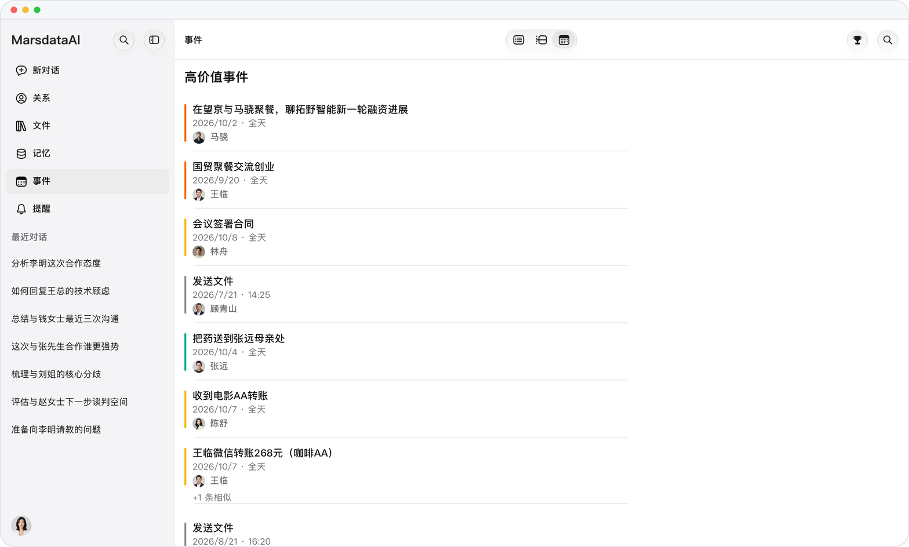
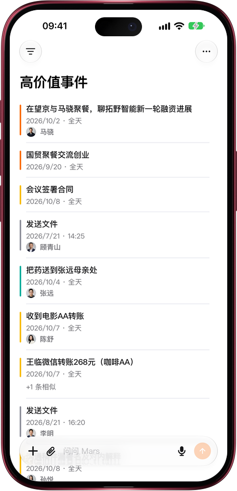

# 值得投入的事和人，排在前面

> **预览** · 2026-10-23 · `0.1.1.7618`
> 以下功能目前处于预览阶段，尚未正式上线。

日常琐事挤满列表，签约和引荐反而被埋了？

打开事件菜单，在「时间排序」下方选择「按价值排序」，列表变成「高价值事件」：签约、融资洽谈、引荐和转账排在日常琐事前面；同一批人三天内重复记下的事件折叠成一行，显示「+N 条相似」，点开即可展开。左滑或长按一行，照样能完成、编辑或删除；网页版的桌面事件类型菜单也提供这个排序。在关系列表里，「按价值排序」按联系人的价值和近半年的互动频率排列，每一行写明主要理由和「半年互动 N 次」。不用从一长串时间线里自己挑重点。时间排序仍是默认顺序，选择时间排序或切换视图即可回去。

不用翻日历，先找到值得投入的事和人。

*示意图，使用虚构演示数据。*

*示意图，使用虚构演示数据。*

[体验预览版](https://canary.marsdata.ai/changelog/sort-by-value) · [全部更新](../README.zh-CN.md)

[English](./crm-2026-10-23-sort-by-value.md) · [繁體中文](./crm-2026-10-23-sort-by-value.zh-HK.md)
