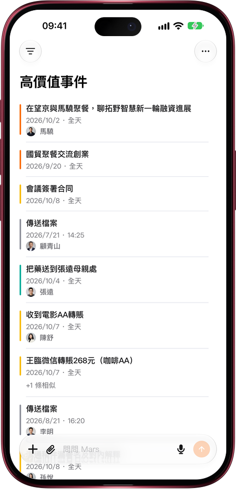

# 按價值排序

> **預覽** · 2026-10-23 · `0.1.1.7618`
> 以下功能目前處於預覽階段，尚未正式上線。

先看到重要的，而不只是最近的。

打開事件菜單，在「時間排序」下方選擇「按價值排序」，列表就會變成「高價值事件」：簽約、融資洽談、引薦和轉賬排在日常瑣事前面；同一批人三天內重複記下的事件會摺疊成一行，顯示「+N 條相似」，點開即可展開。和時間列表一樣，左滑或長按一行即可完成、編輯或刪除。網頁版的桌面事件類型菜單也提供這個排序。在關係列表裏，「按價值排序」會按聯繫人的價值和近半年的互動頻率排列，每一行顯示最主要的理由和「半年互動 N 次」。時間排序仍是默認順序，選擇時間排序或切換到其他視圖即可回去。

不用翻日曆，也能先找到最值得投入的事和人。

*示意圖，使用虛構演示資料。*

*示意圖，使用虛構演示資料。*

[體驗預覽版](https://canary.marsdata.ai/changelog/sort-by-value) · [全部更新](../README.zh-HK.md)

[English](./crm-2026-10-23-sort-by-value.md) · [简体中文](./crm-2026-10-23-sort-by-value.zh-CN.md)
