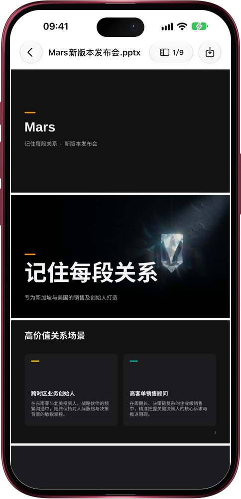

# Mars 制作演示文稿和文档

> **预览** · 2026-10-24 · `0.1.1.7959`
> 以下功能目前处于预览阶段，尚未正式上线。

说出你要的演示文稿，Mars 连同配图一起做好。

让 Mars 做一份演示文稿，比如新品发布会、团队周会或投资人介绍，它会写出一份可编辑的 PowerPoint 文件，采用 Mars 风格，浅色或深色均可。它为每页选择版式，用统一的风格绘制不含文字的配图，关键页用全幅大图配超大标题，并在需要时加入演讲备注、表格或图表。你没有提供的数字，它不会编造。提出修改后，Mars 会另存一份修订版：没有改动的页面保持原样，只重绘你要求更换的配图。让它写一份 Word 文档，比如上手指南，也会以同样的风格交付，带有列表和插图。两种文件都会保存到资料库，你可以逐页预览并下载。

一次请求，就得到可打开、可编辑、可直接演示的演示文稿或文档。

*示意图，使用虚构演示数据。*

*示意图，使用虚构演示数据。*

[体验预览版](https://canary.marsdata.ai/changelog/mars-makes-decks-and-documents) · [全部更新](../README.zh-CN.md)

[English](./crm-2026-10-24-mars-makes-decks-and-documents.md) · [繁體中文](./crm-2026-10-24-mars-makes-decks-and-documents.zh-HK.md)
