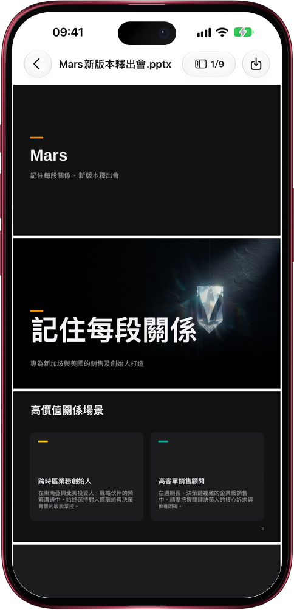

# 一句話，做出能直接上台的演示文稿

> **預覽** · 2026-10-24 · `0.1.1.7959`
> 以下功能目前處於預覽階段，尚未正式上線。

做一份演示文稿，找圖、排版就能耗掉一個下午。

讓 Mars 做一份演示文稿，比如新品發佈會、團隊週會或投資人介紹，它會寫出一份可編輯的 PowerPoint 文件，採用 Mars 風格，淺色或深色均可。每頁單獨選版式，配圖用統一的風格繪製、不含文字，關鍵頁用全幅大圖配超大標題，需要時加入演講備註、表格或圖表；你沒有提供的數字，它不會編造。不是套一個模板到底，也不用自己四處找圖。提出修改後，Mars 另存一份修訂版：沒改的頁面保持原樣，只重繪你要換的配圖。讓它寫一份 Word 文檔，比如上手指南，也會以同樣的風格交付，帶有列表和插圖。兩種文件都保存到資料庫，可以逐頁預覽並下載。

一次請求，就拿到可編輯、可直接演示的演示文稿或文檔。

*示意圖，使用虛構演示資料。*

*示意圖，使用虛構演示資料。*

[體驗預覽版](https://canary.marsdata.ai/changelog/mars-makes-decks-and-documents) · [全部更新](../README.zh-HK.md)

[English](./crm-2026-10-24-mars-makes-decks-and-documents.md) · [简体中文](./crm-2026-10-24-mars-makes-decks-and-documents.zh-CN.md)
